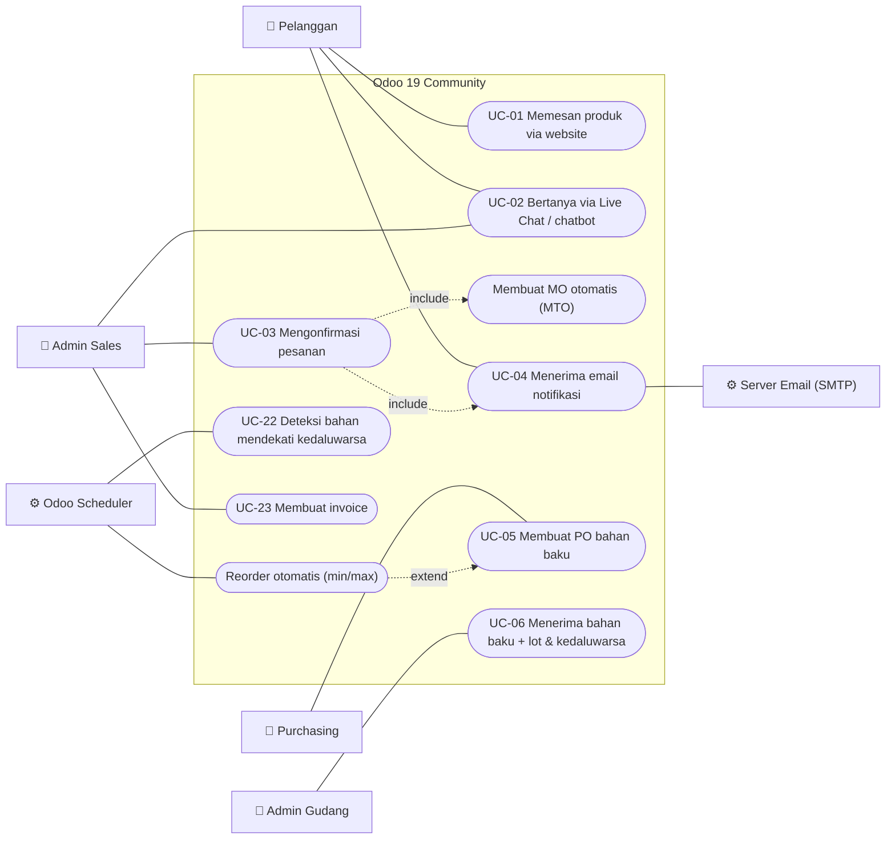
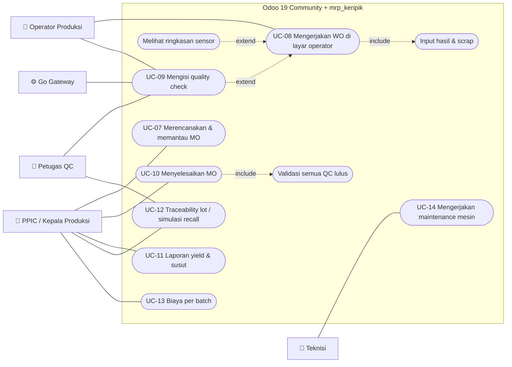
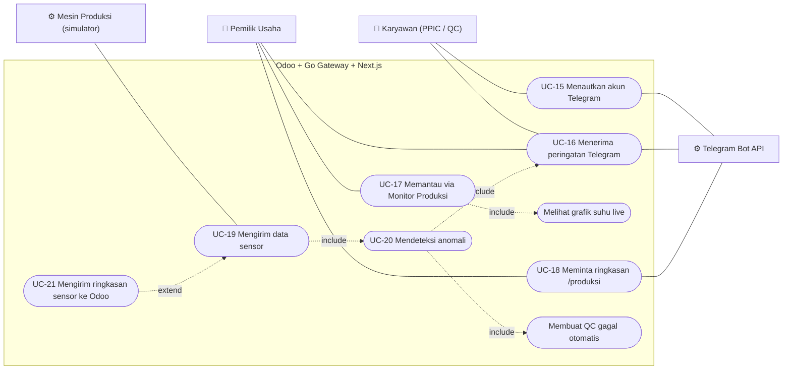

# D2. Use Case Diagram

Mermaid belum punya tipe *use case diagram* resmi, jadi dipakai `flowchart` dengan konvensi:

- **Aktor** = kotak bertanda 👤 (manusia) atau ⚙️ (sistem)
- **Use case** = bentuk stadion `([ ... ])`
- **Batas sistem** = `subgraph`
- `-.->|include|` = selalu dijalankan sebagai bagian dari use case lain
- `-.->|extend|` = hanya dijalankan pada kondisi tertentu

---

## 2.1 Diagram A — Penjualan & Pengadaan

## 2.2 Diagram B — Produksi & Kualitas

> **Go Gateway terhubung ke UC-09** karena bisa membuat QC berstatus *gagal* otomatis. Dalam UML, aktor sistem itu sah: apa pun yang berinteraksi dengan sistem dari luar adalah aktor.

## 2.3 Diagram C — Monitoring & Integrasi

> **UC-21 extend UC-19**: ringkasan hanya dikirim saat *work order selesai*, bukan pada setiap data sensor.

---

## 2.4 Daftar Use Case

| ID | Use case | Aktor utama | Ringkasan | FR |
|---|---|---|---|---|
| UC-01 | Memesan via website | Pelanggan | Pilih produk, checkout → SO | FR-SAL |
| UC-02 | Live Chat | Pelanggan, Admin Sales | Chatbot jawab FAQ → teruskan ke operator | FR-SAL-LC |
| UC-03 | Konfirmasi pesanan | Admin Sales | SO confirm → route MTO membuat MO | FR-SAL |
| UC-04 | Email notifikasi | Pelanggan | Pesanan dikonfirmasi, produksi selesai, siap dikirim | FR-EML |
| UC-05 | PO bahan baku | Purchasing / Scheduler | PO manual atau RFQ dari reorder rule | FR-PUR |
| UC-06 | Terima bahan baku | Admin Gudang | Validasi receipt, isi lot & kedaluwarsa | FR-INV |
| UC-07 | Rencana & pantau MO | PPIC | Cek ketersediaan, jadwalkan, pantau WO | FR-MRP |
| UC-08 | Layar operator | Operator | Mulai/Jeda/Selesai, hasil & scrap, ringkasan sensor | FR-OPS |
| UC-09 | Quality check | QC, Operator, Gateway | Isi nilai → lulus/gagal otomatis | FR-QC |
| UC-10 | Selesaikan MO | PPIC | Ditolak bila ada QC gagal/belum diisi | FR-QC |
| UC-11 | Yield & susut | PPIC, Pemilik | Rencana vs aktual per MO & operasi | FR-YLD |
| UC-12 | Traceability / recall | PPIC, QC | Lot jadi ↔ lot bahan baku | FR-TRC |
| UC-13 | Biaya per batch | PPIC, Pemilik | Bahan + work center (jam aktual) | FR-CST |
| UC-14 | Maintenance | Teknisi | Preventif & korektif | FR-MNT |
| UC-15 | Tautkan Telegram | Karyawan | Kode Odoo → `/start KODE` → chat_id tersimpan | FR-TG |
| UC-16 | Peringatan Telegram | PPIC, QC, Pemilik | QC gagal, MO selesai/tertunda, expiry, anomali | FR-TG, FR-GW-ANM |
| UC-17 | Monitor Produksi | Pemilik | MO berjalan, yield, QC gagal, suhu live | FR-MON |
| UC-18 | `/produksi` | Pemilik | Ringkasan produksi hari ini | FR-GW-BOT |
| UC-19 | Kirim data sensor | Mesin | Suhu tiap 2 dtk, berat per kemasan | FR-GW, FR-SIM |
| UC-20 | Deteksi anomali | Go Gateway | Suhu > 180°C > 60 dtk / berat di luar toleransi | FR-GW-ANM |
| UC-21 | Kirim ringkasan sensor | Go Gateway | Saat WO selesai: avg/min/max suhu, total/avg berat | FR-GW |
| UC-22 | Deteksi expiry | Odoo Scheduler | Cron harian cari lot mendekati kedaluwarsa | FR-EXP |
| UC-23 | Invoice | Admin Sales | Invoice dari SO | FR-INVC |

---

## 2.5 Deskripsi Use Case Inti

> Versi lengkap (alur alternatif, aturan, acceptance criteria) ada di FSD (D7).

### UC-03 Mengonfirmasi pesanan (pemicu MTO)
- **Prasyarat:** produk "Keripik Tempe 200 g" punya route **Manufacture + Replenish on Order (MTO)** dan BoM.
- **Alur:** Confirm SO → Odoo membuat delivery order dan (lewat stock rule) **MO**. Email "pesanan dikonfirmasi" terkirim.
- **ERPNext:** mirip *Sales Order → Make Work Order*, tapi di Odoo otomatis lewat **route/stock rule**.
- ⚠️ Route MTO **diarsipkan secara default** sejak Odoo 13-an → buka arsip di *Inventory → Configuration → Routes*. Cek perilakunya di 19.

### UC-08 Mengerjakan WO di layar operator
- **Prasyarat:** MO *Confirmed*, WO *Ready*, user grup `Keripik / Operator`.
- **Alur:** pilih work center → pilih WO → **Mulai** (time log `mrp.workcenter.productivity`) → **Jeda**/lanjut → isi QC → input qty hasil & scrap → **Selesai**.
- **Error:** Selesai ditolak bila QC wajib operasi itu belum diisi.
- **ERPNext:** ini **Job Card** + *time log*. Shop Floor = Enterprise, jadi kita buat dengan OWL.

### UC-09 Mengisi quality check
- **Pemicu:** MO dikonfirmasi → sistem membuat QC dari **quality point** yang terhubung ke operasi BoM.
- **Alur:** isi nilai (misal 172°C) → dibandingkan batas min/maks → **pass/fail**. Gagal → Telegram ke PPIC & QC.
- **Varian otomatis:** Go memanggil REST API membuat QC gagal dengan `source = gateway`.
- **ERPNext:** **Quality Inspection** + **Quality Inspection Template**.

### UC-10 Menyelesaikan MO
- **Aturan:** override `button_mark_done`. Ada QC `fail` (belum diselesaikan dengan retest) atau `todo` → `UserError` menyebut QC bermasalah.
- **Sukses:** stok produk jadi & by-product masuk dengan lot; email "produksi selesai"; Telegram "MO selesai".

### UC-15 Menautkan akun Telegram
- **Alur:** karyawan → *Generate kode* (unik, sekali pakai, berlaku 15 menit) → buka bot → `/start KODE` (atau deep link `https://t.me/<bot>?start=KODE`) → endpoint Odoo menyimpan `telegram_chat_id` di `hr.employee` → bot membalas "Akun terhubung".
- **Error:** kode salah/kedaluwarsa → "kode tidak valid". Belum menekan Start → bot **tidak bisa** mengirim duluan; status "belum terhubung" ditampilkan.
- Payload deep link terbatas (setahuku maks. 64 karakter `A-Z a-z 0-9 _ -`) — **cek dokumentasi Telegram Bot API bagian Deep linking**.

### UC-20 Mendeteksi anomali
- **Alur:** Go terima suhu → simpan → detektor per mesin melacak durasi > 180°C → > 60 dtk dan belum ada anomali terbuka → `POST` QC gagal ke Odoo **dan** Telegram langsung dari Go.
- **Kenapa Telegram dari Go?** Peringatan keselamatan harus cepat dan tetap terkirim walau Odoo lambat/down.
- **Aturan:** *deduplication*: satu anomali berkelanjutan = satu QC gagal + satu pesan.

---

## 2.6 Tips Interview

- **Kenapa gateway = aktor?** Bagi Odoo ia sistem eksternal → user teknis + token sendiri, *least privilege*.
- **Include vs extend?** Include = selalu (selesai MO selalu validasi QC). Extend = bersyarat (ringkasan hanya saat WO selesai).
- **Siapa menjalankan bot?** Satu proses per token. F6 di Odoo, F9 dipindah ke Go → evolusi arsitektur yang disengaja.
