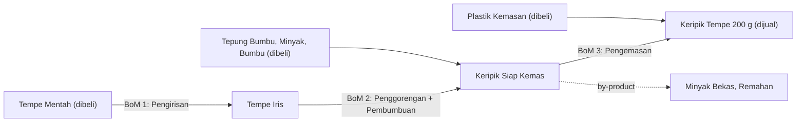
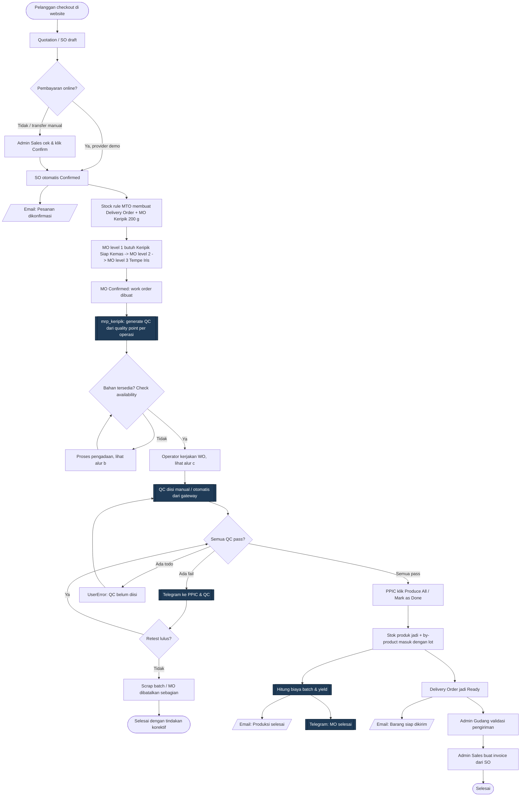
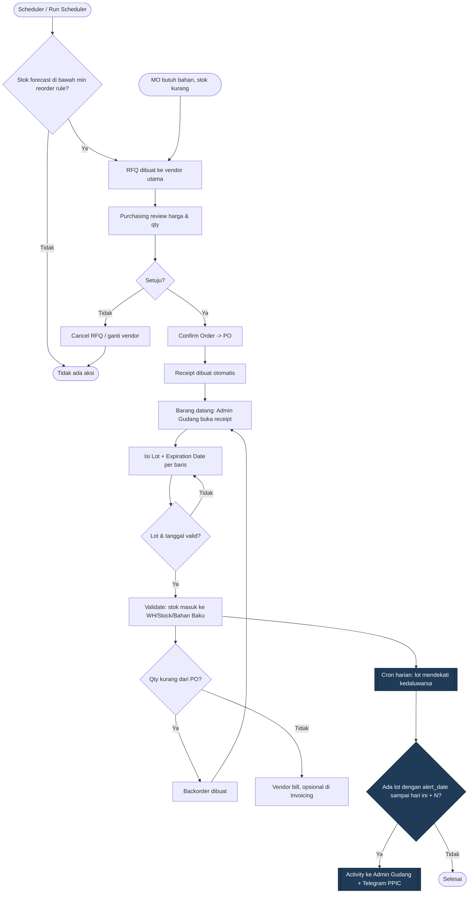
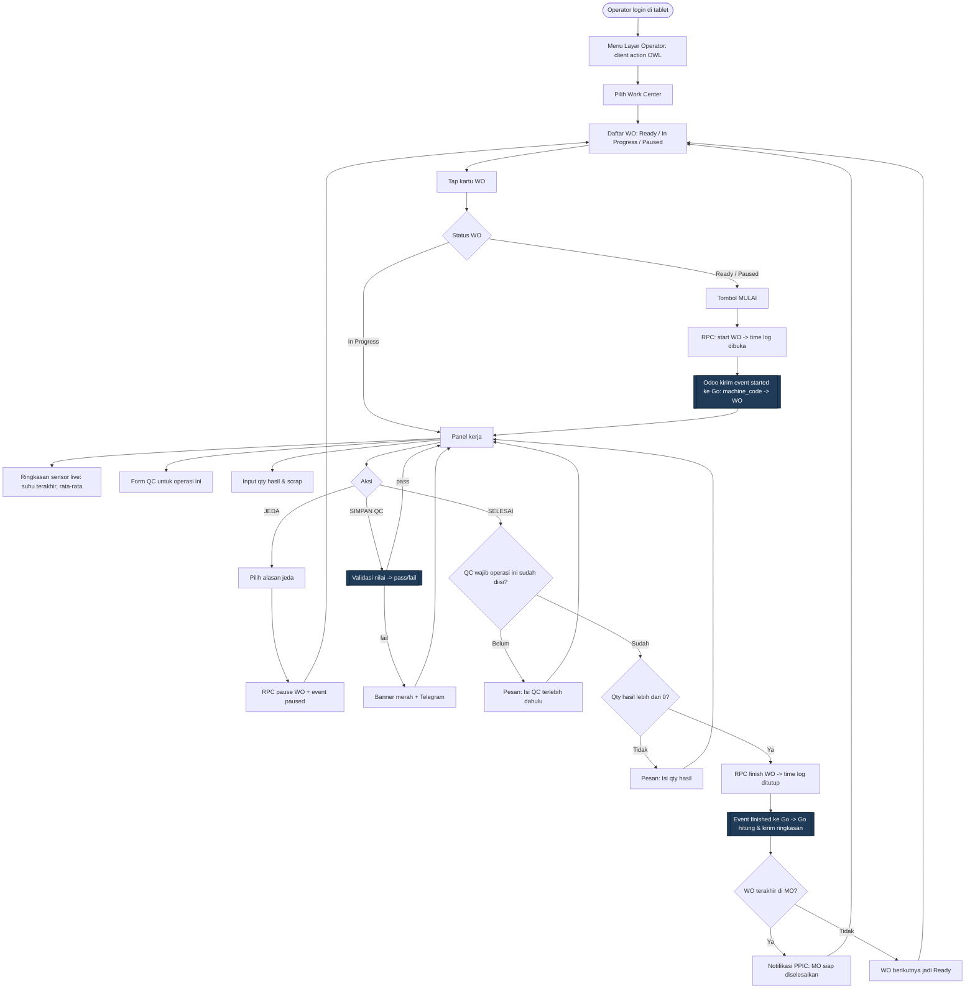
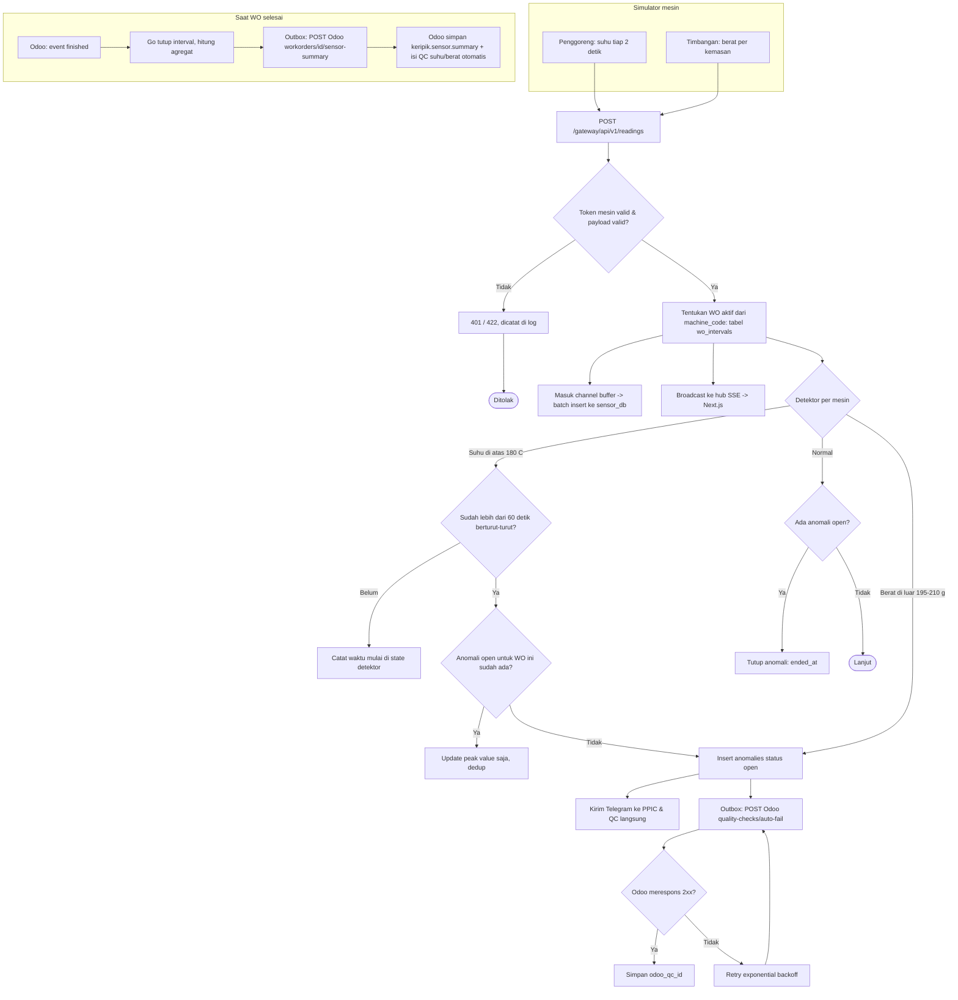
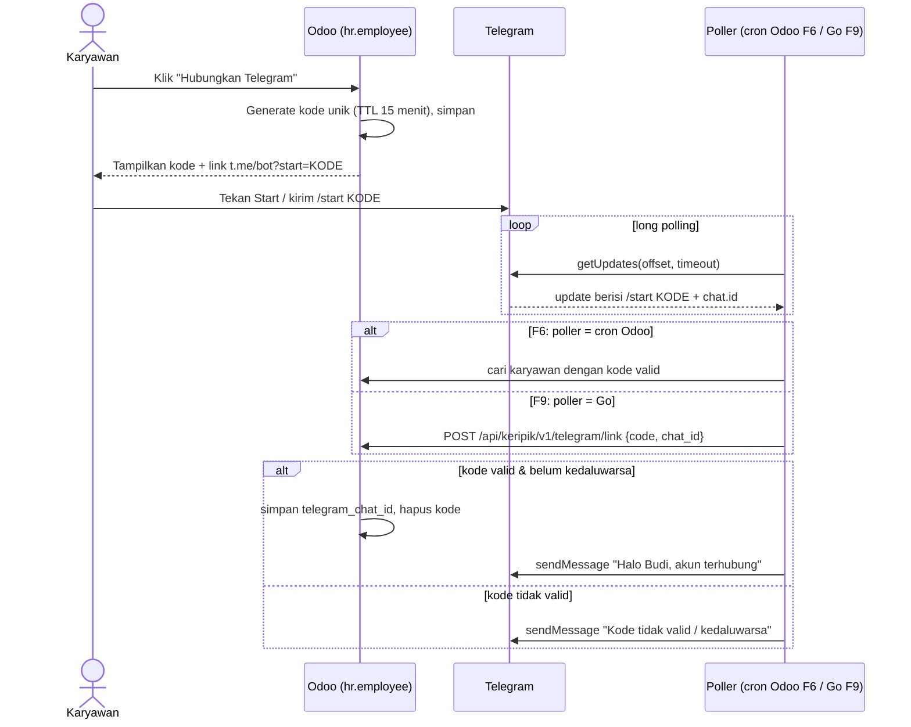
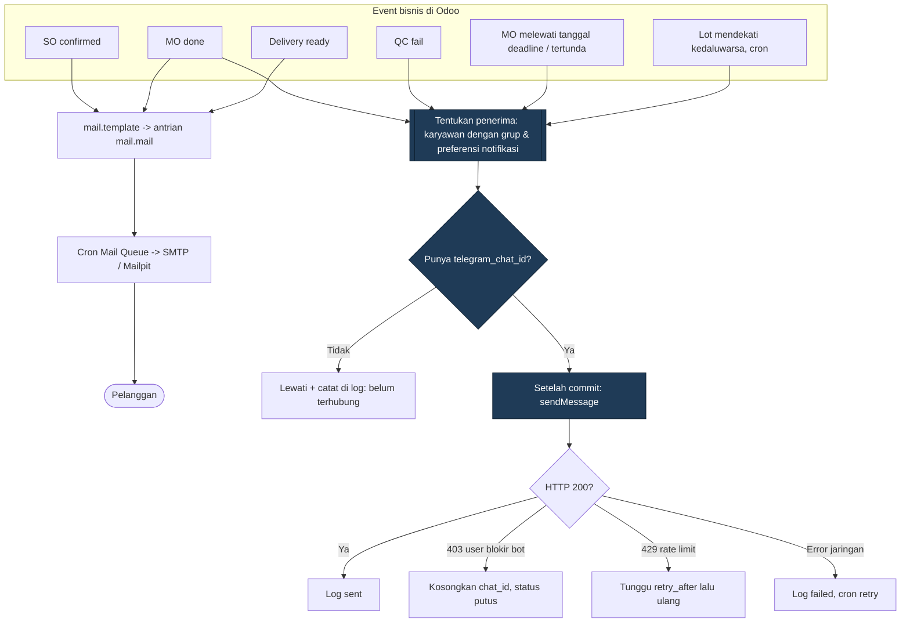

# D3. Flowchart Proses Bisnis

Lima alur:

- (a) Pesanan → MO → produksi → QC → pengiriman
- (b) Pengadaan bahan baku
- (c) Layar operator
- (d) Data sensor & deteksi anomali
- (e) Notifikasi email & Telegram (termasuk penautan akun)

Kotak berwarna gelap = **logika custom `mrp_keripik` / Go**. Kotak lain = fitur standar Odoo.

---

## (a) Pesanan → MO → Produksi → QC → Pengiriman

Struktur BoM multi-level (detail di F1):

Setiap produk setengah jadi punya route **Manufacture + MTO**, jadi satu SO memicu **rantai 3 MO** (Odoo menautkannya lewat smart button *Child/Source MO*). Alternatifnya: produk setengah jadi diproduksi ke stok dengan reorder rule. Untuk demo, rantai MTO lebih menarik. Di ERPNext ini mirip *"Use Multi-Level BOM"* tanpa sub-assembly WO, tapi Odoo benar-benar membuat MO terpisah per level.

**Catatan keputusan:**
- QC dibuat **saat MO dikonfirmasi** (bukan saat WO mulai), supaya QC berstatus `todo` sudah ada dan aturan "belum diisi" bisa memblokir.
- QC gagal **tidak dihapus**, tapi diselesaikan dengan **retest** (QC baru yang menunjuk QC lama). Jejak audit tetap ada, mirip *amend* di Frappe.

---

## (b) Pengadaan Bahan Baku

Padanan ERPNext: reorder rule ≈ *Item Reorder* + *Material Request* otomatis. Bedanya, Odoo langsung membuat **RFQ**, tanpa dokumen Material Request.

---

## (c) Alur Layar Operator

---

## (d) Data Sensor & Deteksi Anomali

**Kenapa outbox?** Kalau Odoo down saat anomali terjadi, permintaan tidak boleh hilang. Go menulis ke tabel `outbox` di transaksi yang sama dengan `anomalies`, lalu worker mengirimnya dengan retry. Ini pola **transactional outbox**, istilah yang bagus untuk interview Backend & Integration.

---

## (e) Notifikasi Email & Telegram

### e.1 Penautan akun Telegram

### e.2 Pengiriman notifikasi

**Kenapa "setelah commit"?** Jika Telegram dikirim di tengah transaksi lalu transaksi di-rollback (misal error validasi), pesan sudah terlanjur terkirim padahal datanya tidak tersimpan. Odoo menyediakan `self.env.cr.postcommit.add(fn)`. Padanannya di Frappe: `frappe.enqueue(..., enqueue_after_commit=True)`.
