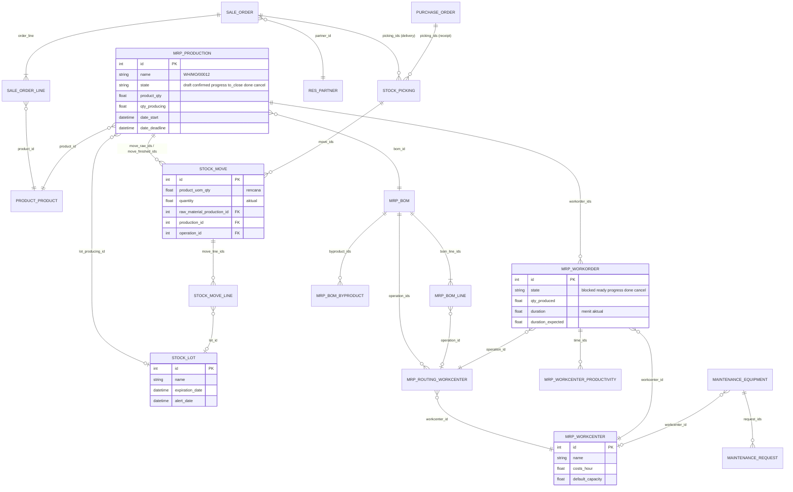
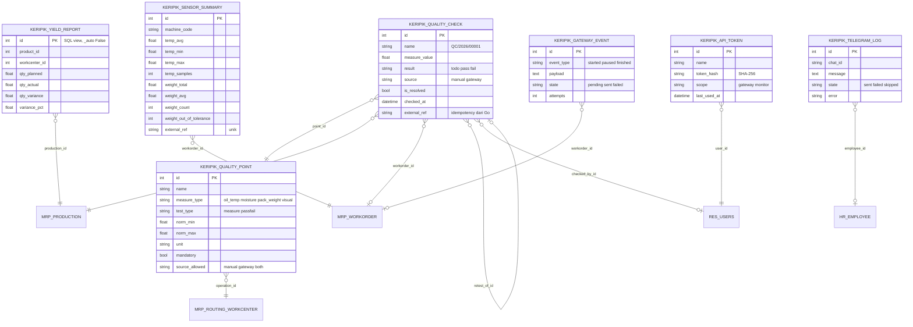
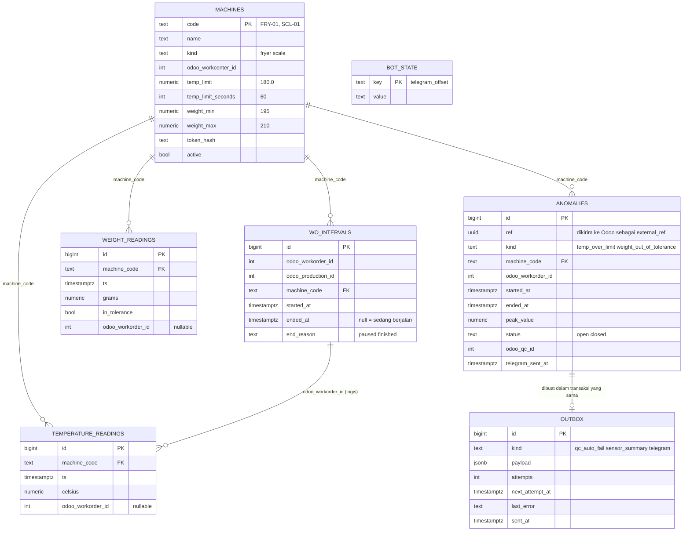

# D4. Data Model

Tiga lapis data:

1. **Model standar Odoo** yang dipakai apa adanya atau di-*extend* (`_inherit`)
2. **Model custom** `mrp_keripik` (prefix `keripik.`)
3. **Skema `sensor_db`** milik Go gateway (PostgreSQL terpisah, tanpa ORM Odoo)

> **Konsep Odoo vs Frappe**
> - `_name = 'keripik.quality.check'` → tabel `keripik_quality_check`. Mirip DocType "Quality Check" → tabel `tabQuality Check`.
> - `_inherit = 'mrp.production'` (tanpa `_name` baru) = **menambah field/method ke model yang sudah ada**, setara *Custom Field* + `override_doctype_class` / `doc_events` di Frappe, tapi lewat pewarisan Python (MRO), jadi wajib memanggil `super()`.
> - `Many2one` = *Link*, `One2many` = *Table* (child table), tapi di Odoo child "table" adalah model biasa dengan Many2one balik ke parent, bukan `istable=1`.
> - Nama field di Odoo 17+ yang sering berubah: `stock.move.quantity_done` → `quantity`; `<tree>` → `<list>` (Odoo 18). **Selalu cek source 19.0.**

---

## 4.1 Model Standar yang Dipakai

| Model | Peran di proyek | Padanan ERPNext | Di-extend? |
|---|---|---|---|
| `res.partner` | Pelanggan, vendor | Customer, Supplier | – |
| `product.template` / `product.product` | Bahan baku, setengah jadi, produk jadi, by-product | Item / Item Variant | – |
| `sale.order` / `sale.order.line` | Pesanan pelanggan | Sales Order | – |
| `purchase.order` | PO bahan baku | Purchase Order | – |
| `stock.warehouse.orderpoint` | Reorder rule min/max | Item Reorder | – |
| `stock.picking` | Receipt, delivery | Purchase Receipt / Delivery Note | ya (email siap kirim) |
| `stock.move` | Pergerakan per produk (rencana vs aktual) | Stock Entry Detail | – (dibaca laporan yield) |
| `stock.move.line` | Pergerakan per lot | Serial and Batch Bundle entry | – (traceability) |
| `stock.lot` | Lot + expiration/alert date (`product_expiry`) | Batch | – |
| `stock.quant` | Saldo stok per lokasi/lot | Bin / Stock Ledger | – |
| `stock.scrap` | Scrap di WO | Stock Entry (Material Scrap) | – |
| `mrp.bom` / `mrp.bom.line` / `mrp.bom.byproduct` | BoM 3 level + by-product | BOM / BOM Item / Scrap & by-product items | – |
| `mrp.routing.workcenter` | Operasi di BoM | Operation di Routing | – (dirujuk quality point) |
| `mrp.workcenter` | Mesin/stasiun kerja | Workstation | ya (`machine_code`) |
| `mrp.production` | MO | **Work Order** | ya (QC, biaya, yield) |
| `mrp.workorder` | WO per operasi | **Job Card** | ya (QC, ringkasan sensor) |
| `mrp.workcenter.productivity` | Time log Mulai/Jeda/Selesai | Job Card Time Log | – (dibaca biaya) |
| `maintenance.equipment` / `maintenance.request` | Mesin penggoreng & jadwalnya | Asset / Asset Maintenance | – |
| `hr.employee` | Karyawan + chat_id Telegram | Employee | ya |
| `account.move` | Invoice pelanggan | Sales Invoice | – |
| `mail.template` / `mail.mail` | Email pelanggan | Email Template / Email Queue | – (data baru) |
| `ir.cron` | Scheduled action | Scheduler event | – (data baru) |
| `ir.config_parameter` | Konfigurasi (bot token, URL gateway) | Single DocType settings | – (data baru) |

### ER diagram — model standar inti

> ⚠️ Nilai `state` dan nama field di atas berdasarkan Odoo 17/18. Cek `addons/mrp/models/mrp_production.py` dan `mrp_workorder.py` di branch **19.0**.

**Kunci traceability:** di MRP, `stock.move.line` punya relasi Many2many `consume_line_ids` / `produce_line_ids` (tabel `stock_move_line_consume_rel`), yang menghubungkan baris lot **bahan yang dikonsumsi** dengan baris lot **produk yang dihasilkan**. Laporan traceability standar Odoo juga memakai relasi ini. Cek namanya di `addons/mrp/models/stock_move_line.py` versi 19.

---

## 4.2 Model Custom `mrp_keripik`

### ER diagram

### Field model baru

#### `keripik.quality.point` — titik pemeriksaan (≈ Quality Inspection Template + parameter)

| Field | Label | Tipe | Wajib | Default | Keterangan |
|---|---|---|---|---|---|
| `name` | Nama | Char | ✔ | – | "Suhu minyak penggorengan" |
| `sequence` | Urutan | Integer | – | 10 | Urutan tampil |
| `operation_id` | Operasi | Many2one `mrp.routing.workcenter` | ✔ | – | Operasi BoM tempat QC dilakukan |
| `bom_id` | BoM | Many2one `mrp.bom` (related `operation_id.bom_id`, stored) | – | – | Untuk filter |
| `test_type` | Jenis uji | Selection `measure`/`passfail` | ✔ | `measure` | |
| `measure_type` | Besaran | Selection `oil_temp`/`moisture`/`pack_weight`/`visual` | ✔ | – | Dipakai gateway untuk mencocokkan QC |
| `norm_min` / `norm_max` | Batas min/maks | Float | ✔ jika `measure` | – | `norm_min <= norm_max` |
| `unit` | Satuan | Char | – | – | °C, %, g |
| `mandatory` | Wajib | Boolean | – | True | Memblokir WO/MO jika `todo` |
| `source_allowed` | Sumber | Selection `manual`/`gateway`/`both` | – | `manual` | |
| `instructions` | Instruksi | Html | – | – | Tampil di layar operator |
| `active` | Aktif | Boolean | – | True | Arsip |

#### `keripik.quality.check` — hasil pemeriksaan (≈ Quality Inspection) — `_inherit = ['mail.thread']`

| Field | Label | Tipe | Wajib | Default | Keterangan |
|---|---|---|---|---|---|
| `name` | Nomor | Char | ✔ | sequence `QC/%(year)s/` | readonly |
| `point_id` | Titik QC | Many2one | ✔ | – | |
| `production_id` | MO | Many2one `mrp.production` | ✔ | – | `ondelete='cascade'` |
| `workorder_id` | WO | Many2one `mrp.workorder` | – | – | domain: WO milik MO |
| `test_type`, `measure_type`, `norm_min`, `norm_max`, `unit` | – | related ke `point_id` | – | – | readonly |
| `measure_value` | Nilai ukur | Float | ✔ saat simpan hasil `measure` | – | |
| `result` | Hasil | Selection `todo`/`pass`/`fail` | ✔ | `todo` | compute dari nilai (`measure`) atau manual (`passfail`), tracking |
| `source` | Sumber | Selection `manual`/`gateway` | ✔ | `manual` | |
| `checked_by_id` | Diperiksa oleh | Many2one `res.users` | – | user saat ini | |
| `checked_at` | Waktu periksa | Datetime | – | – | |
| `note` | Catatan | Text | ✔ jika `fail` | – | |
| `retest_of_id` | Retest dari | Many2one self | – | – | |
| `retest_ids` | Retest | One2many self | – | – | |
| `is_resolved` | Terselesaikan | Boolean compute stored | – | – | True bila `fail` dan ada retest `pass` |
| `external_ref` | Ref eksternal | Char | – | – | unik (constraint), idempotensi dari Go |

#### `keripik.sensor.summary`

| Field | Tipe | Keterangan |
|---|---|---|
| `workorder_id` | Many2one `mrp.workorder`, wajib | |
| `production_id` | related stored | |
| `machine_code` | Char | |
| `period_start` / `period_end` | Datetime | |
| `temp_avg` / `temp_min` / `temp_max` | Float | °C |
| `temp_samples` | Integer | |
| `temp_seconds_over_limit` | Integer | detik > batas |
| `weight_count` / `weight_total` / `weight_avg` | Integer/Float | gram |
| `weight_out_of_tolerance` | Integer | |
| `external_ref` | Char unik | ID ringkasan dari Go (idempotensi) |

#### `keripik.api.token`

| Field | Tipe | Keterangan |
|---|---|---|
| `name` | Char | "Go Gateway", "Next.js Monitor" |
| `user_id` | Many2one `res.users` | Request dijalankan sebagai user ini |
| `scope` | Selection `gateway`/`monitor` | Endpoint yang boleh dipanggil |
| `token_hash` | Char, `groups='base.group_system'` | SHA-256 dari token; token mentah hanya tampil sekali |
| `token_prefix` | Char | 6 karakter awal untuk identifikasi |
| `last_used_at` | Datetime | |
| `active` | Boolean | Cabut token = arsip |

> Alternatif standar: Odoo punya **API key** user (`res.users.apikeys`) dan, setahuku sejak Odoo 18/19, route `auth='bearer'` serta **External JSON-2 API**. Kita tetap membuat token custom agar kamu paham hashing, scope, dan rotasi token, lalu menyebut alternatif ini saat interview. **Cek dokumentasi "External API" Odoo 19.**

#### `keripik.gateway.event` (outbox Odoo → Go)

| Field | Tipe | Keterangan |
|---|---|---|
| `event_type` | Selection `started`/`paused`/`finished` | |
| `workorder_id` | Many2one | |
| `payload` | Text (JSON) | |
| `state` | Selection `pending`/`sent`/`failed` | |
| `attempts` | Integer | |
| `last_error` | Char | |
| `next_attempt_at` | Datetime | backoff |

#### `keripik.telegram.log`

`employee_id`, `chat_id`, `event_type`, `message`, `state` (`sent`/`failed`/`skipped`), `error`, `create_date`.

#### `keripik.yield.report` (SQL view, `_auto = False`, read-only)

Satu baris per `stock.move` bahan baku pada MO berstatus `done`:
`production_id`, `product_id` (bahan), `finished_product_id`, `workcenter_id` (dari `operation_id`), `date`, `qty_planned` (dari `product_uom_qty`), `qty_actual` (`quantity`), `qty_variance = actual − planned`, `variance_pct`. Dibaca lewat pivot/graph. Padanan Frappe: *Script Report* / *Query Report*, tapi di Odoo ini **model biasa di atas VIEW SQL**, jadi pivot/graph/filter langsung jalan.

### Field yang ditambahkan ke model standar

| Model | Field | Tipe | Keterangan |
|---|---|---|---|
| `mrp.production` | `qc_check_ids` | One2many `keripik.quality.check` | |
| | `qc_state` | Selection `none`/`todo`/`fail`/`pass` (compute, stored) | Badge di list/form |
| | `qc_fail_count`, `qc_todo_count` | Integer compute | Smart button |
| | `cost_material` | Monetary compute stored | Σ qty aktual × harga bahan |
| | `cost_workcenter` | Monetary compute stored | Σ (durasi jam × `costs_hour`) |
| | `cost_total`, `cost_per_unit` | Monetary | |
| | `yield_pct` | Float | qty produced / qty plan × 100 |
| | `currency_id` | related company | Wajib untuk Monetary |
| `mrp.workorder` | `qc_check_ids` | One2many | |
| | `sensor_summary_ids` | One2many | |
| | `machine_code` | related `workcenter_id.machine_code` | |
| `mrp.workcenter` | `machine_code` | Char, unik | Kode mesin di gateway, misal `FRY-01` |
| | `is_sensor_enabled` | Boolean | |
| `hr.employee` | `telegram_chat_id` | Char, `groups` HR/admin | |
| | `telegram_username` | Char | |
| | `telegram_link_code` | Char | Kode sekali pakai |
| | `telegram_link_expires_at` | Datetime | |
| | `telegram_linked_at` | Datetime | |
| | `telegram_status` | Selection compute `not_linked`/`pending`/`linked` | |
| | `notify_qc_fail`, `notify_mo`, `notify_expiry` | Boolean | Preferensi |
| `stock.picking` | – | – | Method saja: kirim email "siap dikirim" |

---

## 4.3 Skema `sensor_db` (Go gateway)

### Keputusan skema

| Keputusan | Alasan |
|---|---|
| `odoo_workorder_id` diisi **saat ingest** (lookup interval aktif per mesin, di-cache di memori) | Query ringkasan cukup `WHERE odoo_workorder_id = $1`; tidak perlu join waktu |
| Tidak ada foreign key ke DB Odoo | Dua database terpisah; relasi logis saja (ID Odoo disimpan sebagai angka) |
| Index `(machine_code, ts DESC)` | Query grafik "1 jam terakhir per mesin" |
| Index `(odoo_workorder_id)` | Ringkasan per WO |
| `numeric(5,2)` untuk suhu, `numeric(6,1)` untuk berat | Presisi cukup, hindari error float |
| Retensi: hapus `*_readings` > 90 hari (job harian) | Ringkasan sudah tersimpan permanen di Odoo |
| Opsional: partisi bulanan (`PARTITION BY RANGE (ts)`) atau TimescaleDB | Disebut di interview sebagai langkah skala berikutnya |
| `outbox` dalam DB yang sama | Atomik dengan `anomalies` → tidak ada pesan hilang |
| `bot_state.telegram_offset` | Offset `getUpdates` bertahan saat restart, update tidak diproses dua kali |

DDL lengkap ada di F9 (`gateway/migrations/0001_init.sql`).
