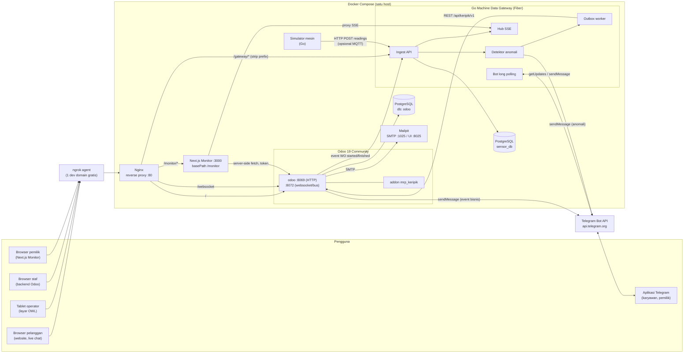
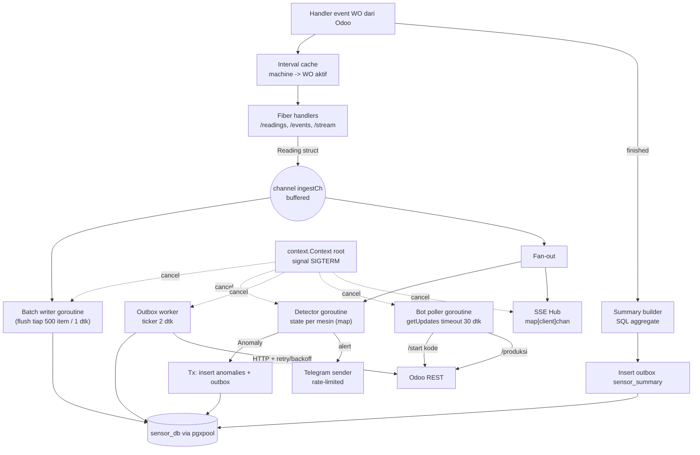

# D5. Arsitektur Sistem & Tech Stack

## 5.1 Diagram Arsitektur (deployment)

### Jalur komunikasi

| Dari → Ke | Protokol | Auth | Keterangan |
|---|---|---|---|
| Simulator → Go | HTTP JSON (`POST /api/v1/readings/*`) | `X-Machine-Token` | Opsional WebSocket/MQTT |
| Go → Odoo | HTTP JSON (`/api/keripik/v1/...`) | `Authorization: Bearer <token scope gateway>` | Lewat jaringan internal Docker (`http://odoo:8069`), **bukan** lewat ngrok |
| Odoo → Go | HTTP JSON (`POST /api/v1/events/workorder`) | `Authorization: Bearer <GATEWAY_INBOUND_TOKEN>` | Dari outbox `keripik.gateway.event` |
| Next.js (server) → Odoo | HTTP JSON | Bearer scope `monitor` | Token **hanya di server**, tidak pernah ke browser |
| Browser → Next.js → Go | SSE (`text/event-stream`) | Cookie sesi Next.js | Route handler Next.js mem-proxy stream Go |
| Odoo/Go → Telegram | HTTPS | Bot token | Keluar ke internet |
| Odoo → Mailpit | SMTP 1025 | – | Dev; produksi ganti ke SMTP asli |

## 5.2 Diagram Komponen Internal Go Gateway

> Konsep Go (detail di F8): setiap kotak "goroutine" adalah fungsi yang berjalan konkuren (≈ *task* ringan, bukan thread OS). Mereka berkomunikasi lewat **channel**, bukan variabel global ber-lock. Semua goroutine menerima `context.Context` yang sama, jadi saat container dihentikan (SIGTERM) semuanya berhenti rapi dan batch terakhir tetap ter-flush.

---

## 5.3 Tech Stack & Versi

> Versi per penulisan (Oktober 2026) belum tentu terbaru. **Cek halaman rilis resmi** sebelum mulai, lalu kunci versi di `docker-compose.yml` dan `go.mod` (jangan pakai `latest` di produksi).

| Komponen | Versi yang direkomendasikan | Cara cek |
|---|---|---|
| Odoo | **19.0 Community** (image `odoo:19.0`) | hub.docker.com/_/odoo |
| Python | Bawaan image Odoo 19 (3.12-an) | `docker compose exec odoo python3 --version` |
| PostgreSQL | **16** (Odoo 19 & Go) | Cek versi minimum PG di dokumentasi instalasi Odoo 19 |
| Go | Rilis stabil terbaru (≥ 1.25) | go.dev/dl |
| Fiber | **v3** jika sudah ada rilis stabil `v3.x.y` (bukan `-rc`/`-beta`). Jika belum: v2.52.x | github.com/gofiber/fiber/releases |
| pgx | v5 (`github.com/jackc/pgx/v5`) | |
| Node.js | 22 LTS (atau LTS aktif saat itu) | nodejs.org |
| Next.js | Versi stabil terbaru (App Router) | `npx create-next-app@latest` |
| React | Ikut Next.js | |
| Tailwind CSS | v4 (ikut template create-next-app) | |
| Recharts | 2.x / 3.x | npm |
| Nginx | 1.27-alpine (stable) | |
| Mailpit | `axllent/mailpit` (kunci tag versi) | |
| ngrok | Agent v3 | ngrok.com/download |
| Mosquitto (opsional) | 2.x | |
| Telegram Bot API | Versi terbaru (Bot API berversi, kompatibel ke belakang) | core.telegram.org/bots/api |

### Catatan Fiber v2 vs v3 (perlu dicek)

Yang setahuku berubah di v3:
- Signature handler: v2 `func(c *fiber.Ctx) error`, v3 `func(c fiber.Ctx) error` (interface, bukan pointer).
- `c.BodyParser(&x)` diganti `c.Bind().Body(&x)`.
- Sebagian middleware pindah atau berganti nama.
- Butuh Go versi lebih baru.

Kode di dokumen ini memakai **v3**. Jika terpaksa memakai v2, ganti tiga hal di atas. **Verifikasi di "What's New in v3"** pada dokumentasi Fiber.

---

## 5.4 Alasan Setiap Pilihan

| Pilihan | Alasan | Alternatif yang ditolak |
|---|---|---|
| **Odoo 19 Community** | Versi terbaru dengan dukungan OCA berjalan; gratis; target lowongan | Odoo 18 (lebih banyak module OCA, tapi kurang "terkini"); Enterprise (berbayar, mengaburkan nilai custom module) |
| **Custom module, bukan Studio** | Studio itu Enterprise; kode bisa di-review, diuji, dan dimigrasi | – |
| **Go untuk gateway** | Konkurensi murah (goroutine), binary tunggal kecil, latensi rendah, cocok untuk I/O jaringan | Python FastAPI (bisa, tapi GIL & tidak menambah variasi skill); Node.js (kamu sudah mahir, kurang menunjukkan hal baru) |
| **Fiber** | API mirip Express (familiar untuk dev JS), performa tinggi (fasthttp) | `net/http` + chi (lebih "idiomatik" Go; sebut di interview sebagai trade-off: fasthttp tidak 100% kompatibel `net/http`) |
| **PostgreSQL terpisah untuk sensor** | Isolasi beban, backup, dan retensi; DB Odoo tetap kecil | Tabel di DB Odoo (lihat D1 §4); InfluxDB/TimescaleDB (lebih tepat untuk skala besar, tapi menambah teknologi; Timescale bisa jadi ekstensi PG nanti) |
| **pgx (tanpa ORM)** | Query SQL eksplisit, `CopyFrom` untuk batch insert cepat | GORM (abstraksi berlebihan untuk tabel time-series) |
| **HTTP dulu, MQTT opsional** | Mudah dites dengan curl; MQTT adalah standar IoT sebenarnya → tantangan lanjutan | MQTT dari awal (menambah broker sebelum inti jalan) |
| **SSE untuk live chart** | Satu arah server→browser, otomatis reconnect, lewat HTTP biasa (mudah di Nginx/ngrok) | WebSocket (dua arah, tidak dibutuhkan) |
| **Next.js App Router** | Kamu sudah mahir; server component/route handler menyembunyikan token Odoo | Halaman dashboard di Odoo (kurang menunjukkan integrasi eksternal) |
| **Telegram, bukan WhatsApp** | Bot API gratis & resmi, tanpa verifikasi bisnis | WhatsApp Cloud API (butuh Meta Business, template berbayar) → pengembangan berikutnya |
| **Long polling, bukan webhook** | ngrok gratis hanya 1 domain dan URL bisa berubah; long polling tidak butuh endpoint publik | Webhook (lebih efisien di produksi; sebut sebagai peningkatan) |
| **Outbox + retry** | Integrasi antar-sistem tidak boleh kehilangan event bila salah satu down | Panggil langsung tanpa retry (rapuh) |
| **Nginx satu domain, path-based** | ngrok gratis = 1 domain → semua layanan dibedakan dengan path | Subdomain per layanan (butuh domain berbayar) |
| **Mailpit** | Menangkap semua email di dev, tidak ada email bocor ke pelanggan sungguhan | SMTP Gmail (rate limit, risiko kirim sungguhan) |
| **Docker Compose** | Satu perintah untuk semua layanan, reprodusibel untuk reviewer | Install manual (sulit diulang) |

---

## 5.5 Keamanan Arsitektur (ringkas)

- Hanya **Nginx** yang mengekspos port ke host. Odoo, PostgreSQL, Go, dan Next.js hanya di jaringan Docker internal.
- `list_db = False` dan `admin_passwd` kuat di `odoo.conf`; `dbfilter` di-set agar database manager tidak terbuka lewat ngrok.
- Token disimpan sebagai **hash** di Odoo; token mentah hanya di `.env` (tidak di-commit; ada `.env.example`).
- Endpoint gateway ingest butuh token mesin; endpoint event dari Odoo butuh token terpisah.
- `proxy_mode = True` agar Odoo membaca `X-Forwarded-*` (IP & skema https dari ngrok benar). Jika tidak, URL di email dan redirect jadi `http://`.

---

## 5.6 Lisensi & Biaya (diverifikasi 6 Okt 2026)

### Odoo
| Komponen | Lisensi | Biaya | Cara cek |
|---|---|---|---|
| Odoo 19 Community (core + semua modul yang dipasang: `sale_management`, `website_sale`, `im_livechat`, `website_livechat`, `mrp`, `sale_mrp`, `purchase`, `purchase_stock`, `product_expiry`, `maintenance`, `hr`, `account`, `stock_account`, `mrp_account`, `mail`, `web`, `stock`) | **LGPL-3** | Gratis (self-hosted) | Field `license` di `__manifest__.py` setiap modul, repo `odoo/odoo` branch 19.0 |
| Modul Enterprise (`quality_control`, `mrp_workorder`, `mrp_maintenance`, dll.) | Odoo Enterprise (berbayar) | **Tidak dipakai** | Tidak ada di repo Community |
| `mrp_keripik` (buatan sendiri) | LGPL-3 (di manifest) | – | – |
| Modul OCA (opsional: `quality_control_oca`, OpenUpgrade, odoo-module-migrator) | **AGPL-3** | Gratis | Hanya dievaluasi/dipakai sebagai alat; bila modul AGPL dipasang di server publik, source modifikasinya wajib dibagikan |
| Odoo Apps Store (modul pihak ketiga berbayar) | – | **Tidak dipakai** | – |
| Hosting Odoo Online / Odoo.sh | – | **Tidak dipakai** (self-hosted Docker) | – |

### Framework & tools open-source (semua gratis)
| Komponen | Lisensi |
|---|---|
| PostgreSQL | PostgreSQL License (permisif) |
| Go | BSD-3-Clause |
| Fiber | MIT |
| pgx | MIT |
| google/uuid | BSD-3-Clause |
| Next.js | MIT |
| React | MIT |
| Tailwind CSS | MIT |
| Recharts | MIT |
| Nginx | BSD-2-Clause |
| Mailpit | MIT |
| wkhtmltopdf (di image Odoo) | LGPL-3.0 |
| Image `odoo` Docker resmi | gratis (Docker Official Image) |
| distroless (image runtime Go) | Apache-2.0 |
| Mosquitto (opsional) | EPL-2.0 / EDL-1.0 |

### Layanan (bukan open-source, paket gratis)
| Layanan | Syarat gratis | Dampak ke proyek |
|---|---|---|
| **Docker Desktop** | Gratis untuk penggunaan pribadi, proyek open-source non-komersial, atau perusahaan **< 250 karyawan dan < US$10 jt** pendapatan/tahun | Portofolio pribadi → gratis. Jika nanti dipakai di perusahaan besar, gunakan alternatif gratis: **Colima** (MIT) atau OrbStack (gratis untuk personal) |
| **Docker Hub** | Akun gratis: 100 pull/jam | Cukup |
| **ngrok** | **$0**: 1 dev domain, **±1 GB transfer & ±20.000 request HTTP/S per bulan**, ada halaman interstitial | ⚠️ Kuota cepat habis: satu kali buka backend Odoo bisa puluhan request (JS, CSS, RPC). Nyalakan ngrok **hanya saat demo/interview**, akses lokal via `localhost` saat develop. Alternatif: **Cloudflare Tunnel** (gratis, tanpa kuota; *quick tunnel* memberi URL acak, URL tetap butuh domain sendiri di Cloudflare) |
| **Telegram Bot API** | Gratis | Batas laju berlaku (lihat FSD §4.5) |
| **SMTP** | Mailpit lokal (gratis) | Untuk email sungguhan nanti: Gmail SMTP / Brevo / Mailtrap paket gratis (di luar cakupan) |

> Angka kuota ngrok dan syarat Docker Desktop bisa berubah. Cek ulang <https://ngrok.com/pricing> dan <https://www.docker.com/pricing/faq/> sebelum demo.
