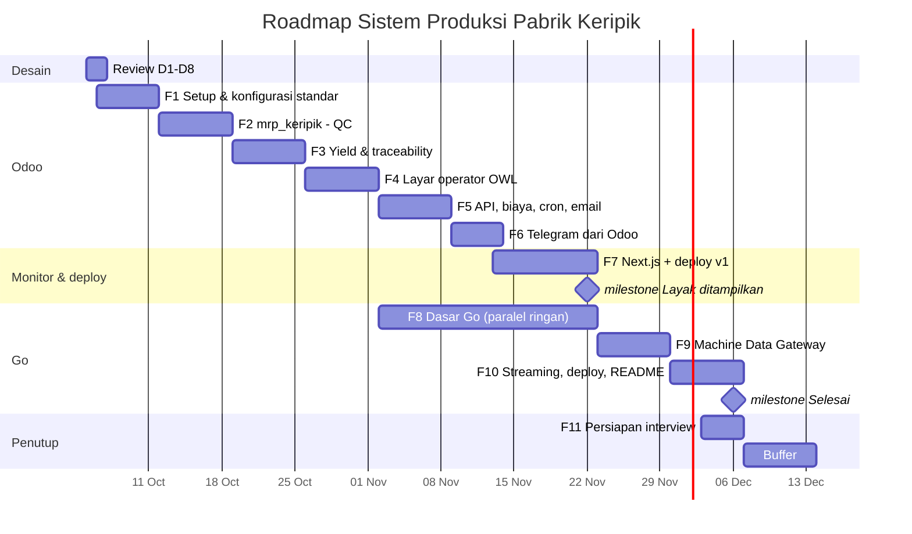

# D8. Roadmap (9 minggu + buffer)

- **Mulai:** Senin, 5 Oktober 2026
- **Kapasitas:** 10–15 jam/minggu
- **Milestone utama:** akhir minggu 7 (22 Nov) proyek **layak ditampilkan** (Odoo lengkap + Monitor + deploy v1). Minggu 8–9 menambah Go gateway.

> **F8 berjalan paralel** (±2 jam/minggu mulai minggu 5: Tour of Go + latihan kecil), supaya di minggu 8 kamu sudah siap menulis gateway.

---

## Rencana per Minggu

| Minggu | Tanggal | Fase | Fokus | Jam |
|---|---|---|---|---|
| 1 | 5–11 Okt | Review D + **F1** | Docker, install modul, master data, BoM, uji MTO manual | 12–14 |
| 2 | 12–18 Okt | **F2** | Kerangka module, security, quality point/check, blokir MO, test | 14–15 |
| 3 | 19–25 Okt | **F3** | SQL view yield, pivot/graph, QWeb, traceability & wizard recall | 12–14 |
| 4 | 26 Okt–1 Nov | **F4** | OWL client action, komponen, RPC, CSS tablet | 14–15 |
| 5 | 2–8 Nov | **F5** + F8 (2 jam) | Controller + token, biaya batch, cron expiry, mail template | 13–15 |
| 6 | 9–15 Nov | **F6** + mulai F7 + F8 (2 jam) | Telegram service, penautan akun, poller cron; scaffold Next.js | 12–14 |
| 7 | 16–22 Nov | **F7** + F8 (2 jam) | Monitor, Nginx, compose prod, ngrok, screenshot v1 | 12–15 |
| 8 | 23–29 Nov | **F9** | Gateway: ingest, sensor_db, event WO, ringkasan, anomali, outbox, bot, simulator | 15 |
| 9 | 30 Nov–6 Des | **F10** + **F11** | SSE + grafik live, deploy lengkap, data demo, README, latihan interview | 13–15 |
| Buffer | 7–13 Des | – | Perbaikan bug, MQTT opsional, video demo | 0–10 |
| – | setelah Odoo 20 rilis | **F12** | Migrasi module | 8–12 |

---

## Checklist "Selesai kalau..."

### F1 — Setup & konfigurasi standar (5–11 Okt)
- [ ] `docker compose up -d` menjalankan odoo, db, mailpit tanpa error; Odoo terbuka di `http://localhost:8069`.
- [ ] Database `keripik` (tanpa demo data) dengan bahasa Indonesia, IDR, zona Asia/Jakarta.
- [ ] Modul standar ter-install (D7 §5.2).
- [ ] Semua produk, vendor, 3 BoM, 5 work center, operasi, by-product, reorder rule, equipment dibuat.
- [ ] Route MTO aktif; 1 order dari website menghasilkan 3 MO berantai (AC-SAL-02/03).
- [ ] Satu siklus penuh manual sukses: PO → receipt dengan lot → MO → WO → done → delivery → invoice.
- [ ] Email uji tampil di Mailpit.
- [ ] **Backup database** disimpan (`docs/backup/keripik-f1.zip`, jangan commit jika besar) agar bisa reset.

### F2 — QC & aturan blokir (12–18 Okt)
- [ ] Module `mrp_keripik` ter-install & ter-upgrade tanpa warning ACL.
- [ ] 4 grup custom + ACL + record rule berfungsi (uji login sebagai Operator/QC).
- [ ] Quality point default ter-load dari data XML.
- [ ] QC terbentuk saat MO confirm, tidak duplikat (AC-QC-01/02).
- [ ] Hasil pass/fail otomatis + constraint catatan (AC-QC-03/04).
- [ ] Blokir MO & WO + retest (AC-QC-05/06/07).
- [ ] `test_quality_check.py` lulus (`--test-tags /mrp_keripik`).

### F3 — Laporan (19–25 Okt)
- [ ] Pivot & graph yield menampilkan data dari minimal 3 MO done (AC-YLD-01…03).
- [ ] QWeb yield per MO tercetak (AC-YLD-04).
- [ ] Wizard recall dua arah + PDF (AC-TRC-01…03).
- [ ] Test traceability & yield lulus.

### F4 — Layar operator (26 Okt–1 Nov)
- [ ] Menu Layar Operator membuka client action OWL tanpa error console.
- [ ] Mulai/Jeda/Selesai, QC, qty & scrap jalan (AC-OPS-01…05, 07).
- [ ] Lolos uji device mode 1024×768 (AC-OPS-06).
- [ ] Screenshot/gif layar operator disimpan di `docs/screenshots/`.

### F5 — API, biaya, cron, email (2–8 Nov)
- [ ] Token API bisa dibuat, dicabut; 401/403/422 sesuai (AC-API-01/02/05/08).
- [ ] Semua endpoint D6 §6.2 merespons sesuai contoh; koleksi Bruno/Postman disimpan di repo.
- [ ] Biaya batch sesuai contoh perhitungan (AC-CST-01…04).
- [ ] Cron expiry jalan (AC-EXP-01…04).
- [ ] Tiga email muncul di Mailpit pada momen yang benar (AC-EML-01…04).
- [ ] Outbox `keripik.gateway.event` tercipta saat start/finish WO (pengiriman diuji di F9).

### F6 — Telegram (9–13 Nov)
- [ ] Bot dibuat di @BotFather, token di parameter sistem.
- [ ] Penautan akun via `/start KODE` berhasil (AC-TG-01…03).
- [ ] Notifikasi QC gagal, MO selesai, MO tertunda, expiry diterima (AC-TG-04, 07).
- [ ] Rollback tidak mengirim pesan; 403 memutus tautan (AC-TG-05/06).

### F7 — Monitor + deploy v1 (13–22 Nov) ⭐ layak ditampilkan
- [ ] Next.js `/monitor` dengan login, KPI, MO berjalan, QC gagal (AC-MON-01…03, 06, 07).
- [ ] `docker compose -f docker-compose.yml up -d` menjalankan nginx, odoo (workers ≥ 2), db, mailpit, monitor.
- [ ] Nginx: `/` → Odoo, `/websocket` → 8072, `/monitor` → Next.js; `proxy_mode` aktif.
- [ ] Akses publik via domain ngrok: website, backend, monitor, live chat berjalan.
- [ ] README versi awal + screenshot.

### F8 — Dasar Go (paralel, 2–22 Nov)
- [ ] Menyelesaikan Tour of Go bagian Basics, Methods & Interfaces, Concurrency.
- [ ] Latihan: HTTP server Fiber kecil + goroutine/channel worker pool + context timeout + unit test table-driven.

### F9 — Gateway (23–29 Nov)
- [ ] `sensor_db` termigrasi; ingest HTTP jalan (AC-GW-01/02).
- [ ] Event WO dari Odoo terhubung; ringkasan masuk Odoo (AC-GW-03/07, AC-API-06/07).
- [ ] Anomali suhu & berat + QC gagal + Telegram tanpa duplikat (AC-GW-04/05/06).
- [ ] Bot `/start` & `/produksi` dari Go; poller Odoo dimatikan (AC-GW-09).
- [ ] Simulator semua skenario (AC-SIM-01…05).
- [ ] `go test ./...` lulus (detector, outbox backoff).

### F10 — Streaming, deploy lengkap, README (30 Nov–6 Des)
- [ ] Grafik live + banner anomali di Monitor (AC-MON-04/05).
- [ ] Compose lengkap (gateway, sensor-db, simulator profile `demo`) + Nginx `/gateway/`.
- [ ] Skrip data demo menghasilkan ±2 minggu riwayat MO, QC, yield.
- [ ] README portofolio lengkap (diagram, Odoo vs Go, modul yang disentuh, cara menjalankan, screenshot, video).
- [ ] Checklist keamanan NFR-SEC lulus.

### F11 — Persiapan interview (3–6 Des)
- [ ] Bisa menjelaskan tanpa catatan: arsitektur, alasan Go/sensor_db, alur QC blokir MO, outbox, auth token, OWL, perbedaan dengan ERPNext.
- [ ] Demo 5 menit terlatih (skrip di F11).

### F12 — Migrasi Odoo 20 (setelah rilis)
- [ ] Module ter-install di Odoo 20 bersih; semua test lulus; catatan perubahan API di `MIGRATION.md`.
