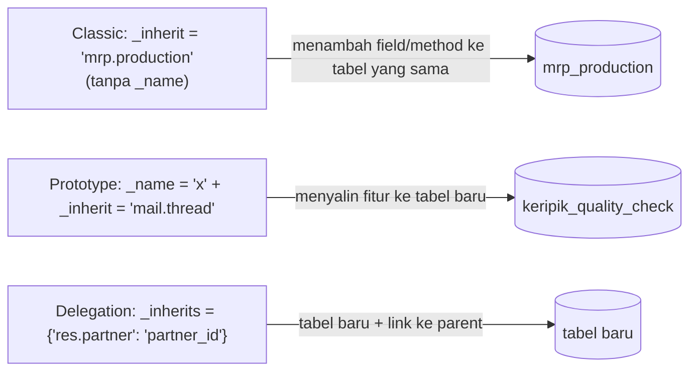
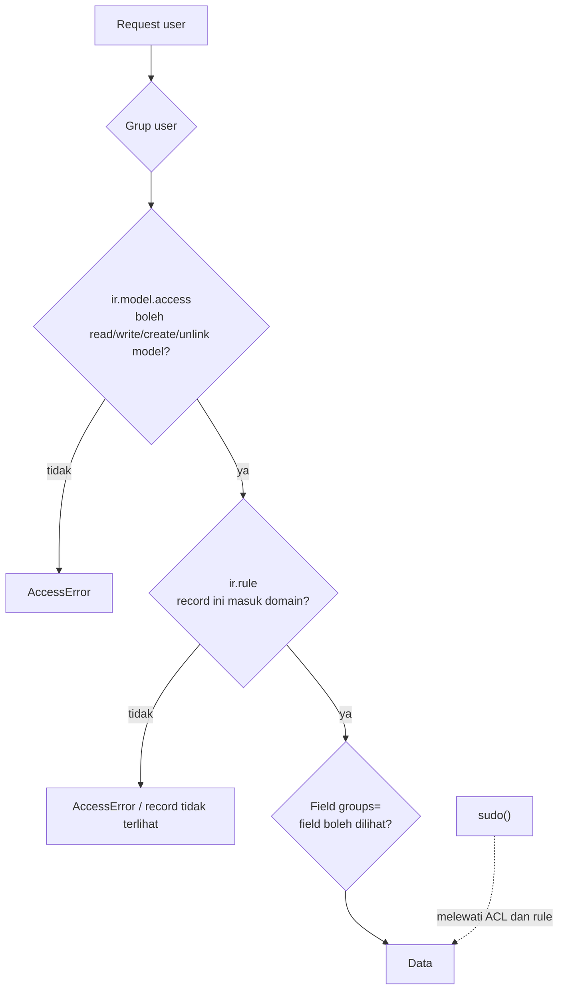

# F2. Module `mrp_keripik`: Model, View, Security, Quality Check & Blokir MO

| | |
|---|---|
| **Requirement FSD** | FR-QC-01…09 (kecuali notifikasi Telegram FR-QC-08 → F6), NFR-SEC-01/02/08 |
| **Minggu** | 2 (12–18 Okt 2026) |
| **Hasil** | Module ter-install, grup & ACL, quality point/check, QC dibuat otomatis, MO/WO terblokir, unit test lulus |

> 🧭 **Pembagian kode:** kerangka module, manifest, data, menu, dan sebagian view = **lengkap** (boilerplate). Model, logika QC, security, dan test = **konsep + kerangka + petunjuk**. Kamu yang menulis. Minta "solusi lengkap F2 bagian X" bila buntu.

---

## 1. Konsep

### 1.1 Anatomi module Odoo vs app Frappe

| Frappe app | Odoo module |
|---|---|
| `hooks.py` | `__manifest__.py` (metadata, dependensi, file data) |
| DocType JSON + `.py` controller | Model Python (`models/*.py`) + view XML (`views/*.xml`) terpisah |
| Fixtures | `data/*.xml`, `*.csv` (di-load berurutan sesuai `data` di manifest) |
| `doc_events` / override class | `_inherit` + override method + `super()` |
| Role Permission | `security/ir.model.access.csv` + `res.groups` |
| User Permission | `ir.rule` (domain) |
| `frappe.throw` | `raise UserError(...)` / `ValidationError(...)` |
| `validate()` | `@api.constrains(...)` atau override `write/create` |
| `fetch_from` | `related='...'` |
| Virtual field / `@property` | `compute=` (tanpa `store`) |
| Field computed tersimpan | `compute=` + `store=True` + `@api.depends` |

### 1.2 Tiga mekanisme pewarisan



Di F2 kita pakai **classic** (extend `mrp.production`, `mrp.workorder`) dan **prototype** (`keripik.quality.check` mewarisi `mail.thread` + `mail.activity.mixin` agar punya chatter).

### 1.3 Override method & `super()`
Odoo memakai MRO Python. Banyak module bisa meng-override method yang sama (misal `button_mark_done` di `mrp`, `mrp_account`, `sale_mrp`). **Selalu panggil `super()`** dan kembalikan hasilnya. Validasi dilakukan **sebelum** `super()`, aksi tambahan **sesudah** `super()`.

```python
def button_mark_done(self):
    self._keripik_check_quality()     # validate first
    res = super().button_mark_done()  # standard behaviour (may return a wizard action!)
    # post-actions here (careful: res can be a dict action for backorder/consumption wizard)
    return res
```

> ⚠️ `button_mark_done` bisa mengembalikan **action wizard** (backorder, consumption warning) dan dipanggil ulang dari wizard dengan context tertentu. Validasi QC kamu harus tetap berjalan pada panggilan ulang itu, dan aksi "setelah selesai" (email, Telegram) sebaiknya dipicu saat `state` benar-benar `done`, misalnya dengan mengecek `self.filtered(lambda p: p.state == 'done')` setelah `super()`.

### 1.4 Security berlapis



---

## 2. Langkah

### Langkah 1 — Scaffold

```bash
docker compose exec odoo odoo scaffold mrp_keripik /mnt/extra-addons
# The folder appears at ./odoo/addons/mrp_keripik (owned by the container user)
sudo chown -R $(whoami) odoo/addons/mrp_keripik   # if permission issue on macOS (usually not needed)
```

Hapus isi contoh dari scaffold, lalu bentuk struktur sesuai D6 §6.5:

```bash
cd odoo/addons/mrp_keripik
rm -rf demo views/templates.xml controllers/controllers.py models/models.py
mkdir -p data report security static/description static/src/operator_screen/components tests wizard
touch models/{quality_point,quality_check,mrp_production,mrp_workorder,mrp_workcenter}.py
touch tests/{__init__,common,test_quality_check}.py
```

### Langkah 2 — `__manifest__.py` (lengkap)

`odoo/addons/mrp_keripik/__manifest__.py`
```python
{
    "name": "MRP Keripik",
    "summary": "Quality checks, yield, traceability, operator screen and "
               "machine gateway integration for a chips factory",
    "version": "19.0.1.0.0",
    "category": "Manufacturing/Manufacturing",
    "author": "Your Name",
    "website": "https://github.com/your-github/odoo-project",
    "license": "LGPL-3",
    "depends": [
        "mrp",
        "mrp_account",
        "sale_mrp",
        "purchase_stock",
        "product_expiry",
        "hr",
        "mail",
    ],
    "data": [
        # security first: groups -> access -> rules
        "security/mrp_keripik_groups.xml",
        "security/ir.model.access.csv",
        "security/mrp_keripik_rules.xml",
        # data
        "data/ir_sequence_data.xml",
        # views
        "views/quality_point_views.xml",
        "views/quality_check_views.xml",
        "views/mrp_production_views.xml",
        "views/mrp_workorder_views.xml",
        "views/mrp_workcenter_views.xml",
        "views/menus.xml",
    ],
    "demo": [],
    "assets": {},
    "installable": True,
    "application": False,
}
```

> Urutan di `data` penting: grup harus ada sebelum CSV yang merujuknya; view action harus ada sebelum menu yang merujuknya. Ini mirip urutan fixtures di Frappe, tapi Odoo **gagal install** bila referensi XML ID belum ada.

### Langkah 3 — `__init__.py` (lengkap)

`mrp_keripik/__init__.py`
```python
from . import models
```

`mrp_keripik/models/__init__.py`
```python
from . import quality_point
from . import quality_check
from . import mrp_production
from . import mrp_workorder
from . import mrp_workcenter
```

### Langkah 4 — Sequence (lengkap)

`mrp_keripik/data/ir_sequence_data.xml`
```xml
<?xml version="1.0" encoding="utf-8"?>
<odoo noupdate="1">
    <record id="seq_keripik_quality_check" model="ir.sequence">
        <field name="name">Keripik Quality Check</field>
        <field name="code">keripik.quality.check</field>
        <field name="prefix">QC/%(year)s/</field>
        <field name="padding">5</field>
        <field name="company_id" eval="False"/>
    </record>
</odoo>
```

> `noupdate="1"` = record tidak ditimpa saat `-u` (nomor urut terakhir tidak di-reset). Mirip fixtures yang hanya di-insert sekali.

### Langkah 5 — Grup (kerangka + petunjuk)

`mrp_keripik/security/mrp_keripik_groups.xml`
```xml
<?xml version="1.0" encoding="utf-8"?>
<odoo>
    <!--
    TODO: define 4 groups (see FSD §2.3):
      group_keripik_operator  (implies mrp.group_mrp_user)
      group_keripik_quality   (implies base.group_user)
      group_keripik_manager   (implies operator + quality + mrp.group_mrp_manager)
      group_keripik_owner     (implies base.group_user)

    HINT (Odoo 17/18 style):
    <record id="group_keripik_operator" model="res.groups">
        <field name="name">Operator</field>
        <field name="category_id" ref="..."/>
        <field name="implied_ids" eval="[Command.link(ref('mrp.group_mrp_user'))]"/>
    </record>

    ⚠️ Odoo 19: open odoo/addons/mrp/security/mrp_security.xml (branch 19.0)
    and copy the exact pattern used there (category / privilege fields may differ).
    Also make admin a member: user_ids / users field on base.user_admin.
    -->
</odoo>
```

Petunjuk:
- `implied_ids` = "grup ini otomatis memberi grup lain" (≈ tidak ada padanan langsung di Frappe; Frappe Role tidak bertingkat).
- `Command.link(id)` sama dengan tuple lama `(4, id)`.
- Buat kategori module sendiri ("Keripik") agar di form User muncul satu dropdown untuk tingkatan Operator → Manager (bila pola 19 mendukung).

### Langkah 6 — Model `keripik.quality.point` (kerangka)

`mrp_keripik/models/quality_point.py`
```python
from odoo import api, fields, models
from odoo.exceptions import ValidationError


class KeripikQualityPoint(models.Model):
    _name = "keripik.quality.point"
    _description = "Quality Control Point"
    _order = "sequence, id"

    name = fields.Char(required=True, translate=True)
    sequence = fields.Integer(default=10)
    active = fields.Boolean(default=True)
    company_id = fields.Many2one(
        "res.company", required=True, default=lambda self: self.env.company
    )
    operation_id = fields.Many2one(
        "mrp.routing.workcenter", string="Operation", required=True, ondelete="cascade"
    )
    bom_id = fields.Many2one(related="operation_id.bom_id", store=True)

    # TODO: test_type (selection measure/passfail, default measure)
    # TODO: measure_type (selection: thickness, oil_temp, color, moisture,
    #       pack_weight, seal, other)
    # TODO: norm_min, norm_max (Float), unit (Char)
    # TODO: mandatory (Boolean, default True)
    # TODO: source_allowed (selection manual/gateway/both, default manual)
    # TODO: instructions (Html)

    # TODO: constraint norm_min <= norm_max when test_type == 'measure'
    # HINT:
    # @api.constrains("test_type", "norm_min", "norm_max")
    # def _check_norm(self):
    #     for point in self:
    #         if ...:
    #             raise ValidationError(self.env._("..."))
```

> `self.env._(...)` adalah cara terjemahan baru (Odoo 18+). Cara lama `from odoo import _`. ⚠️ Cek mana yang direkomendasikan di 19 (keduanya kemungkinan masih jalan).

### Langkah 7 — Model `keripik.quality.check` (kerangka + petunjuk)

`mrp_keripik/models/quality_check.py`
```python
from odoo import api, fields, models
from odoo.exceptions import UserError, ValidationError


class KeripikQualityCheck(models.Model):
    _name = "keripik.quality.check"
    _description = "Quality Check"
    _inherit = ["mail.thread", "mail.activity.mixin"]
    _order = "id desc"
    _check_company_auto = True

    name = fields.Char(
        required=True, readonly=True, copy=False, default=lambda self: self.env._("New")
    )
    point_id = fields.Many2one("keripik.quality.point", required=True, check_company=True)
    production_id = fields.Many2one(
        "mrp.production", required=True, ondelete="cascade", index=True, check_company=True
    )
    workorder_id = fields.Many2one("mrp.workorder", index=True, check_company=True)
    company_id = fields.Many2one(related="production_id.company_id", store=True)

    # related (readonly) info from the point
    test_type = fields.Selection(related="point_id.test_type")
    measure_type = fields.Selection(related="point_id.measure_type", store=True)
    norm_min = fields.Float(related="point_id.norm_min")
    norm_max = fields.Float(related="point_id.norm_max")
    unit = fields.Char(related="point_id.unit")

    measure_value = fields.Float(tracking=True)
    result = fields.Selection(
        [("todo", "To Do"), ("pass", "Pass"), ("fail", "Fail")],
        required=True, default="todo", tracking=True,
    )
    source = fields.Selection(
        [("manual", "Manual"), ("gateway", "Gateway")], required=True, default="manual"
    )
    checked_by_id = fields.Many2one("res.users", readonly=True)
    checked_at = fields.Datetime(readonly=True)
    note = fields.Text()

    retest_of_id = fields.Many2one("keripik.quality.check", readonly=True)
    retest_ids = fields.One2many("keripik.quality.check", "retest_of_id")
    is_resolved = fields.Boolean(compute="_compute_is_resolved", store=True)

    external_ref = fields.Char(copy=False, index=True)

    # TODO (Odoo 19): unique external_ref.
    # Odoo 19 introduced models.Constraint as replacement of _sql_constraints:
    #   _external_ref_uniq = models.Constraint("UNIQUE(external_ref)", "External ref must be unique.")
    # ⚠️ verify the exact API in odoo/orm (19.0); fallback: _sql_constraints list.

    @api.model_create_multi
    def create(self, vals_list):
        # TODO: assign sequence when name is "New"
        # HINT: self.env["ir.sequence"].next_by_code("keripik.quality.check")
        return super().create(vals_list)

    @api.depends("result", "retest_ids.result")
    def _compute_is_resolved(self):
        # TODO: True when result == 'fail' and any retest has result 'pass'
        #       (later: or waived by manager)
        ...

    # ---------- business actions ----------
    def action_record_measure(self, value):
        """Store a measured value and compute pass/fail (BR-QC-01)."""
        # TODO:
        # 1. ensure_one(), test_type == 'measure'
        # 2. compute result from norm_min/norm_max
        # 3. write measure_value, result, checked_by_id=self.env.user, checked_at=now
        # 4. return result (used by the OWL screen in F4)
        ...

    def action_pass(self):
        # TODO: for passfail checks
        ...

    def action_fail(self):
        # TODO: for passfail checks (note is required -> constraint)
        ...

    def action_retest(self):
        # TODO: create a new check copying point/production/workorder,
        #       retest_of_id = self, result todo; return form action of the new one
        ...

    # ---------- constraints ----------
    # TODO @api.constrains("result", "note"): note required when result == 'fail'
    # TODO: prevent unlink when result != 'todo' (override unlink or use @api.ondelete)
    #   HINT: @api.ondelete(at_uninstall=False)
    #         def _unlink_except_done(self): ...
    # TODO: operator cannot write a gateway check:
    #   override write(): if any(rec.source == 'gateway' for rec in self)
    #   and not self.env.user.has_group('mrp_keripik.group_keripik_manager')
    #   and not self.env.su: raise UserError
```

**Petunjuk logika:**
- Perhitungan pass/fail taruh di satu helper `_compute_result_from_value(value)` agar dipakai `action_record_measure`, API gateway (F5), dan ringkasan sensor (F9).
- Gunakan `fields.Datetime.now()`.
- `@api.ondelete` lebih disarankan daripada override `unlink` (tidak memblokir uninstall module).

### Langkah 8 — Extend `mrp.production` (kerangka + petunjuk)

`mrp_keripik/models/mrp_production.py`
```python
from odoo import api, fields, models
from odoo.exceptions import UserError


class MrpProduction(models.Model):
    _inherit = "mrp.production"

    qc_check_ids = fields.One2many("keripik.quality.check", "production_id", string="Quality Checks")
    qc_todo_count = fields.Integer(compute="_compute_qc_counts")
    qc_fail_count = fields.Integer(compute="_compute_qc_counts")
    qc_state = fields.Selection(
        [("none", "No QC"), ("todo", "To Do"), ("fail", "Failed"), ("pass", "Passed")],
        compute="_compute_qc_state", store=True,
    )

    @api.depends("qc_check_ids.result", "qc_check_ids.is_resolved", "qc_check_ids.point_id.mandatory")
    def _compute_qc_state(self):
        # TODO: none if no checks; fail if any unresolved fail; todo if any mandatory todo; else pass
        ...

    def _compute_qc_counts(self):
        # TODO
        ...

    # ---------- generation ----------
    def action_confirm(self):
        res = super().action_confirm()
        self._keripik_generate_quality_checks()
        return res

    def _keripik_generate_quality_checks(self):
        """Create one 'todo' check per active quality point of the BoM operations (FR-QC-02).

        Must be idempotent (AC-QC-02).
        """
        # TODO:
        # for production in self:
        #   points = search quality points where operation_id in production.bom_id.operation_ids
        #   existing = set of point ids already having an original check (retest_of_id = False)
        #   for each workorder in production.workorder_ids:
        #       for point in points of workorder.operation_id not in existing:
        #           prepare vals {point_id, production_id, workorder_id}
        #   create in batch (one create call with vals_list)
        ...

    # ---------- blocking ----------
    def _keripik_check_quality(self):
        """Raise UserError when MO has mandatory todo checks or unresolved failed checks (BR-QC-02)."""
        # TODO: build a readable message listing check names + operation names
        # HINT: checks.mapped(lambda c: f"{c.point_id.name} ({c.workorder_id.name})")
        ...

    def button_mark_done(self):
        self._keripik_check_quality()
        return super().button_mark_done()

    def action_view_quality_checks(self):
        # TODO: return a window action on keripik.quality.check filtered by this MO
        ...
```

Pertanyaan untuk kamu jawab sendiri sebelum menulis:
1. Apakah QC perlu dibuat untuk MO yang **tidak** punya WO (BoM tanpa operasi)? → tidak ada operasi = tidak ada point; aman.
2. Apa yang terjadi bila MO di-*split* atau backorder dibuat? Backorder adalah MO baru → `action_confirm` mungkin tidak dipanggil (MO langsung confirmed). ⚠️ Cek di 19 bagaimana backorder dibuat (`_split_productions`/`_generate_backorder_productions`). Override di sana atau di `create` jika perlu agar backorder juga punya QC.

### Langkah 9 — Extend `mrp.workorder` & `mrp.workcenter` (kerangka)

`mrp_keripik/models/mrp_workorder.py`
```python
from odoo import fields, models
from odoo.exceptions import UserError


class MrpWorkorder(models.Model):
    _inherit = "mrp.workorder"

    qc_check_ids = fields.One2many("keripik.quality.check", "workorder_id")
    qc_todo_count = fields.Integer(compute="_compute_qc_todo_count")

    def _compute_qc_todo_count(self):
        # TODO: count mandatory checks still 'todo'
        ...

    def _keripik_check_quality_before_finish(self):
        # TODO: raise UserError("Isi QC terlebih dahulu: ...") when mandatory todo (FR-QC-06)
        ...

    # TODO: override the method(s) that finish a workorder and call the check first.
    # ⚠️ In 17/18 this is `button_finish` (and `do_finish`/`action_mark_as_done` in some flows).
    #    Read odoo/addons/mrp/models/mrp_workorder.py on branch 19.0 and list every
    #    entry point that sets state 'done'.
```

`mrp_keripik/models/mrp_workcenter.py`
```python
from odoo import fields, models


class MrpWorkcenter(models.Model):
    _inherit = "mrp.workcenter"

    machine_code = fields.Char(
        help="Machine code used by the Machine Data Gateway, e.g. FRY-01", copy=False
    )
    is_sensor_enabled = fields.Boolean()
    # TODO: unique machine_code (same Constraint approach as external_ref)
```

### Langkah 10 — ACL (kerangka + contoh)

`mrp_keripik/security/ir.model.access.csv`
```csv
id,name,model_id:id,group_id:id,perm_read,perm_write,perm_create,perm_unlink
access_qc_point_manager,qc.point.manager,model_keripik_quality_point,group_keripik_manager,1,1,1,1
access_qc_point_user,qc.point.user,model_keripik_quality_point,base.group_user,1,0,0,0
```

TODO: tambahkan baris untuk `keripik.quality.check` sesuai matriks FSD §2.4:

| Grup | R | W | C | D |
|---|---|---|---|---|
| operator | 1 | 1 | 0 | 0 |
| quality | 1 | 1 | 1 | 0 |
| manager | 1 | 1 | 1 | 1 |
| owner | 1 | 0 | 0 | 0 |

Petunjuk:
- `model_id:id` = `model_` + nama model dengan titik diganti underscore.
- Grup dalam module sendiri boleh tanpa prefix (`group_keripik_manager`), grup module lain pakai prefix (`mrp.group_mrp_user`).
- ACL bersifat **aditif** (gabungan semua grup user). Tidak ada "deny".

### Langkah 11 — Record rule (kerangka)

`mrp_keripik/security/mrp_keripik_rules.xml`
```xml
<?xml version="1.0" encoding="utf-8"?>
<odoo>
    <record id="rule_qc_check_company" model="ir.rule">
        <field name="name">Quality check: multi-company</field>
        <field name="model_id" ref="model_keripik_quality_check"/>
        <field name="domain_force">[('company_id', 'in', company_ids)]</field>
        <!-- no groups => global rule (applies to everyone, AND-ed) -->
    </record>

    <!-- TODO: same for keripik.quality.point -->
</odoo>
```

> **Rule global** (tanpa grup) di-AND; **rule grup** di-OR antar grup. Kesalahan klasik: membuat rule grup yang terlalu ketat, lalu heran mengapa Manager juga terbatas (karena Manager juga anggota grup Operator via `implied_ids`). Solusi: rule Manager dengan domain `[(1, '=', 1)]`.

### Langkah 12 — View (Quality Point lengkap, Quality Check kerangka)

`mrp_keripik/views/quality_point_views.xml` (lengkap)
```xml
<?xml version="1.0" encoding="utf-8"?>
<odoo>
    <record id="keripik_quality_point_view_list" model="ir.ui.view">
        <field name="name">keripik.quality.point.list</field>
        <field name="model">keripik.quality.point</field>
        <field name="arch" type="xml">
            <list>
                <field name="sequence" widget="handle"/>
                <field name="name"/>
                <field name="bom_id"/>
                <field name="operation_id"/>
                <field name="test_type"/>
                <field name="measure_type"/>
                <field name="norm_min" invisible="test_type != 'measure'"/>
                <field name="norm_max" invisible="test_type != 'measure'"/>
                <field name="unit"/>
                <field name="mandatory"/>
                <field name="source_allowed"/>
            </list>
        </field>
    </record>

    <record id="keripik_quality_point_view_form" model="ir.ui.view">
        <field name="name">keripik.quality.point.form</field>
        <field name="model">keripik.quality.point</field>
        <field name="arch" type="xml">
            <form>
                <sheet>
                    <widget name="web_ribbon" title="Archived" bg_color="text-bg-danger" invisible="active"/>
                    <div class="oe_title">
                        <h1><field name="name" placeholder="e.g. Oil temperature"/></h1>
                    </div>
                    <group>
                        <group>
                            <field name="operation_id"/>
                            <field name="bom_id"/>
                            <field name="test_type" widget="radio"/>
                            <field name="measure_type"/>
                        </group>
                        <group invisible="test_type != 'measure'">
                            <field name="norm_min"/>
                            <field name="norm_max"/>
                            <field name="unit"/>
                        </group>
                        <group>
                            <field name="mandatory"/>
                            <field name="source_allowed"/>
                            <field name="company_id" groups="base.group_multi_company"/>
                            <field name="active" invisible="1"/>
                        </group>
                    </group>
                    <notebook>
                        <page string="Instructions" name="instructions">
                            <field name="instructions"/>
                        </page>
                    </notebook>
                </sheet>
            </form>
        </field>
    </record>

    <record id="keripik_quality_point_view_search" model="ir.ui.view">
        <field name="name">keripik.quality.point.search</field>
        <field name="model">keripik.quality.point</field>
        <field name="arch" type="xml">
            <search>
                <field name="name"/>
                <field name="operation_id"/>
                <field name="bom_id"/>
                <filter name="archived" string="Archived" domain="[('active', '=', False)]"/>
                <group>
                    <filter name="group_bom" string="BoM" context="{'group_by': 'bom_id'}"/>
                </group>
            </search>
        </field>
    </record>

    <record id="keripik_quality_point_action" model="ir.actions.act_window">
        <field name="name">Quality Points</field>
        <field name="res_model">keripik.quality.point</field>
        <field name="view_mode">list,form</field>
    </record>
</odoo>
```

> Sejak Odoo 17, `attrs="{'invisible': [...]}"` **dihapus** dan diganti ekspresi Python langsung: `invisible="test_type != 'measure'"`. Sejak 18, `<tree>` → `<list>` dan `view_mode` `tree` → `list`.

`mrp_keripik/views/quality_check_views.xml` (kerangka)
```xml
<?xml version="1.0" encoding="utf-8"?>
<odoo>
    <!-- TODO list view: name, production_id, workorder_id, point_id, measure_value, unit,
         result (widget="badge" decoration-success="result == 'pass'"
                 decoration-danger="result == 'fail'" decoration-muted="result == 'todo'"),
         source, checked_by_id, checked_at, is_resolved -->

    <!-- TODO form view:
         <header>
           buttons: action_pass / action_fail (invisible="test_type != 'passfail' or result != 'todo'")
                    action_retest (invisible="result != 'fail' or is_resolved")
           <field name="result" widget="statusbar" statusbar_visible="todo,pass,fail"/>
         </header>
         <sheet> name, point info, measure_value (readonly="source == 'gateway'"), note, retest_ids </sheet>
         <chatter/>   ⚠️ Odoo 18+ shorthand; older: div.oe_chatter with message_follower_ids/message_ids
    -->

    <!-- TODO search view: filters todo / fail / today / gateway; group by production, point -->
    <!-- TODO pivot + graph view (FR-QC-09) -->
    <!-- TODO action keripik_quality_check_action -->
</odoo>
```

`mrp_keripik/views/mrp_production_views.xml` (kerangka)
```xml
<?xml version="1.0" encoding="utf-8"?>
<odoo>
    <record id="mrp_production_form_view_inherit_keripik" model="ir.ui.view">
        <field name="name">mrp.production.form.inherit.keripik</field>
        <field name="model">mrp.production</field>
        <field name="inherit_id" ref="mrp.mrp_production_form_view"/>
        <field name="arch" type="xml">
            <!-- TODO smart button inside div[@name='button_box'] calling action_view_quality_checks,
                 showing qc_fail_count / total -->
            <!-- TODO new notebook page "Quality" with qc_check_ids (inline list) -->
            <!-- HINT: <xpath expr="//notebook" position="inside"> ... </xpath> -->
        </field>
    </record>

    <!-- TODO inherit list view mrp.mrp_production_tree_view (⚠️ check XML id in 19) to add qc_state badge -->
</odoo>
```

> XPath di view inheritance ≈ "Customize Form" di Frappe, tapi deklaratif dan versioned. Cari XML ID view induk: *Developer mode → Edit View: Form* atau di `addons/mrp/views/mrp_production_views.xml`.

`mrp_keripik/views/mrp_workorder_views.xml`, `mrp_workcenter_views.xml`: TODO serupa (tambah tab QC di WO; field `machine_code`, `is_sensor_enabled` di work center).

### Langkah 13 — Menu (lengkap)

`mrp_keripik/views/menus.xml`
```xml
<?xml version="1.0" encoding="utf-8"?>
<odoo>
    <menuitem id="menu_keripik_root"
              name="Keripik"
              parent="mrp.menu_mrp_root"
              sequence="25"/>

    <menuitem id="menu_keripik_quality"
              name="Quality"
              parent="menu_keripik_root"
              sequence="10"/>

    <menuitem id="menu_keripik_quality_check"
              name="Quality Checks"
              parent="menu_keripik_quality"
              action="keripik_quality_check_action"
              sequence="10"/>

    <menuitem id="menu_keripik_quality_point"
              name="Quality Points"
              parent="menu_keripik_quality"
              action="keripik_quality_point_action"
              groups="group_keripik_manager"
              sequence="20"/>
</odoo>
```

### Langkah 14 — Data quality point default

Buat `data/keripik_quality_point_data.xml` (tambahkan ke manifest **setelah** BoM ada). Masalah: BoM dibuat manual lewat UI di F1, jadi XML ID-nya tidak ada.

Dua pilihan:
1. **(Disarankan)** Pindahkan master data F1 (produk, work center, BoM, operasi) ke `data/keripik_master_demo.xml` sebagai **demo data** module, sehingga database baru bisa direproduksi. Ini juga bagus untuk reviewer.
2. Isi quality point lewat UI saja.

Contoh satu record (pola):
```xml
<record id="qp_fry_oil_temp" model="keripik.quality.point">
    <field name="name">Oil temperature</field>
    <field name="operation_id" ref="mrp_keripik.op_bom_ks_frying"/>
    <field name="test_type">measure</field>
    <field name="measure_type">oil_temp</field>
    <field name="norm_min">160</field>
    <field name="norm_max">180</field>
    <field name="unit">°C</field>
    <field name="source_allowed">both</field>
</record>
```

### Langkah 15 — Install & update

```bash
make install MOD=mrp_keripik      # first time
make update  MOD=mrp_keripik      # after every Python/XML change
make restart                      # after Python changes when not using -u
make logs
```

---

## 3. Testing

### 3.1 Struktur test (kerangka + satu contoh lengkap)

`mrp_keripik/tests/__init__.py`
```python
from . import test_quality_check
```

`mrp_keripik/tests/common.py`
```python
from odoo.tests import TransactionCase


class KeripikCommon(TransactionCase):
    @classmethod
    def setUpClass(cls):
        super().setUpClass()
        uom_kg = cls.env.ref("uom.product_uom_kgm")
        cls.workcenter = cls.env["mrp.workcenter"].create({"name": "Test Fryer", "machine_code": "T-FRY"})
        cls.raw = cls.env["product.product"].create({
            "name": "Test Raw", "type": "consu", "is_storable": True, "uom_id": uom_kg.id,
        })  # ⚠️ field names for storable products in 19
        cls.finished = cls.env["product.product"].create({
            "name": "Test Chips", "type": "consu", "is_storable": True, "uom_id": uom_kg.id,
        })
        cls.bom = cls.env["mrp.bom"].create({
            "product_tmpl_id": cls.finished.product_tmpl_id.id,
            "product_qty": 1.0,
            "operation_ids": [(0, 0, {"name": "Frying", "workcenter_id": cls.workcenter.id})],
            "bom_line_ids": [(0, 0, {"product_id": cls.raw.id, "product_qty": 1.0})],
        })
        cls.operation = cls.bom.operation_ids
        cls.point_temp = cls.env["keripik.quality.point"].create({
            "name": "Oil temperature", "operation_id": cls.operation.id,
            "test_type": "measure", "measure_type": "oil_temp",
            "norm_min": 160, "norm_max": 180, "unit": "°C",
        })

    def _create_mo(self, qty=1.0):
        mo = self.env["mrp.production"].create({
            "product_id": self.finished.id,
            "product_qty": qty,
            "bom_id": self.bom.id,
        })
        mo.action_confirm()
        return mo
```

`mrp_keripik/tests/test_quality_check.py`
```python
from odoo.exceptions import UserError, ValidationError
from odoo.tests import tagged

from .common import KeripikCommon


@tagged("post_install", "-at_install")
class TestQualityCheck(KeripikCommon):

    def test_checks_generated_on_confirm(self):
        """AC-QC-01: one todo check per quality point."""
        mo = self._create_mo()
        self.assertEqual(len(mo.qc_check_ids), 1)
        self.assertEqual(mo.qc_check_ids.result, "todo")
        self.assertEqual(mo.qc_check_ids.workorder_id, mo.workorder_ids)

    # TODO test_generation_is_idempotent (AC-QC-02)
    # TODO test_measure_pass (AC-QC-03)
    # TODO test_fail_requires_note (AC-QC-04) -> assertRaises(ValidationError)
    # TODO test_mark_done_blocked_when_todo (AC-QC-05) -> assertRaises(UserError)
    # TODO test_retest_unblocks (AC-QC-06)
    # TODO test_workorder_finish_blocked (AC-QC-07)
    # TODO test_operator_cannot_edit_gateway_check (AC-QC-09)
    #      HINT: create user with group operator, use check.with_user(user)
    # TODO test_cannot_delete_done_check (AC-QC-10)
```

> Odoo menjalankan setiap test dalam transaksi yang di-rollback, mirip `FrappeTestCase`. `setUpClass` membuat data sekali per class.

Jalankan:
```bash
make test MOD=mrp_keripik
# grep the log for "FAIL" / "ERROR"; summary line: "x failed, y error(s) of z tests"
```

### 3.2 Uji manual (AC FSD)

| AC | Langkah |
|---|---|
| AC-QC-01 | Buat MO Keripik Siap Kemas → Confirm → tab Quality berisi QC Penggorengan & Pembumbuan |
| AC-QC-03/04 | Isi suhu 172 → Pass; isi 186 tanpa catatan → error |
| AC-QC-05 | Biarkan QC todo → Produce All/Mark as Done → error menyebut QC |
| AC-QC-06 | QC fail → Retest → isi 175 → Mark as Done berhasil |
| AC-QC-09 | Login `operator1` → buka QC sumber gateway (buat manual via shell dengan `source='gateway'`) → edit → ditolak |

Shell untuk data uji:
```bash
make shell
>>> mo = env['mrp.production'].search([], limit=1, order='id desc')
>>> mo.qc_check_ids
>>> env.cr.commit()   # shell does not auto-commit!
```

---

## 4. Error yang Sering Terjadi

| Error | Penyebab | Solusi |
|---|---|---|
| `ParseError: External ID not found: mrp_keripik.group_keripik_manager` | Urutan file di manifest; atau nama ID salah | Pastikan groups XML sebelum CSV |
| `The model keripik.quality.check has no access rules` (warning) | Belum ada baris ACL | Tambah CSV |
| `ValueError: Invalid field 'xxx' on model` di view | Field belum ada / module belum di-update | `-u mrp_keripik`; cek ejaan |
| `Element '<xpath expr=...>' cannot be located in parent view` | XPath salah untuk view versi 19 | Lihat arch view induk di developer mode |
| `AccessError` untuk admin | Admin belum masuk grup custom | Tambahkan admin ke grup manager di XML |
| Compute `store=True` tidak ter-update | `@api.depends` kurang lengkap | Tambah field yang dibaca (termasuk relasi `qc_check_ids.result`) |
| QC dobel | `_keripik_generate_quality_checks` tidak idempoten | Cek existing sebelum create |
| `RecursionError` saat override `write` | Memanggil `self.write` di dalam `write` | Gunakan `super().write` |
| `Odoo Server Error: ... button_mark_done() got an unexpected keyword` | Signature override berbeda | Pakai `*args, **kwargs` jika signature 19 berbeda |
| Perubahan Python tidak terlihat | Tidak restart | `make restart` atau `-u` |

---

## 5. Pertanyaan Interview

1. **Kenapa QC dibuat saat MO confirm, bukan saat WO start?** Supaya ada record `todo` yang bisa memblokir MO. Kalau dibuat saat WO start, WO yang dilewati tidak punya QC sehingga blokir bisa ditembus.
2. **Kenapa validasi di `button_mark_done`, bukan di `write(state='done')`?** `state` MO adalah compute di versi baru; titik masuk bisnisnya adalah tombol. Tapi saya juga memeriksa jalur lain (wizard backorder memanggil ulang method yang sama).
3. **Bagaimana memastikan tidak ada QC duplikat?** Generator idempoten (cek existing) + aturan satu QC asli per point per MO.
4. **Apa beda `ValidationError` dan `UserError`?** Keduanya rollback transaksi; `ValidationError` untuk constraint data (dipakai di `@api.constrains`), `UserError` untuk aturan bisnis/aksi.
5. **Kenapa `@api.ondelete` daripada override `unlink`?** Tidak menghalangi uninstall module dan lebih eksplisit.
6. **ACL vs record rule?** ACL per model (CRUD), rule per record (domain). Rule global di-AND, rule grup di-OR. `sudo()` melewati keduanya, jadi pemakaiannya harus disengaja.
7. **Kenapa tidak pakai `quality_control_oca`?** Sudah dievaluasi; butuh integrasi spesifik (blokir MO, input gateway, retest, layar operator). Membangun sendiri juga menunjukkan pemahaman ORM & security.
8. **Bedanya dengan ERPNext Quality Inspection?** ERPNext mengaitkan inspection ke dokumen stok (Purchase Receipt/Stock Entry/Job Card) dan bisa diwajibkan per item. Di sini QC terikat ke operasi BoM dan MO, dengan sumber otomatis dari mesin.
