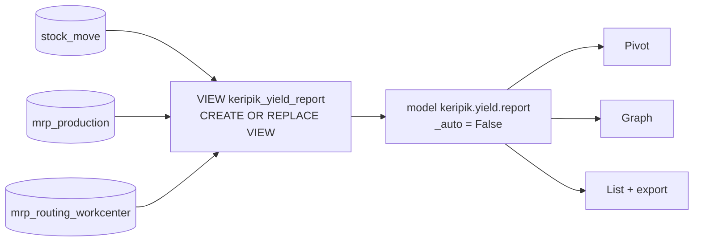
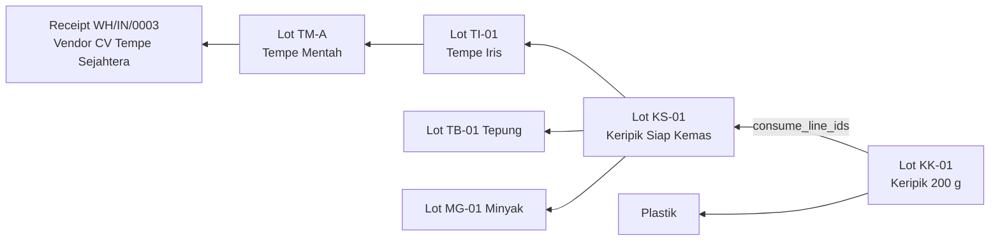

# F3. Laporan Yield & Susut + Traceability Lot

| | |
|---|---|
| **Requirement FSD** | FR-YLD-01…05, FR-TRC-01…04 |
| **Minggu** | 3 (19–25 Okt 2026) |
| **Hasil** | Pivot/graph yield, QWeb yield per MO & periode, wizard recall dua arah + PDF |

---

## 1. Konsep

### 1.1 Report model berbasis SQL VIEW (`_auto = False`)

| Frappe | Odoo |
|---|---|
| Query Report (SQL) / Script Report (Python) | Model biasa dengan `_auto = False`; method `init()` membuat `CREATE OR REPLACE VIEW` |
| Report view terpisah, filter manual | Pivot, graph, list, search view, export **otomatis** (karena dia model) |
| Permission per report | ACL per model seperti biasa |



`init()` dipanggil setiap install/update module, jadi perubahan SQL cukup dengan `-u`.

### 1.2 QWeb report

| Frappe | Odoo |
|---|---|
| Print Format (Jinja) | `ir.actions.report` + template QWeb (`t-foreach`, `t-esc`/`t-out`, `t-if`) |
| `frappe.get_print` | `self.env.ref('...').report_action(records)` |
| Data custom via `get_context` | AbstractModel `report.<module>.<template>` dengan `_get_report_values(docids, data)` |

PDF dirender oleh **wkhtmltopdf** (sudah ada di image resmi Odoo). Mulai F3, cek bahwa `web.base.url` benar (`http://odoo:8069` di dalam container); kalau salah, CSS tidak ter-load di PDF.

### 1.3 Traceability = penelusuran graf

Setiap MO menghasilkan `stock.move.line` produk (dengan lot) yang terhubung ke `stock.move.line` bahan yang dikonsumsi lewat Many2many **`consume_line_ids` / `produce_line_ids`** ⚠️ (verifikasi di `addons/mrp/models/stock_move_line.py` 19.0).



Backward = ikuti `consume_line_ids` sampai lot yang tidak berasal dari produksi (bahan baku). Forward = ikuti `produce_line_ids` sampai produk jadi, lalu cari move ke lokasi pelanggan. Gunakan **BFS dengan set `visited`** untuk mencegah loop.

---

## 2. Langkah — Yield & Susut

### Langkah 1 — Field `yield_pct` di MO (petunjuk)
Di `models/mrp_production.py` tambahkan:
```python
yield_pct = fields.Float(compute="_compute_yield_pct", store=True, aggregator="avg")
# ⚠️ 'aggregator' replaced 'group_operator' in Odoo 17/18; verify in 19.

@api.depends("qty_produced", "product_qty", "state")
def _compute_yield_pct(self):
    # TODO: qty_produced / product_qty * 100 when state == 'done' else 0
    ...
```

### Langkah 2 — Model SQL view (kerangka)

`models/yield_report.py`
```python
from odoo import api, fields, models, tools
from odoo.tools import SQL


class KeripikYieldReport(models.Model):
    _name = "keripik.yield.report"
    _description = "Yield & Shrinkage Analysis"
    _auto = False
    _order = "date desc"
    _rec_name = "production_id"

    production_id = fields.Many2one("mrp.production", readonly=True)
    date = fields.Datetime(readonly=True)
    finished_product_id = fields.Many2one("product.product", readonly=True)
    product_id = fields.Many2one("product.product", string="Component", readonly=True)
    operation_id = fields.Many2one("mrp.routing.workcenter", readonly=True)
    workcenter_id = fields.Many2one("mrp.workcenter", readonly=True)
    uom_id = fields.Many2one("uom.uom", readonly=True)
    qty_planned = fields.Float(readonly=True, aggregator="sum")
    qty_actual = fields.Float(readonly=True, aggregator="sum")
    qty_variance = fields.Float(readonly=True, aggregator="sum")
    variance_pct = fields.Float(readonly=True, aggregator="avg")
    company_id = fields.Many2one("res.company", readonly=True)

    def init(self):
        tools.drop_view_if_exists(self.env.cr, self._table)
        self.env.cr.execute(SQL(
            """
            CREATE OR REPLACE VIEW %s AS (
                SELECT
                    sm.id                       AS id,
                    mp.id                       AS production_id,
                    mp.date_finished            AS date,
                    mp.product_id               AS finished_product_id,
                    sm.product_id               AS product_id,
                    sm.operation_id             AS operation_id,
                    rw.workcenter_id            AS workcenter_id,
                    sm.product_uom              AS uom_id,
                    mp.company_id               AS company_id,
                    -- TODO qty_planned normalised: sm.product_uom_qty * (mp.qty_produced / NULLIF(mp.product_qty, 0))
                    -- TODO qty_actual: sm.quantity  (⚠️ column name in 19)
                    -- TODO qty_variance = actual - planned
                    -- TODO variance_pct = variance / NULLIF(planned, 0) * 100
                    0::float AS qty_planned,
                    0::float AS qty_actual,
                    0::float AS qty_variance,
                    0::float AS variance_pct
                FROM stock_move sm
                JOIN mrp_production mp ON mp.id = sm.raw_material_production_id
                LEFT JOIN mrp_routing_workcenter rw ON rw.id = sm.operation_id
                WHERE mp.state = 'done'
                  AND sm.state = 'done'
            )
            """,
            SQL.identifier(self._table),
        ))
```

Petunjuk:
- Gunakan `SQL(...)` dan `SQL.identifier` (Odoo 17+) daripada f-string. Ini mencegah SQL injection dan menjadi kebiasaan yang dinilai baik di code review.
- **Konversi UoM**: kalau semua move bahan memakai UoM produk, abaikan dulu. Tambahkan konversi (join `uom_uom` + `factor`) sebagai peningkatan.
- Cek kolom-kolomnya dengan `make psql` → `\d stock_move`.
- `qty_produced` di `mrp_production` bisa berupa compute non-stored ⚠️. Jika demikian, ambil dari `stock_move` produk jadi (`production_id = mp.id`, `state='done'`, `SUM(quantity)`) via subquery/CTE.

### Langkah 3 — ACL & view (lengkap)

Tambahkan ke `ir.model.access.csv`:
```csv
access_yield_report_manager,yield.report.manager,model_keripik_yield_report,group_keripik_manager,1,0,0,0
access_yield_report_quality,yield.report.quality,model_keripik_yield_report,group_keripik_quality,1,0,0,0
access_yield_report_owner,yield.report.owner,model_keripik_yield_report,group_keripik_owner,1,0,0,0
```

`views/yield_report_views.xml`
```xml
<?xml version="1.0" encoding="utf-8"?>
<odoo>
    <record id="keripik_yield_report_view_pivot" model="ir.ui.view">
        <field name="name">keripik.yield.report.pivot</field>
        <field name="model">keripik.yield.report</field>
        <field name="arch" type="xml">
            <pivot string="Yield &amp; Shrinkage" disable_linking="False" sample="1">
                <field name="finished_product_id" type="row"/>
                <field name="date" interval="month" type="col"/>
                <field name="qty_planned" type="measure"/>
                <field name="qty_actual" type="measure"/>
                <field name="qty_variance" type="measure"/>
            </pivot>
        </field>
    </record>

    <record id="keripik_yield_report_view_graph" model="ir.ui.view">
        <field name="name">keripik.yield.report.graph</field>
        <field name="model">keripik.yield.report</field>
        <field name="arch" type="xml">
            <graph string="Variance per operation" type="bar" sample="1">
                <field name="operation_id"/>
                <field name="variance_pct" type="measure"/>
            </graph>
        </field>
    </record>

    <record id="keripik_yield_report_view_list" model="ir.ui.view">
        <field name="name">keripik.yield.report.list</field>
        <field name="model">keripik.yield.report</field>
        <field name="arch" type="xml">
            <list create="0" edit="0" delete="0"
                  decoration-danger="variance_pct &gt; 5">
                <field name="date"/>
                <field name="production_id"/>
                <field name="finished_product_id"/>
                <field name="operation_id"/>
                <field name="product_id"/>
                <field name="qty_planned" sum="Total"/>
                <field name="qty_actual" sum="Total"/>
                <field name="qty_variance" sum="Total"/>
                <field name="variance_pct" avg="Average"/>
                <field name="uom_id"/>
            </list>
        </field>
    </record>

    <record id="keripik_yield_report_view_search" model="ir.ui.view">
        <field name="name">keripik.yield.report.search</field>
        <field name="model">keripik.yield.report</field>
        <field name="arch" type="xml">
            <search>
                <field name="production_id"/>
                <field name="finished_product_id"/>
                <field name="product_id"/>
                <field name="workcenter_id"/>
                <filter name="this_month" string="This Month" date="date"/>
                <filter name="high_variance" string="Variance &gt; 5%"
                        domain="[('variance_pct', '&gt;', 5)]"/>
                <group>
                    <filter name="g_finished" string="Finished product" context="{'group_by': 'finished_product_id'}"/>
                    <filter name="g_operation" string="Operation" context="{'group_by': 'operation_id'}"/>
                    <filter name="g_component" string="Component" context="{'group_by': 'product_id'}"/>
                    <filter name="g_month" string="Month" context="{'group_by': 'date:month'}"/>
                </group>
            </search>
        </field>
    </record>

    <record id="keripik_yield_report_action" model="ir.actions.act_window">
        <field name="name">Yield &amp; Shrinkage</field>
        <field name="res_model">keripik.yield.report</field>
        <field name="view_mode">pivot,graph,list</field>
        <field name="context">{'search_default_this_month': 1}</field>
    </record>
</odoo>
```

> Filter `date="date"` menghasilkan pilihan periode otomatis (Odoo 17+). ⚠️ Cek sintaks filter tanggal di 19.

Menu (tambahkan di `menus.xml`):
```xml
<menuitem id="menu_keripik_reporting" name="Reports" parent="menu_keripik_root" sequence="30"/>
<menuitem id="menu_keripik_yield" name="Yield &amp; Shrinkage" parent="menu_keripik_reporting"
          action="keripik_yield_report_action" sequence="10"
          groups="group_keripik_manager,group_keripik_quality,group_keripik_owner"/>
```

### Langkah 4 — QWeb report per MO (action lengkap, template kerangka)

`report/report_actions.xml`
```xml
<?xml version="1.0" encoding="utf-8"?>
<odoo>
    <record id="action_report_mo_yield" model="ir.actions.report">
        <field name="name">Yield &amp; Shrinkage Report</field>
        <field name="model">mrp.production</field>
        <field name="report_type">qweb-pdf</field>
        <field name="report_name">mrp_keripik.report_mo_yield</field>
        <field name="report_file">mrp_keripik.report_mo_yield</field>
        <field name="print_report_name">'Yield - %s' % object.name</field>
        <field name="binding_model_id" ref="mrp.model_mrp_production"/>
        <field name="binding_type">report</field>
    </record>

    <record id="action_report_recall" model="ir.actions.report">
        <field name="name">Traceability / Recall</field>
        <field name="model">keripik.recall.wizard</field>
        <field name="report_type">qweb-pdf</field>
        <field name="report_name">mrp_keripik.report_recall</field>
        <field name="report_file">mrp_keripik.report_recall</field>
    </record>
</odoo>
```

`report/yield_report_templates.xml` (kerangka)
```xml
<?xml version="1.0" encoding="utf-8"?>
<odoo>
    <template id="report_mo_yield">
        <t t-call="web.html_container">
            <t t-foreach="docs" t-as="mo">
                <t t-call="web.external_layout">
                    <div class="page">
                        <h2>Yield &amp; Shrinkage — <span t-field="mo.name"/></h2>
                        <div class="row mb-3">
                            <div class="col-6">
                                <strong>Product:</strong> <span t-field="mo.product_id"/><br/>
                                <strong>Planned:</strong> <span t-field="mo.product_qty"/> <span t-field="mo.product_uom_id"/><br/>
                                <strong>Produced:</strong> <span t-field="mo.qty_produced"/>
                            </div>
                            <div class="col-6">
                                <strong>Finished:</strong> <span t-field="mo.date_finished"/><br/>
                                <strong>Yield:</strong> <span t-esc="'%.1f' % mo.yield_pct"/> %
                            </div>
                        </div>

                        <h4>Components</h4>
                        <table class="table table-sm">
                            <thead>
                                <tr><th>Component</th><th>Operation</th>
                                    <th class="text-end">Planned</th><th class="text-end">Actual</th>
                                    <th class="text-end">Variance</th><th class="text-end">%</th></tr>
                            </thead>
                            <tbody>
                                <!-- TODO: loop rows. HINT: in the template you can call
                                     env['keripik.yield.report'].search([('production_id', '=', mo.id)])
                                     or better: add a method on mrp.production `_keripik_yield_lines()`
                                     returning a list of dicts and call t-foreach="mo._keripik_yield_lines()" -->
                                <!-- TODO: class text-danger when variance_pct > threshold (BR-YLD-05) -->
                            </tbody>
                        </table>

                        <h4>Operations</h4>
                        <!-- TODO: table workorder name, workcenter, duration_expected vs duration -->

                        <h4>By-products</h4>
                        <!-- TODO: mo.move_byproduct_ids (⚠️ field name) with quantity -->

                        <h4>Cost</h4>
                        <!-- F5: cost_material, cost_workcenter, cost_total, cost_per_unit -->
                    </div>
                </t>
            </t>
        </t>
    </template>
</odoo>
```

Tambahkan ke manifest `data`: `report/report_actions.xml`, `report/yield_report_templates.xml`, `views/yield_report_views.xml`, dan `models/__init__.py`: `from . import yield_report`.

Preview HTML (lebih cepat dari PDF saat develop):
```
http://localhost:8069/report/html/mrp_keripik.report_mo_yield/<mo_id>
```

### Langkah 5 — Laporan periode (FR-YLD-05)
Wizard `keripik.yield.period.wizard` (`date_from`, `date_to`, `product_ids`) → tombol mengembalikan `self.env.ref('mrp_keripik.action_report_mo_yield').report_action(mos)` untuk semua MO done di periode. Template yang sama akan mencetak satu halaman per MO. Rekap satu tabel bisa dibuat dengan template kedua yang menerima `data`. **Tulis sendiri** mengikuti pola wizard recall di bawah.

---

## 3. Langkah — Traceability & Recall

### Langkah 6 — Wizard (kerangka)

`wizard/recall_wizard.py`
```python
from odoo import api, fields, models
from odoo.exceptions import UserError

MAX_DEPTH = 10


class KeripikRecallWizard(models.TransientModel):
    _name = "keripik.recall.wizard"
    _description = "Lot Traceability / Recall Simulation"

    lot_id = fields.Many2one("stock.lot", required=True)
    direction = fields.Selection(
        [("backward", "Backward (to raw materials)"), ("forward", "Forward (to customers)")],
        required=True, default="forward",
    )
    line_ids = fields.One2many("keripik.recall.wizard.line", "wizard_id")
    customer_count = fields.Integer(compute="_compute_summary")
    affected_lot_count = fields.Integer(compute="_compute_summary")

    @api.model
    def default_get(self, fields_list):
        res = super().default_get(fields_list)
        # TODO: when opened from a lot (active_model == 'stock.lot'), prefill lot_id
        #       and choose direction: backward if lot product is sold (sale_ok), else forward
        return res

    def action_trace(self):
        self.ensure_one()
        self.line_ids.unlink()
        lines = (
            self._trace_backward(self.lot_id)
            if self.direction == "backward"
            else self._trace_forward(self.lot_id)
        )
        if not lines:
            raise UserError(self.env._("No stock movement found for this lot."))
        self.line_ids = [fields.Command.create(vals) for vals in lines]
        # keep the wizard open
        return {
            "type": "ir.actions.act_window",
            "res_model": self._name,
            "res_id": self.id,
            "view_mode": "form",
            "target": "new",
        }

    # ------------------------------------------------------------------
    def _produced_lines_of_lot(self, lot):
        """Move lines that PRODUCED this lot (finished move of an MO)."""
        # TODO: env['stock.move.line'].sudo().search([
        #     ('lot_id', '=', lot.id), ('state', '=', 'done'),
        #     ('move_id.production_id', '!=', False)])
        ...

    def _trace_backward(self, lot):
        """BFS from finished lot to raw-material lots (FR-TRC-01)."""
        # TODO:
        # queue = [(lot, 0)]; visited = set(); result = []
        # while queue:
        #     current, level = queue.pop(0)
        #     if current.id in visited or level > MAX_DEPTH: continue
        #     visited.add(current.id)
        #     produced = self._produced_lines_of_lot(current)
        #     if not produced:
        #         # raw material: find the receipt (picking_type_code == 'incoming') and vendor
        #         result.append({... level, lot_id, product_id, picking_id, partner_id ...})
        #         continue
        #     result.append({... level, lot_id, production_id ...})
        #     for consumed in produced.consume_line_ids:   # ⚠️ field name
        #         if consumed.lot_id: queue.append((consumed.lot_id, level + 1))
        #         else: result.append({... untracked component (e.g. plastic) ...})
        # return result
        ...

    def _trace_forward(self, lot):
        """BFS from raw-material lot to finished lots and customers (FR-TRC-02)."""
        # TODO:
        # consumed lines of lot (move_id.raw_material_production_id != False)
        #   -> their produce_line_ids -> lot -> recurse
        # for finished lots: outgoing done move lines to customer location
        #   (location_dest_id.usage == 'customer') -> picking.partner_id, sale_id
        # also compute qty_in_stock = sum of stock.quant for that lot in internal locations
        ...

    @api.depends("line_ids")
    def _compute_summary(self):
        # TODO: count distinct partner_id and lot_id in lines
        ...

    def action_print(self):
        return self.env.ref("mrp_keripik.action_report_recall").report_action(self)


class KeripikRecallWizardLine(models.TransientModel):
    _name = "keripik.recall.wizard.line"
    _description = "Recall line"
    _order = "level, id"

    wizard_id = fields.Many2one("keripik.recall.wizard", required=True, ondelete="cascade")
    level = fields.Integer()
    lot_id = fields.Many2one("stock.lot")
    product_id = fields.Many2one("product.product")
    qty = fields.Float()
    uom_id = fields.Many2one("uom.uom")
    production_id = fields.Many2one("mrp.production")
    picking_id = fields.Many2one("stock.picking")
    partner_id = fields.Many2one("res.partner")
    date = fields.Datetime()
    qty_in_stock = fields.Float()
```

> **Kenapa `sudo()` di penelusuran?** Petugas QC mungkin tidak punya akses ke delivery atau PO, tapi recall harus lengkap. Akses dijaga di level **menu & ACL wizard** (BR-TRC-01). Saat interview, sebutkan bahwa ini keputusan sadar, bukan jalan pintas.

### Langkah 7 — View wizard & tombol di lot (kerangka)

`wizard/recall_wizard_views.xml`
```xml
<?xml version="1.0" encoding="utf-8"?>
<odoo>
    <record id="keripik_recall_wizard_view_form" model="ir.ui.view">
        <field name="name">keripik.recall.wizard.form</field>
        <field name="model">keripik.recall.wizard</field>
        <field name="arch" type="xml">
            <form string="Recall Simulation">
                <group>
                    <field name="lot_id"/>
                    <field name="direction" widget="radio"/>
                </group>
                <div invisible="not line_ids" class="alert alert-warning">
                    <field name="affected_lot_count" class="oe_inline"/> affected lot(s),
                    <field name="customer_count" class="oe_inline"/> customer(s)
                </div>
                <field name="line_ids" readonly="1">
                    <list>
                        <field name="level"/>
                        <field name="product_id"/>
                        <field name="lot_id"/>
                        <field name="qty"/>
                        <field name="uom_id"/>
                        <field name="production_id"/>
                        <field name="picking_id"/>
                        <field name="partner_id"/>
                        <field name="qty_in_stock"/>
                        <field name="date"/>
                    </list>
                </field>
                <footer>
                    <button name="action_trace" type="object" string="Trace" class="btn-primary"/>
                    <button name="action_print" type="object" string="Print PDF" invisible="not line_ids"/>
                    <button special="cancel" string="Close"/>
                </footer>
            </form>
        </field>
    </record>

    <record id="keripik_recall_wizard_action" model="ir.actions.act_window">
        <field name="name">Recall Simulation</field>
        <field name="res_model">keripik.recall.wizard</field>
        <field name="view_mode">form</field>
        <field name="target">new</field>
    </record>

    <!-- TODO: inherit stock.view_production_lot_form (⚠️ XML id in 19) and add a button
         in button_box that opens keripik_recall_wizard_action with context
         {'active_model': 'stock.lot', 'active_id': id} -->
</odoo>
```

ACL TransientModel (wajib sejak Odoo 14):
```csv
access_recall_wizard_manager,recall.wizard.manager,model_keripik_recall_wizard,group_keripik_manager,1,1,1,1
access_recall_wizard_line_manager,recall.wizard.line.manager,model_keripik_recall_wizard_line,group_keripik_manager,1,1,1,1
```
TODO: tambahkan untuk grup quality & owner.

### Langkah 8 — Template recall (kerangka)
`report/traceability_report_templates.xml`: template `report_recall` menerima `docs` = wizard; tampilkan ringkasan (`affected_lot_count`, `customer_count`) dan tabel `line_ids` dengan indentasi `level` (`t-att-style="'padding-left: %spx' % (line.level * 16)"`). **Tulis sendiri.**

---

## 4. Testing

`tests/test_yield_traceability.py` (TODO):
- `test_yield_view_variance`: MO done dengan konsumsi diubah 3 → 3,3 → baris yield `qty_variance == 0.3` (AC-YLD-01). HINT: set `move.quantity = 3.3` (⚠️ cara set qty konsumsi di 19, mungkin lewat `move_line_ids`), lalu `mo.button_mark_done()`, lalu `self.env['keripik.yield.report'].search(...)`. Catatan: SQL view membaca DB, jadi panggil `self.env.flush_all()` sebelum search.
- `test_yield_partial_normalisation` (AC-YLD-02).
- `test_trace_backward_two_levels` (AC-TRC-01).
- `test_trace_forward_to_customer` (AC-TRC-02): butuh SO + delivery done.

Manual:
| AC | Langkah |
|---|---|
| AC-YLD-01 | Gunakan MO F1 (minyak 3,3 L) → Reports → Yield → group by Component |
| AC-YLD-04 | MO → Print → Yield & Shrinkage Report |
| AC-TRC-01 | Lot KK → tombol Recall → Backward → Trace |
| AC-TRC-02 | Lot TM → Forward → pelanggan dari F1 tampil |
| AC-TRC-04 | Login operator1 → menu Reports tidak tampil |

---

## 5. Error yang Sering Terjadi

| Error | Penyebab | Solusi |
|---|---|---|
| `column sm.quantity does not exist` | Nama kolom versi | `\d stock_move` di psql |
| Pivot kosong padahal ada MO | `state` bukan `done`, atau view belum dibuat ulang | `-u mrp_keripik`; cek `SELECT * FROM keripik_yield_report` |
| `id` duplikat di view | Join menghasilkan > 1 baris per move | Pastikan join 1:1 atau gunakan `ROW_NUMBER()` |
| PDF tanpa CSS / blank | `web.base.url` tidak bisa diakses dari container | Set `report.url` = `http://localhost:8069` (system parameter) atau `web.base.url` + freeze |
| `wkhtmltopdf` error | Versi/font | Pakai image resmi; cek log |
| Wizard tertutup setelah Trace | Method tidak mengembalikan action | Kembalikan act_window `target: new` dengan `res_id` |
| Penelusuran terhenti di Plastik | Produk tanpa lot | Tampilkan sebagai baris tanpa lot, jangan di-recurse |

---

## 6. Pertanyaan Interview

1. **Kenapa SQL view, bukan compute Python?** Agregasi ribuan move lebih cepat di PostgreSQL; pivot/graph/filter/export didapat gratis karena dia model; tidak menambah data tersimpan.
2. **Bagaimana kamu mencegah SQL injection di `init()`?** Pakai `odoo.tools.SQL` dan `SQL.identifier`; tidak ada input user di query view.
3. **Kenapa qty rencana dinormalisasi?** Produksi parsial akan tampak "hemat bahan" tanpa normalisasi terhadap qty yang benar-benar dihasilkan.
4. **Bagaimana traceability bekerja di Odoo?** Relasi `consume_line_ids`/`produce_line_ids` antar `stock.move.line` membentuk graf lot; saya menelusurinya dengan BFS + visited + batas kedalaman.
5. **Apa beda laporan traceability standar dengan yang kamu buat?** Standar menampilkan pergerakan lot; versi saya menjawab pertanyaan recall: lot mana terdampak, pelanggan siapa, berapa qty masih di gudang, dan bisa dicetak sebagai PDF.
6. **Padanan di ERPNext?** *Batch-wise traceability* / Serial and Batch Bundle report; di sana penelusuran lewat Stock Ledger + Stock Entry Manufacture.
