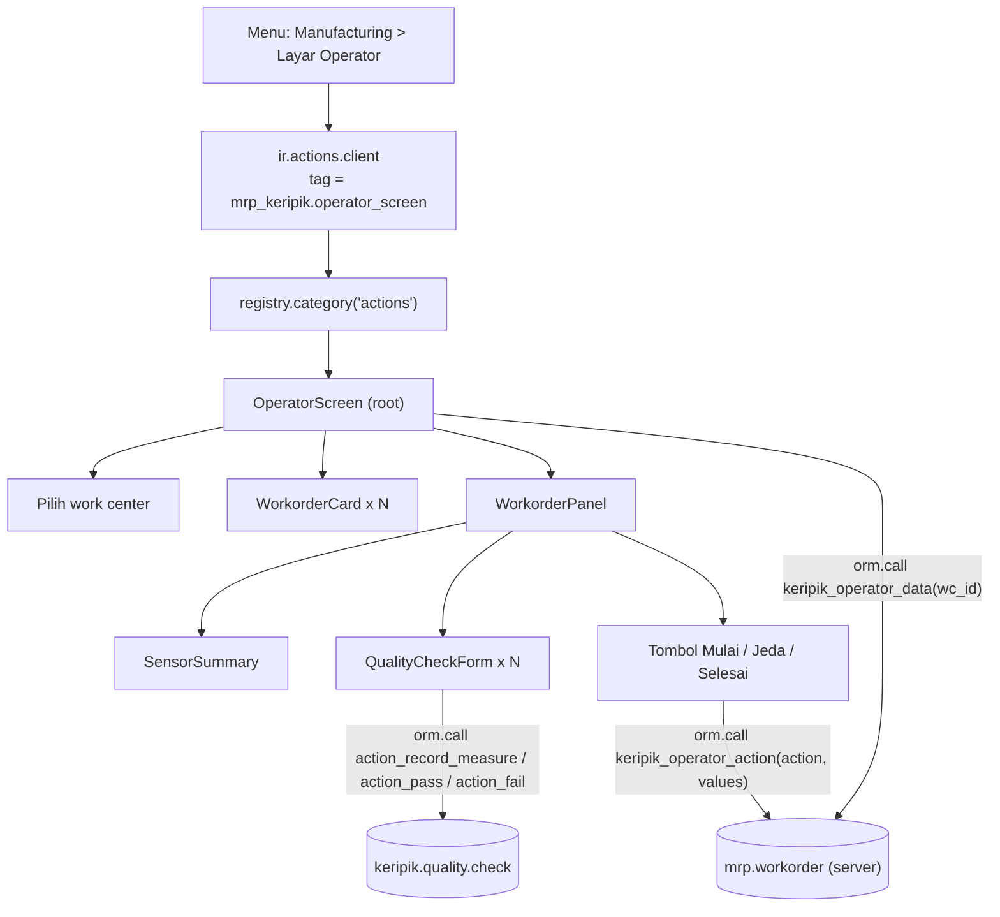

# F4. Layar Operator dengan OWL

| | |
|---|---|
| **Requirement FSD** | FR-OPS-01…08, FR-QC-03/06 (dari layar), NFR-UX-01…03 |
| **Minggu** | 4 (26 Okt–1 Nov 2026) |
| **Hasil** | Client action OWL ramah tablet: pilih work center, kartu WO, Mulai/Jeda/Selesai, QC, qty & scrap, ringkasan sensor |

---

## 1. Konsep

### 1.1 OWL untuk developer React/Vue

| React / Vue | OWL (Odoo Web Library) |
|---|---|
| Function component / SFC | **Class** `extends Component` |
| JSX / `<template>` Vue | Template XML QWeb terpisah (`static template = "module.Name"`) |
| `useState` (React) / `reactive` (Vue) | `useState({...})` mengembalikan objek **reaktif proxy** (mirip Vue): mutasi langsung `this.state.x = 1` |
| `useEffect(() => {...}, [])` | `onWillStart` (async, sebelum render pertama), `onMounted`, `onWillUnmount` |
| props + PropTypes | `static props = {...}` (validasi di dev mode) |
| `{items.map(i => <X key={i.id}/>)}` | `<t t-foreach="items" t-as="i" t-key="i.id"><X .../></t>` |
| `onClick={fn}` | `t-on-click="fn"` (atau `t-on-click="() => this.fn(i)"`) |
| `{cond && <X/>}` | `t-if="cond"` |
| Context / hooks custom | **Services** via `useService("orm")`, `"notification"`, `"action"`, `"dialog"` |
| fetch ke API | `this.orm.call(model, method, args, kwargs)`, `this.orm.searchRead(...)` |
| Router | Client action di `registry.category("actions")` |

> OWL lebih mirip **Vue** (reaktif proxy, template terpisah) daripada React (immutable + re-render). Mutasi `this.state.workorders = [...]` langsung memicu render.

### 1.2 Arsitektur layar



### 1.3 Prinsip penting
- **Satu endpoint data** `keripik_operator_data(workcenter_id)` mengembalikan semua yang dibutuhkan layar (WO, QC, ringkasan sensor) → sedikit RPC, cepat di tablet.
- **Satu endpoint aksi** `keripik_operator_action(action, values)` → validasi di server (BR-OPS-01). Klien tidak memanggil `button_start` langsung, supaya aturan QC, event gateway, dan pesan error konsisten.
- Klien **tidak dipercaya**: semua cek (QC wajib, qty > 0) diulang di server.

---

## 2. Langkah

### Langkah 1 — Method server (kerangka + petunjuk)

Di `models/mrp_workorder.py`:
```python
from odoo import api, fields, models
from odoo.exceptions import UserError


class MrpWorkorder(models.Model):
    _inherit = "mrp.workorder"

    # ... fields from F2 ...

    @api.model
    def keripik_operator_data(self, workcenter_id):
        """Return everything the operator screen needs for one work center.

        Shape (keep it JSON-serialisable):
        {
          "workcenter": {"id": 1, "name": "Penggoreng 1", "machine_code": "FRY-01"},
          "workorders": [{
              "id": 31, "name": "Penggorengan", "production": "WH/MO/00012",
              "product": "Keripik Siap Kemas", "qty_production": 6.0, "uom": "kg",
              "state": "progress", "is_paused": False, "duration": 42.1,
              "date_start": "...", "has_failed_qc": False,
              "checks": [{"id": 88, "name": "Oil temperature", "test_type": "measure",
                          "norm_min": 160, "norm_max": 180, "unit": "°C",
                          "result": "todo", "measure_value": 0, "source": "manual",
                          "mandatory": True}],
              "sensor": {"temp_avg": 170.9, "temp_max": 178.2, "temp_last": 172.4} | None,
          }],
          "loss_reasons": [{"id": 1, "name": "Material shortage"}],
          "scrap_reasons": [...],
        }
        """
        # TODO:
        # 1. domain: workcenter_id, state in ('ready', 'progress') ⚠️ state names in 19
        #    (+ 'pending'/'waiting' if you want to show blocked ones greyed)
        # 2. order by production_id.priority desc, date_start
        # 3. build list of dicts; use read()/mapped to avoid N+1 queries
        # 4. is_paused: state == 'progress' but no open time log (time_ids with date_end False)?
        #    ⚠️ check how 19 represents "paused" (in 17: state 'progress' + is_user_working False)
        ...

    def keripik_operator_action(self, action, values=None):
        """Single entry point for operator actions: start, pause, finish, scrap."""
        self.ensure_one()
        values = values or {}
        if action == "start":
            # TODO: call standard start method (button_start ⚠️)
            # TODO: create keripik.gateway.event 'started' (F5) if machine_code
            ...
        elif action == "pause":
            # TODO: require values['loss_id']; call button_pending ⚠️ with loss reason
            ...
        elif action == "finish":
            # TODO: qty = values.get('qty_producing'); validate > 0
            # TODO: self._keripik_check_quality_before_finish()   (F2)
            # TODO: set qty_producing on production (⚠️ how 19 records produced qty per WO)
            # TODO: call button_finish ⚠️
            ...
        elif action == "scrap":
            # TODO: create stock.scrap {product_id, scrap_qty, production_id, workorder_id,
            #       location_id, scrap_reason_tag_ids ⚠️}; action_validate()
            ...
        else:
            raise UserError(self.env._("Unknown action %s", action))
        return True
```

> Cara menemukan method standar: buka `odoo/addons/mrp/models/mrp_workorder.py` (19.0), cari `def button_start`, `def button_pending`, `def button_finish`, `def end_previous`. Bandingkan dengan tombol di view `mrp.mrp_production_workorder_form_view_inherit` ⚠️ (atribut `name="button_start"`).

### Langkah 2 — Client action & menu (lengkap)

`views/operator_screen_action.xml`
```xml
<?xml version="1.0" encoding="utf-8"?>
<odoo>
    <record id="action_keripik_operator_screen" model="ir.actions.client">
        <field name="name">Operator Screen</field>
        <field name="tag">mrp_keripik.operator_screen</field>
        <field name="target">fullscreen</field>
    </record>

    <menuitem id="menu_keripik_operator_screen"
              name="Operator Screen"
              parent="mrp.menu_mrp_root"
              action="action_keripik_operator_screen"
              groups="group_keripik_operator,group_keripik_manager"
              sequence="1"/>
</odoo>
```

> `target="fullscreen"` menyembunyikan navbar Odoo (⚠️ cek dukungan di 19; jika tidak, pakai `main` dan sembunyikan navbar via CSS).

### Langkah 3 — Assets di manifest (lengkap)

Tambahkan ke `__manifest__.py`:
```python
    "data": [
        # ...
        "views/operator_screen_action.xml",
    ],
    "assets": {
        "web.assets_backend": [
            "mrp_keripik/static/src/operator_screen/**/*",
        ],
    },
```

Glob `**/*` memuat `.js`, `.xml` (template OWL), dan `.scss` sekaligus.

### Langkah 4 — Root component (kerangka)

`static/src/operator_screen/operator_screen.js`
```javascript
/** @odoo-module **/

import { Component, onMounted, onWillStart, onWillUnmount, useState } from "@odoo/owl";
import { registry } from "@web/core/registry";
import { useService } from "@web/core/utils/hooks";
import { _t } from "@web/core/l10n/translation";

import { WorkorderCard } from "./components/workorder_card";
import { WorkorderPanel } from "./components/workorder_panel";

const STORAGE_KEY = "keripik.operator.wc";
const REFRESH_MS = 15000;

export class OperatorScreen extends Component {
    static template = "mrp_keripik.OperatorScreen";
    static components = { WorkorderCard, WorkorderPanel };
    static props = ["*"]; // client actions receive action/actionId/etc.

    setup() {
        this.orm = useService("orm");
        this.notification = useService("notification");

        this.state = useState({
            workcenters: [],
            workcenterId: null,
            data: null,          // result of keripik_operator_data
            selectedId: null,    // selected workorder id
            loading: false,
            offline: false,
        });

        onWillStart(async () => {
            // TODO: load work centers (searchRead mrp.workcenter: id, name, machine_code)
            // TODO: restore workcenterId from localStorage (wrap in try/catch)
            // TODO: if workcenterId -> await this.load()
        });

        onMounted(() => {
            // TODO: start polling: this.timer = setInterval(() => this.load(), REFRESH_MS)
            // TODO: listen to window 'online'/'offline' to toggle state.offline
        });

        onWillUnmount(() => {
            // TODO: clearInterval + remove listeners (like React useEffect cleanup)
        });
    }

    get selectedWorkorder() {
        // TODO: find in this.state.data.workorders by selectedId
        return null;
    }

    async load() {
        // TODO: if no workcenterId return
        // TODO: this.state.data = await this.orm.call("mrp.workorder", "keripik_operator_data", [this.state.workcenterId])
        // TODO: keep selectedId if still present, otherwise select first
        // TODO: catch errors -> set offline / notify
    }

    onChangeWorkcenter(ev) {
        // TODO: parse int, save to localStorage, load()
    }

    onSelectWorkorder(id) {
        this.state.selectedId = id;
    }

    async runAction(action, values = {}) {
        // TODO:
        // try {
        //   await this.orm.call("mrp.workorder", "keripik_operator_action", [[this.state.selectedId], action, values]);
        //   this.notification.add(_t("Saved"), { type: "success" });
        // } catch (e) {
        //   // RPC errors from UserError are shown automatically by Odoo's error service;
        //   // decide if you want to catch and show a softer notification instead.
        // } finally { await this.load(); }
    }

    toggleFullscreen() {
        // TODO: document.documentElement.requestFullscreen() / document.exitFullscreen()
    }
}

registry.category("actions").add("mrp_keripik.operator_screen", OperatorScreen);
```

> **Penanganan error RPC:** `UserError` dari server otomatis ditampilkan Odoo sebagai dialog. Untuk tablet, toast lebih nyaman: tangkap `RPCError` (`import { RPCError } from "@web/core/network/rpc"` ⚠️ path di 19) lalu `this.notification.add(e.data.message, { type: "danger" })`.

### Langkah 5 — Template root (kerangka)

`static/src/operator_screen/operator_screen.xml`
```xml
<?xml version="1.0" encoding="UTF-8"?>
<templates xml:space="preserve">
    <t t-name="mrp_keripik.OperatorScreen">
        <div class="o_keripik_operator">
            <header class="o_keripik_topbar">
                <span class="o_keripik_title">Operator Screen</span>
                <select class="o_keripik_select" t-on-change="onChangeWorkcenter">
                    <option value="">— Work center —</option>
                    <t t-foreach="state.workcenters" t-as="wc" t-key="wc.id">
                        <option t-att-value="wc.id" t-att-selected="wc.id === state.workcenterId">
                            <t t-esc="wc.name"/>
                        </option>
                    </t>
                </select>
                <button class="o_keripik_icon_btn" t-on-click="toggleFullscreen">⛶</button>
            </header>

            <div t-if="state.offline" class="o_keripik_banner o_keripik_banner_danger">
                Offline — actions are disabled
            </div>

            <main class="o_keripik_body" t-if="state.data">
                <aside class="o_keripik_queue">
                    <!-- TODO: t-foreach state.data.workorders -> <WorkorderCard
                         workorder="wo" selected="wo.id === state.selectedId"
                         onSelect.bind="onSelectWorkorder"/> -->
                    <!-- TODO: empty state when no workorders -->
                </aside>
                <section class="o_keripik_panel">
                    <!-- TODO: <WorkorderPanel t-if="selectedWorkorder" workorder="selectedWorkorder"
                         lossReasons="state.data.loss_reasons" disabled="state.offline"
                         onAction.bind="runAction" onReload.bind="load"/> -->
                </section>
            </main>
            <div t-else="" class="o_keripik_empty">Select a work center to begin.</div>
        </div>
    </t>
</templates>
```

> `onSelect.bind="onSelectWorkorder"` = meneruskan callback dengan `this` terikat (mirip `onSelect={this.onSelectWorkorder.bind(this)}` di React class component).

### Langkah 6 — Komponen anak (kerangka)

`components/workorder_card.js`
```javascript
/** @odoo-module **/
import { Component } from "@odoo/owl";

export class WorkorderCard extends Component {
    static template = "mrp_keripik.WorkorderCard";
    static props = {
        workorder: Object,
        selected: Boolean,
        onSelect: Function,
    };

    get statusClass() {
        // TODO: return one of o_wo_running / o_wo_ready / o_wo_paused / o_wo_failed
        return "";
    }
}
```

`components/workorder_card.xml`
```xml
<?xml version="1.0" encoding="UTF-8"?>
<templates xml:space="preserve">
    <t t-name="mrp_keripik.WorkorderCard">
        <button t-attf-class="o_keripik_card {{ statusClass }} {{ props.selected ? 'o_selected' : '' }}"
                t-on-click="() => props.onSelect(props.workorder.id)">
            <div class="o_card_title"><t t-esc="props.workorder.production"/></div>
            <div class="o_card_sub"><t t-esc="props.workorder.name"/> · <t t-esc="props.workorder.product"/></div>
            <div class="o_card_meta">
                <t t-esc="props.workorder.qty_production"/> <t t-esc="props.workorder.uom"/>
            </div>
        </button>
    </t>
</templates>
```

`components/workorder_panel.js` (kerangka)
```javascript
/** @odoo-module **/
import { Component, useState } from "@odoo/owl";
import { QualityCheckForm } from "./quality_check_form";
import { SensorSummary } from "./sensor_summary";

export class WorkorderPanel extends Component {
    static template = "mrp_keripik.WorkorderPanel";
    static components = { QualityCheckForm, SensorSummary };
    static props = {
        workorder: Object,
        lossReasons: Array,
        disabled: Boolean,
        onAction: Function,
        onReload: Function,
    };

    setup() {
        this.form = useState({ qty: this.props.workorder.qty_production, scrapQty: 0, lossId: null, askPause: false });
    }

    get canStart() { /* TODO: ready or paused */ return false; }
    get canPause() { /* TODO: running */ return false; }
    get canFinish() {
        // TODO: running AND no mandatory check with result 'todo' AND qty > 0
        return false;
    }
    get missingChecks() { /* TODO: names of mandatory todo checks for the message */ return []; }

    start() { return this.props.onAction("start"); }
    pause() {
        // TODO: if !askPause -> show loss reason picker; else onAction("pause", { loss_id })
    }
    finish() {
        // TODO: if !canFinish -> show inline message "Isi QC terlebih dahulu: ..."
        // TODO: onAction("finish", { qty_producing: this.form.qty })
    }
    saveScrap() { /* TODO: onAction("scrap", { scrap_qty, ... }) */ }
}
```

Template `workorder_panel.xml`, `quality_check_form.{js,xml}`, `sensor_summary.{js,xml}`: **tulis sendiri**, mengikuti layout D6 §6.4A.

Petunjuk `QualityCheckForm`:
- Props: `check`, `disabled`, `onSaved`.
- Measure: `<input type="number" inputmode="decimal" step="0.1">` (keyboard numerik di tablet).
- Tombol Simpan → `orm.call("keripik.quality.check", "action_record_measure", [[check.id], value])` → `props.onSaved()`.
- Passfail: dua tombol besar **Lulus**/**Gagal**; Gagal memunculkan textarea catatan (note wajib).
- `check.source === 'gateway'` → tampil readonly + badge 🤖.

Petunjuk `SensorSummary`:
- Props: `sensor` (bisa `null`) → "Belum ada data sensor".
- Format angka `Intl.NumberFormat('id-ID', { maximumFractionDigits: 1 })`.

### Langkah 7 — SCSS ramah tablet (lengkap)

`static/src/operator_screen/operator_screen.scss`
```scss
// Operator screen: large touch targets, high contrast, no hover dependency
$k-green: #1e8e3e;
$k-yellow: #f2a600;
$k-red: #d93025;
$k-grey: #5f6368;
$k-bg: #f4f5f7;

.o_keripik_operator {
    display: flex;
    flex-direction: column;
    height: 100%;
    background: $k-bg;
    font-size: 18px;
    color: #202124;
    user-select: none;
    -webkit-tap-highlight-color: transparent;

    .o_keripik_topbar {
        display: flex;
        align-items: center;
        gap: 16px;
        padding: 12px 16px;
        background: #1f3b57;
        color: #fff;

        .o_keripik_title { font-size: 22px; font-weight: 600; flex: 1; }
    }

    .o_keripik_select {
        min-height: 48px;
        min-width: 240px;
        font-size: 18px;
        border-radius: 8px;
        padding: 0 12px;
    }

    .o_keripik_icon_btn {
        min-width: 48px;
        min-height: 48px;
        font-size: 22px;
        border: 0;
        border-radius: 8px;
        background: rgba(255, 255, 255, 0.15);
        color: #fff;
    }

    .o_keripik_banner {
        padding: 12px 16px;
        font-weight: 600;
        &.o_keripik_banner_danger { background: $k-red; color: #fff; }
    }

    .o_keripik_body {
        flex: 1;
        display: grid;
        grid-template-columns: minmax(220px, 28%) 1fr;
        gap: 16px;
        padding: 16px;
        overflow: hidden;
    }

    .o_keripik_queue {
        overflow-y: auto;
        display: flex;
        flex-direction: column;
        gap: 12px;
    }

    .o_keripik_card {
        text-align: left;
        width: 100%;
        min-height: 96px;
        padding: 12px 14px;
        border: 3px solid transparent;
        border-left-width: 10px;
        border-radius: 10px;
        background: #fff;
        box-shadow: 0 1px 3px rgba(0, 0, 0, 0.12);

        &.o_selected { border-color: #1f3b57; }
        &.o_wo_running { border-left-color: $k-green; }
        &.o_wo_ready { border-left-color: $k-grey; }
        &.o_wo_paused { border-left-color: $k-yellow; }
        &.o_wo_failed { border-left-color: $k-red; }

        .o_card_title { font-weight: 700; font-size: 20px; }
        .o_card_sub, .o_card_meta { color: $k-grey; font-size: 16px; }
    }

    .o_keripik_panel {
        overflow-y: auto;
        background: #fff;
        border-radius: 12px;
        padding: 20px;
        box-shadow: 0 1px 3px rgba(0, 0, 0, 0.12);
    }

    .o_keripik_metrics {
        display: grid;
        grid-template-columns: repeat(3, 1fr);
        gap: 12px;
        margin: 12px 0 20px;

        .o_metric {
            background: $k-bg;
            border-radius: 10px;
            padding: 12px;
            .o_metric_label { font-size: 14px; color: $k-grey; }
            .o_metric_value { font-size: 28px; font-weight: 700; }
        }
    }

    .o_keripik_actions {
        display: grid;
        grid-template-columns: repeat(3, 1fr);
        gap: 12px;
        margin-top: 24px;

        button {
            min-height: 64px;
            font-size: 22px;
            font-weight: 700;
            border: 0;
            border-radius: 12px;
            color: #fff;
            &:disabled { opacity: 0.4; }
        }
        .o_btn_start { background: $k-green; }
        .o_btn_pause { background: $k-yellow; color: #202124; }
        .o_btn_finish { background: #1f3b57; }
    }

    .o_keripik_qc_row {
        display: flex;
        align-items: center;
        gap: 12px;
        padding: 10px 0;
        border-bottom: 1px solid #e0e0e0;

        input[type="number"] {
            width: 120px;
            min-height: 48px;
            font-size: 20px;
            text-align: right;
            border-radius: 8px;
            border: 2px solid #c4c7c5;
        }
        .o_qc_pass { color: $k-green; font-weight: 700; }
        .o_qc_fail { color: $k-red; font-weight: 700; }

        button {
            min-height: 48px;
            min-width: 96px;
            border-radius: 8px;
            font-size: 18px;
        }
    }

    .o_keripik_empty {
        flex: 1;
        display: flex;
        align-items: center;
        justify-content: center;
        color: $k-grey;
        font-size: 22px;
    }

    @media (max-width: 900px) {
        .o_keripik_body { grid-template-columns: 1fr; }
        .o_keripik_queue { flex-direction: row; overflow-x: auto; }
        .o_keripik_card { min-width: 220px; }
    }
}
```

### Langkah 8 — Update & cek
```bash
make update MOD=mrp_keripik
# Then hard refresh the browser. In dev, open with ?debug=assets to get unminified JS
# http://localhost:8069/odoo?debug=assets   (⚠️ URL prefix /odoo since 17.2; older: /web)
```

---

## 3. Testing

| AC | Cara |
|---|---|
| AC-OPS-01 | Login `operator1` → Operator Screen → pilih Penggoreng 1 → hanya WO WC itu |
| AC-OPS-02 | Mulai → kartu hijau; backend MO → WO → tab Time Tracking ada baris baru |
| AC-OPS-03 | Jeda → pilih alasan → time log tertutup dengan loss reason |
| AC-OPS-04 | Selesai tanpa QC → pesan, WO tetap berjalan |
| AC-OPS-05 | Isi QC & qty → Selesai → kartu hilang |
| AC-OPS-06 | Chrome DevTools → Device toolbar → iPad (1024×768) dan Galaxy Tab → tidak ada scroll horizontal; ukur tombol ≥ 56 px |
| AC-OPS-07 | Scrap 0,2 kg → MO → smart button Scraps |

**Test otomatis (opsional, nilai plus):**
- Python: test `keripik_operator_data` dan `keripik_operator_action` (TransactionCase) untuk start/finish/blokir QC.
- JS tour: `registry.category("web_tour.tours").add("keripik_operator_tour", { steps: () => [...] })` + `HttpCase.start_tour`. ⚠️ API tour berubah di beberapa versi; cek contoh di `addons/mrp/static/tests/tours`.

---

## 4. Error yang Sering Terjadi

| Gejala | Penyebab | Solusi |
|---|---|---|
| Layar kosong, console: `Missing template mrp_keripik.OperatorScreen` | XML template tidak termuat (glob assets salah) | Cek `assets` di manifest; `-u`; hard refresh |
| `The action "mrp_keripik.operator_screen" was not found` | Tag di `ir.actions.client` ≠ nama registry | Samakan |
| `Invalid props for component` | `static props` tidak cocok | Sesuaikan; pakai `["*"]` untuk root client action |
| Perubahan JS tidak muncul | Cache asset | `?debug=assets`, hard refresh; `-u` module |
| `t-key` warning | Tidak ada `t-key` di `t-foreach` | Tambahkan `t-key="wo.id"` |
| `orm.call` error `method not found` / private | Nama method diawali `_` (private tidak bisa dipanggil via RPC) | Method publik tanpa underscore |
| `this` undefined di handler | Callback tidak di-bind | `onSelect.bind="..."` atau arrow function |
| Polling tetap jalan setelah pindah menu | Tidak `clearInterval` di `onWillUnmount` | Tambahkan cleanup |
| Operator `AccessError` saat start WO | ACL/grup kurang | Operator implied `mrp.group_mrp_user` |

---

## 5. Pertanyaan Interview

1. **Kenapa membangun layar operator sendiri?** Shop Floor = Enterprise; UMKM butuh layar sederhana per work center. Dibangun sebagai client action OWL yang memakai ORM service, jadi security tetap ditegakkan server.
2. **OWL vs React?** OWL berbasis class + template QWeb + reaktivitas proxy (mirip Vue). Terintegrasi dengan registry/services Odoo. Konsep lifecycle sama (`onWillStart` ≈ data loading sebelum render).
3. **Kenapa satu method server untuk semua aksi?** Validasi terpusat, klien tidak dipercaya, event gateway selalu tercipta, dan mudah diuji tanpa browser.
4. **Bagaimana menghindari N+1 di `keripik_operator_data`?** Ambil WO dalam satu search, prefetch ORM (`mapped`), bentuk dict sekali; hindari `search` di dalam loop.
5. **Bagaimana layar tahu ada perubahan dari user lain?** Polling 15 detik (sederhana). Peningkatan: bus Odoo (`bus_service`) untuk push notification saat WO berubah.
6. **Pertimbangan UX tablet?** Target sentuh besar, tanpa hover, keyboard numerik (`inputmode`), status warna + teks (aksesibilitas), toast bukan dialog.
