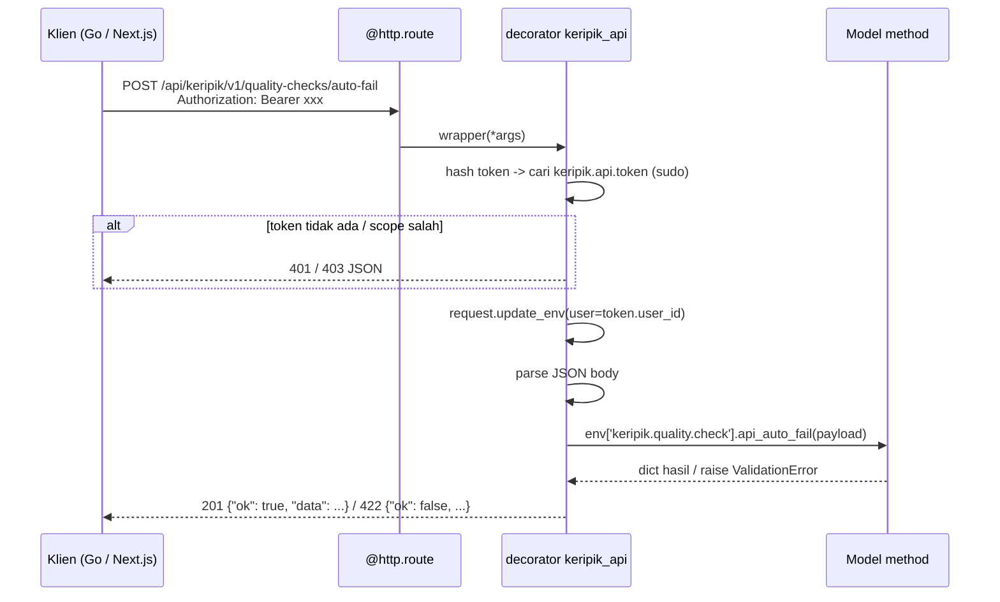

# F5. REST Controller, Biaya per Batch, Scheduled Action, Mail Template

| | |
|---|---|
| **Requirement FSD** | FR-API-01…11, FR-CST-01…04, FR-EXP-01…04, FR-EML-01…03, NFR-SEC-03/07 |
| **Minggu** | 5 (2–8 Nov 2026) |
| **Hasil** | API token + endpoint D6, outbox event ke gateway, biaya batch, cron expiry, 3 email pelanggan |

---

## 1. Konsep

### 1.1 Controller Odoo vs Frappe

| Frappe | Odoo |
|---|---|
| `@frappe.whitelist(allow_guest=True)` | `@http.route("/path", type="http", auth="none", methods=["POST"], csrf=False)` |
| `frappe.form_dict` | `request.httprequest.get_data()` / `request.get_json_data()` ⚠️ |
| `frappe.session.user` | `request.env.user` (setelah `update_env`) |
| Token API key:secret bawaan | Dibuat sendiri (atau API key / `auth='bearer'` Odoo 19 ⚠️) |
| `frappe.response` | `request.make_json_response(data, status=...)` |
| Error → `frappe.throw` | Tangkap exception → JSON error + status |

`auth` mode:
- `user`: wajib session login (cookie).
- `public`: user publik bila tidak login.
- `none`: tanpa env user; **kamu** yang menentukan user (dari token).
- `bearer` ⚠️: API key di header (cek di 19).

### 1.2 Alur request API



### 1.3 Kenapa logika di model, bukan controller
- Bisa diuji dengan `TransactionCase` tanpa HTTP.
- Bisa dipanggil dari tempat lain (cron, shell, gateway lain).
- Controller hanya: auth, parsing, mapping error → HTTP.

### 1.4 Cron di Odoo vs Frappe scheduler

| Frappe | Odoo |
|---|---|
| `scheduler_events = {"daily": [...]}` di hooks | Record `ir.cron` (data XML) dengan `model_id`, `code`, `interval_number`, `interval_type` |
| RQ worker | Thread cron (`workers=0`) atau proses cron (`max_cron_threads`) |
| `frappe.db.commit()` manual | Commit otomatis di akhir job; `self.env.cr.commit()` di dalam loop hanya bila perlu batch |

> ⚠️ Sejak Odoo 17, `numbercall` & `doall` dihapus dari `ir.cron`. Odoo 18 juga punya `_commit_progress` / `ir.cron._notify_progress` untuk job panjang. Cek di 19.

### 1.5 Mail template

| Frappe | Odoo |
|---|---|
| Email Template (Jinja) + Notification DocType | `mail.template` (QWeb inline / `{{ }}` ⚠️ engine) + pemicu di kode (`message_post_with_source` / `send_mail`) atau *Automation Rules* (`base_automation`) |
| Email Queue | `mail.mail` + cron "Email Queue Manager" |

---

## 2. Langkah — REST API

### Langkah 1 — Model token (kerangka)

`models/api_token.py`
```python
import hashlib
import secrets

from odoo import api, fields, models


def hash_token(raw):
    return hashlib.sha256(raw.encode()).hexdigest()


class KeripikApiToken(models.Model):
    _name = "keripik.api.token"
    _description = "Keripik API Token"

    name = fields.Char(required=True)
    user_id = fields.Many2one("res.users", required=True, ondelete="restrict")
    scope = fields.Selection([("gateway", "Gateway"), ("monitor", "Monitor")], required=True)
    token_hash = fields.Char(readonly=True, groups="base.group_system", copy=False)
    token_prefix = fields.Char(readonly=True, copy=False)
    last_used_at = fields.Datetime(readonly=True)
    active = fields.Boolean(default=True)

    # TODO: unique token_hash constraint

    def action_generate(self):
        """Generate a new raw token, store only its hash, show it ONCE in a wizard/notification."""
        self.ensure_one()
        raw = "kpk_" + secrets.token_urlsafe(32)
        # TODO: write token_hash, token_prefix (first 8 chars)
        # TODO: return an action that displays `raw` once
        #   (simple: a transient model keripik.api.token.show with a readonly Char field)
        ...

    @api.model
    def _authenticate(self, raw, scope):
        """Return the token record or empty recordset. Called with sudo()."""
        # TODO:
        # 1. if not raw: return empty
        # 2. h = hash_token(raw); rec = search([('token_hash', '=', h), ('active', '=', True)], limit=1)
        # 3. scope check: monitor scope may only call monitor endpoints; gateway may call both
        # 4. update last_used_at at most once per minute (avoid a write on every request)
        ...
```

> Kenapa hash? Kalau DB bocor, token tidak bisa dipakai. SHA-256 cukup untuk token acak berentropi tinggi (berbeda dengan password, yang butuh bcrypt/argon2 karena entropinya rendah). Sebutkan perbedaan ini di interview.

ACL: hanya `base.group_system` yang punya akses CRUD.

### Langkah 2 — Helper & decorator (kerangka + petunjuk)

`controllers/auth.py`
```python
import functools
import json
import logging

from odoo.exceptions import AccessError, MissingError, UserError, ValidationError
from odoo.http import request

_logger = logging.getLogger(__name__)


class ApiError(Exception):
    def __init__(self, status, code, message):
        super().__init__(message)
        self.status, self.code, self.message = status, code, message


def json_ok(data, status=200, **extra):
    return request.make_json_response({"ok": True, "data": data, **extra}, status=status)


def json_error(status, code, message):
    return request.make_json_response(
        {"ok": False, "error": {"code": code, "message": message}}, status=status
    )


def read_json_body():
    # TODO: raw = request.httprequest.get_data(as_text=True) or "{}"
    #       try json.loads; on error raise ApiError(400, "INVALID_JSON", ...)
    #       ensure dict
    ...


def keripik_api(scope):
    """Decorator: token auth + JSON error mapping (FR-API-01)."""

    def decorator(func):
        @functools.wraps(func)
        def wrapper(self, *args, **kwargs):
            try:
                # TODO 1: read header "Authorization", expect "Bearer <token>"
                # TODO 2: token = request.env["keripik.api.token"].sudo()._authenticate(raw, scope)
                #         if not token -> raise ApiError(401, "UNAUTHORIZED", "Invalid token")
                #         scope mismatch -> 403 FORBIDDEN_SCOPE
                # TODO 3: request.update_env(user=token.user_id.id)   ⚠️ API name in 19
                return func(self, *args, **kwargs)
            except ApiError as e:
                return json_error(e.status, e.code, e.message)
            # TODO: map ValidationError/UserError -> 422, MissingError -> 404, AccessError -> 403
            except Exception:
                _logger.exception("Unhandled API error")
                # IMPORTANT: rollback is handled by Odoo when an exception propagates,
                # but here we swallow it -> explicitly rollback
                request.env.cr.rollback()
                return json_error(500, "INTERNAL_ERROR", "Unexpected error")

        return wrapper

    return decorator
```

> ⚠️ **Transaksi**: Odoo melakukan commit bila handler mengembalikan respons tanpa exception. Kalau kamu menangkap `ValidationError` lalu mengembalikan JSON 422, transaksi **tetap di-commit** (bisa jadi setengah tersimpan). Panggil `request.env.cr.rollback()` di setiap cabang error, atau bungkus logika dalam `with request.env.cr.savepoint():`.

### Langkah 3 — Controller (kerangka)

`controllers/__init__.py`
```python
from . import api
```

`controllers/api.py`
```python
from odoo import http

from .auth import ApiError, json_ok, keripik_api, read_json_body

BASE = "/api/keripik/v1"
ROUTE = dict(type="http", auth="none", csrf=False, save_session=False)
# ⚠️ verify 'save_session' param in 19; it avoids creating a session cookie per call


class KeripikApi(http.Controller):

    # ---------- gateway scope ----------
    @http.route(f"{BASE}/workorders/<int:wo_id>/sensor-summary", methods=["POST"], **ROUTE)
    @keripik_api(scope="gateway")
    def sensor_summary(self, wo_id, **kw):
        payload = read_json_body()
        # TODO: result = request.env["keripik.sensor.summary"].api_create_summary(wo_id, payload)
        # TODO: return json_ok(result["data"], status=200 if result["duplicate"] else 201,
        #                      duplicate=result["duplicate"])
        ...

    @http.route(f"{BASE}/quality-checks/auto-fail", methods=["POST"], **ROUTE)
    @keripik_api(scope="gateway")
    def qc_auto_fail(self, **kw):
        # TODO: call keripik.quality.check.api_auto_fail(payload)
        ...

    @http.route(f"{BASE}/telegram/link", methods=["POST"], **ROUTE)
    @keripik_api(scope="gateway")
    def telegram_link(self, **kw):
        # TODO (F6 model method): hr.employee.api_link_telegram(code, chat_id, username)
        #   -> raise ApiError(404, "CODE_INVALID") / ApiError(410, "CODE_EXPIRED")
        ...

    @http.route(f"{BASE}/recipients", methods=["GET"], **ROUTE)
    @keripik_api(scope="gateway")
    def recipients(self, event="anomaly", **kw):
        ...

    @http.route(f"{BASE}/workcenters", methods=["GET"], **ROUTE)
    @keripik_api(scope="gateway")
    def workcenters(self, **kw):
        ...

    # ---------- monitor scope (gateway allowed too) ----------
    @http.route(f"{BASE}/production/today", methods=["GET"], **ROUTE)
    @keripik_api(scope="monitor")
    def production_today(self, **kw):
        # TODO: request.env["mrp.production"].api_production_today()
        ...

    @http.route(f"{BASE}/productions", methods=["GET"], **ROUTE)
    @keripik_api(scope="monitor")
    def productions(self, state="progress,confirmed", limit=50, **kw):
        # TODO: validate limit <= 200; split state
        ...

    @http.route(f"{BASE}/yield", methods=["GET"], **ROUTE)
    @keripik_api(scope="monitor")
    def yield_summary(self, date_from=None, date_to=None, **kw):
        # TODO: read_group on keripik.yield.report (⚠️ _read_group signature in 17+)
        ...

    @http.route(f"{BASE}/quality-checks", methods=["GET"], **ROUTE)
    @keripik_api(scope="monitor")
    def quality_checks(self, result=None, date_from=None, limit=50, **kw):
        ...
```

Tambahkan `from . import controllers` ke `mrp_keripik/__init__.py`.

### Langkah 4 — Method model untuk API (petunjuk)

| Method | Model | Isi |
|---|---|---|
| `api_auto_fail(payload)` | `keripik.quality.check` | Validasi field wajib; `external_ref` sudah ada → kembalikan existing + `duplicate`; cari WO; cari QC `todo` dengan `measure_type`; kalau ada → isi `fail`, kalau tidak → create; `source='gateway'`; `note=payload['message']`; return dict |
| `api_create_summary(wo_id, payload)` | `keripik.sensor.summary` | Idempoten by `external_ref`; create; isi QC `oil_temp` (pakai `temp_avg`) / `pack_weight` (pakai `weight_avg`) yang `todo` dan `source_allowed in (gateway, both)` |
| `api_production_today()` | `mrp.production` | Hitung `mo_done`, `mo_in_progress`, `mo_late`, `qty_done_units`, `yield_pct_avg`, `qc_fail_today` berdasarkan tanggal **zona Asia/Jakarta** (konversi ke UTC untuk domain) |
| `api_list_productions(states, limit)` | `mrp.production` | `search_read` + bentuk dict sesuai D6 |

Model `keripik.sensor.summary` (D4): buat `models/sensor_summary.py` sesuai tabel field. **Tulis sendiri**, polanya sama dengan quality check.

### Langkah 5 — Outbox ke gateway (kerangka)

`models/gateway_event.py`
```python
import json
import logging
import uuid
from datetime import timedelta

import requests

from odoo import api, fields, models

_logger = logging.getLogger(__name__)
MAX_ATTEMPTS = 10


class KeripikGatewayEvent(models.Model):
    _name = "keripik.gateway.event"
    _description = "Outbound event to Machine Data Gateway"
    _order = "id"

    ref = fields.Char(required=True, default=lambda self: str(uuid.uuid4()), copy=False, index=True)
    event_type = fields.Selection(
        [("started", "Started"), ("paused", "Paused"), ("finished", "Finished")], required=True
    )
    workorder_id = fields.Many2one("mrp.workorder", required=True, ondelete="cascade")
    payload = fields.Text()
    state = fields.Selection(
        [("pending", "Pending"), ("sent", "Sent"), ("failed", "Failed")],
        default="pending", required=True, index=True,
    )
    attempts = fields.Integer()
    next_attempt_at = fields.Datetime(default=fields.Datetime.now)
    last_error = fields.Char()

    @api.model
    def enqueue(self, workorder, event_type):
        """Create the event inside the current transaction and try to send after commit."""
        # TODO:
        # 1. skip if gateway disabled (ir.config_parameter mrp_keripik.gateway_url empty)
        #    or workorder.workcenter_id.machine_code empty
        # 2. payload = json.dumps({ref, event, workorder_id, production_id, machine_code, at})
        # 3. event = self.sudo().create(...)
        # 4. self.env.cr.postcommit.add(lambda: self._send_after_commit(event.id))
        ...

    def _send_after_commit(self, event_id):
        # postcommit runs AFTER the transaction is closed -> open a new cursor
        # TODO:
        # with self.env.registry.cursor() as cr:
        #     env = api.Environment(cr, SUPERUSER_ID, {})
        #     env["keripik.gateway.event"].browse(event_id)._send()
        ...

    def _send(self):
        # TODO: for each event: POST {gateway_url}/api/v1/events/workorder with
        #   headers Authorization: Bearer <mrp_keripik.gateway_inbound_token>, timeout=3
        #   success -> state sent; error -> attempts += 1, backoff next_attempt_at
        #   (1, 2, 4, 8 ... minutes, max 60), failed when attempts >= MAX_ATTEMPTS
        ...

    @api.model
    def _cron_send_pending(self):
        # TODO: search pending with next_attempt_at <= now, limit 100, order id -> _send()
        ...
```

Panggil `enqueue` dari `keripik_operator_action` (start/pause/finish) di F4.

> **Kenapa `postcommit` + cron?** HTTP keluar di tengah transaksi berisiko: jika transaksi gagal, Go sudah terlanjur menerima event yang tidak pernah terjadi. Kalau Go mati, cron mengirim ulang. Ini **transactional outbox** sisi Odoo.

### Langkah 6 — Parameter sistem (lengkap)

`data/ir_config_parameter_data.xml`
```xml
<?xml version="1.0" encoding="utf-8"?>
<odoo noupdate="1">
    <record id="param_gateway_url" model="ir.config_parameter">
        <field name="key">mrp_keripik.gateway_url</field>
        <field name="value"></field>
    </record>
    <record id="param_gateway_inbound_token" model="ir.config_parameter">
        <field name="key">mrp_keripik.gateway_inbound_token</field>
        <field name="value"></field>
    </record>
    <record id="param_expiry_warning_days" model="ir.config_parameter">
        <field name="key">mrp_keripik.expiry_warning_days</field>
        <field name="value">2</field>
    </record>
    <record id="param_expiry_responsible_login" model="ir.config_parameter">
        <field name="key">mrp_keripik.expiry_responsible_login</field>
        <field name="value">gudang</field>
    </record>
    <record id="param_yield_variance_threshold" model="ir.config_parameter">
        <field name="key">mrp_keripik.yield_variance_threshold</field>
        <field name="value">5</field>
    </record>
</odoo>
```

> ⚠️ Record `ir.config_parameter` dengan value kosong kadang ditolak (`value` required). Jika error, isi `-` lalu anggap `-` sebagai kosong, atau buat parameter lewat `res.config.settings` (`config_parameter=` pada field settings).

### Langkah 7 — User teknis & token (manual)
1. *Settings → Users*: buat `gateway_bot` (grup: Keripik/Quality User + Manufacturing User) dan `monitor_bot` (Keripik/Owner).
2. *Settings → Technical → Keripik → API Tokens*: buat token *Go Gateway* (scope gateway, user gateway_bot) dan *Next.js Monitor* (scope monitor, user monitor_bot) → **Generate** → salin ke `.env` (`ODOO_GATEWAY_TOKEN`, `ODOO_MONITOR_TOKEN`).

### Langkah 8 — Uji dengan curl

```bash
TOKEN=kpk_xxx   # monitor token
curl -s http://localhost:8069/api/keripik/v1/production/today -H "Authorization: Bearer $TOKEN" | jq

# missing token -> 401
curl -s -i http://localhost:8069/api/keripik/v1/productions | head -1

# gateway token: auto-fail
GW=kpk_yyy
curl -s -X POST http://localhost:8069/api/keripik/v1/quality-checks/auto-fail \
  -H "Authorization: Bearer $GW" -H "Content-Type: application/json" \
  -d '{"external_ref":"test-1","workorder_id":31,"measure_type":"oil_temp","value":186.2,"message":"test"}' | jq
```

> Jika ada beberapa database dan `dbfilter` tidak di-set, route `auth='none'` tidak tahu DB mana → 404. Set `dbfilter = ^keripik$` di `odoo.conf` (atau hanya satu DB).

Simpan koleksi request di `docs/api/keripik.bru` (Bruno) atau Postman collection.

---

## 3. Langkah — Biaya per Batch

### Langkah 9 — Field & compute (kerangka)

Di `models/mrp_production.py`:
```python
    currency_id = fields.Many2one(related="company_id.currency_id")
    cost_material = fields.Monetary(compute="_compute_batch_cost", store=True)
    cost_workcenter = fields.Monetary(compute="_compute_batch_cost", store=True)
    cost_total = fields.Monetary(compute="_compute_batch_cost", store=True)
    cost_per_unit = fields.Monetary(compute="_compute_batch_cost", store=True)
    cost_is_estimate = fields.Boolean(compute="_compute_batch_cost", store=True)

    @api.depends(
        "state",
        "move_raw_ids.state", "move_raw_ids.quantity",
        "workorder_ids.time_ids.duration",
        "qty_produced",
    )
    def _compute_batch_cost(self):
        for mo in self:
            # TODO material:
            #   done -> sum(move.quantity * unit price) for move_raw_ids done
            #           unit price: prefer valuation of the move (stock_account)
            #           ⚠️ in 17/18 stock.valuation.layer (value/quantity); verify 19
            #           fallback: move.product_id.standard_price
            #   not done -> planned estimate (product_uom_qty * standard_price)
            # TODO workcenter:
            #   sum(t.duration / 60.0 * t.workcenter_id.costs_hour for t in mo.workorder_ids.time_ids)
            #   not done -> duration_expected based estimate
            # TODO total, per unit (qty_produced or product_qty), cost_is_estimate
            ...
```

Petunjuk:
- **BR-CST-01 (snapshot):** karena `store=True` dan depends tidak mencakup `standard_price`, nilai tidak berubah saat harga berubah. Itu tepat sesuai aturan. Namun `-u` module bisa memicu recompute; pastikan memakai nilai valuasi move (historis), bukan harga produk saat ini, agar recompute pun konsisten.
- Konversi UoM: `move.product_uom._compute_quantity(move.quantity, move.product_id.uom_id)`.
- Tambahkan tab "Cost" di form MO (view inherit) dan bagian Cost di QWeb F3.

### Langkah 10 — Test biaya (kerangka)
`tests/test_batch_cost.py`: reproduksi AC-CST-01…03 (angka di FSD). Buat time log manual:
```python
self.env["mrp.workcenter.productivity"].create({
    "workorder_id": wo.id,
    "workcenter_id": wo.workcenter_id.id,
    "loss_id": self.env.ref("mrp.block_reason7").id,  # ⚠️ productive loss xml id
    "date_start": ..., "date_end": ...,  # 70 minutes
})
```

---

## 4. Langkah — Scheduled Action Kedaluwarsa

### Langkah 11 — Data cron (lengkap)

`data/ir_cron_data.xml`
```xml
<?xml version="1.0" encoding="utf-8"?>
<odoo noupdate="1">
    <record id="ir_cron_keripik_expiry_alert" model="ir.cron">
        <field name="name">Keripik: lots close to expiry</field>
        <field name="model_id" ref="stock.model_stock_lot"/>
        <field name="state">code</field>
        <field name="code">model._cron_keripik_expiry_alert()</field>
        <field name="interval_number">1</field>
        <field name="interval_type">days</field>
        <field name="nextcall" eval="(DateTime.now().replace(hour=23, minute=0, second=0)).strftime('%Y-%m-%d %H:%M:%S')"/>
        <!-- 23:00 UTC = 06:00 Asia/Jakarta -->
        <field name="active" eval="True"/>
    </record>

    <record id="ir_cron_keripik_gateway_events" model="ir.cron">
        <field name="name">Keripik: send pending gateway events</field>
        <field name="model_id" ref="model_keripik_gateway_event"/>
        <field name="state">code</field>
        <field name="code">model._cron_send_pending()</field>
        <field name="interval_number">1</field>
        <field name="interval_type">minutes</field>
        <field name="active" eval="True"/>
    </record>
</odoo>
```

### Langkah 12 — Method cron (kerangka)

`models/stock_lot.py`
```python
from datetime import timedelta

from odoo import api, fields, models


class StockLot(models.Model):
    _inherit = "stock.lot"

    keripik_expiry_notified_date = fields.Date(copy=False)

    @api.model
    def _cron_keripik_expiry_alert(self):
        """FR-EXP-01..04"""
        # TODO:
        # days = int(ICP.get_param('mrp_keripik.expiry_warning_days', 2))
        # limit_dt = now + timedelta(days=days)
        # today = fields.Date.context_today(self)   # respects user tz of the cron user
        # quants = env['stock.quant'].search([('location_id.usage', '=', 'internal'),
        #                                     ('quantity', '>', 0), ('lot_id', '!=', False)])
        # lots = quants.lot_id.filtered(lambda l: ((l.alert_date and l.alert_date <= now)
        #            or (l.expiration_date and l.expiration_date <= limit_dt))
        #            and l.keripik_expiry_notified_date != today)
        # for lot in lots: lot.activity_schedule('mail.mail_activity_data_warning', user_id=..., note=...)
        # message = self._keripik_expiry_message(lots, quants)   # grouped, max 30 lines
        # env['keripik.telegram'].notify('expiry', message)       # F6 (guard if not installed yet)
        # lots.write({'keripik_expiry_notified_date': today})
        ...
```

Petunjuk: gunakan `read_group`/dict untuk menjumlah qty per lot dari quants. Uji dengan *Settings → Technical → Scheduled Actions → Run Manually*.

---

## 5. Langkah — Mail Template Pelanggan

### Langkah 13 — Template (contoh lengkap satu, lainnya pola sama)

`data/mail_template_data.xml`
```xml
<?xml version="1.0" encoding="utf-8"?>
<odoo>
    <data noupdate="1">
        <record id="mail_template_production_done" model="mail.template">
            <field name="name">Keripik: Production finished</field>
            <field name="model_id" ref="sale.model_sale_order"/>
            <field name="subject">Pesanan {{ object.name }} selesai diproduksi</field>
            <field name="email_from">{{ (object.company_id.email_formatted or user.email_formatted) }}</field>
            <field name="partner_to">{{ object.partner_id.id }}</field>
            <field name="lang">{{ object.partner_id.lang }}</field>
            <field name="auto_delete" eval="True"/>
            <field name="body_html" type="html">
<div style="font-family: Arial, sans-serif; font-size: 14px; color: #222;">
    <p>Halo <t t-out="object.partner_id.name or ''">Pelanggan</t>,</p>
    <p>Pesanan <strong t-out="object.name or ''">S00001</strong> sudah <strong>selesai diproduksi</strong>
       dan sedang disiapkan untuk pengiriman.</p>
    <table style="border-collapse: collapse; width: 100%; margin: 12px 0;">
        <tr style="background: #f4f5f7;">
            <th style="text-align: left; padding: 6px;">Produk</th>
            <th style="text-align: right; padding: 6px;">Qty</th>
        </tr>
        <t t-foreach="object.order_line.filtered(lambda l: not l.display_type)" t-as="line">
            <tr>
                <td style="padding: 6px;" t-out="line.product_id.display_name or ''">Keripik</td>
                <td style="padding: 6px; text-align: right;" t-out="line.product_uom_qty or 0">30</td>
            </tr>
        </t>
    </table>
    <p>
        <a t-att-href="object.get_portal_url()"
           style="background: #1f3b57; color: #fff; padding: 10px 16px; border-radius: 6px; text-decoration: none;">
            Lihat pesanan
        </a>
    </p>
    <p>Terima kasih,<br/><t t-out="object.company_id.name or ''">CV Keripik</t></p>
</div>
            </field>
        </record>

        <!-- TODO: mail_template_delivery_ready on stock.model_stock_picking
             subject: "Pesanan {{ object.origin }} siap dikirim"
             body: picking name, scheduled date, products (move_ids) -->
    </data>
</odoo>
```

> ⚠️ Engine template: Odoo 15+ memakai `{{ }}` (inline_template) untuk field pendek dan QWeb (`t-out`) untuk `body_html`. Lihat `addons/sale/data/mail_template_data.xml` di 19 sebagai referensi.
> FR-EML-01 (pesanan dikonfirmasi): template standar `sale.mail_template_sale_confirmation` ⚠️ sudah dikirim saat konfirmasi eCommerce. Cukup **sesuaikan** isinya lewat UI (*Settings → Technical → Email Templates*) atau inherit record. Untuk SO dari backend, cek apakah konfirmasi mengirim email otomatis; jika tidak, panggil template di override `action_confirm` sale.order dengan flag sekali kirim.

### Langkah 14 — Pemicu (kerangka)

Di `mrp_production.py`, setelah `super().button_mark_done()`:
```python
    def button_mark_done(self):
        self._keripik_check_quality()
        res = super().button_mark_done()
        self.filtered(lambda p: p.state == "done")._keripik_after_done()
        return res

    def _keripik_after_done(self):
        # TODO:
        # 1. find related sale orders. ⚠️ In 17/18 sale_mrp exposes mo.sale_order_count and
        #    procurement_group_id.sale_id; Odoo 19 may have refactored procurement groups.
        #    Read sale_mrp/models/mrp_production.py (19.0) to find the link.
        # 2. only top-level MOs: the MO whose product is in the SO lines (BR-EML-04)
        # 3. for each SO not yet keripik_mail_done_sent and whose top-level MOs are ALL done:
        #       so.message_post_with_source(template, subtype_xmlid='mail.mt_comment') ⚠️
        #       or template.send_mail(so.id)
        #       so.keripik_mail_done_sent = True
        # 4. F6: Telegram 'mo_done'
        ...
```

`models/stock_picking.py`
```python
from odoo import fields, models


class StockPicking(models.Model):
    _inherit = "stock.picking"

    keripik_mail_ready_sent = fields.Boolean(copy=False)

    # TODO: detect transition to state 'assigned' for outgoing pickings with sale_id.
    # 'state' is a stored compute on picking -> overriding write() won't catch it reliably.
    # Options:
    #  (a) override _compute_state? (fragile)
    #  (b) Automation rule (base_automation, Community) "on update, state = assigned" -> server action
    #      calling a method -> declarative, explain in interview
    #  (c) cron every 5 min: outgoing pickings assigned & not sent
    # Recommendation: (c) simple & robust, or (b) to show base_automation knowledge.
```

---

## 6. Testing

| Area | Test otomatis | Manual |
|---|---|---|
| API | `tests/test_api.py` dengan `HttpCase`: `self.url_open(url, data=json.dumps(...), headers=...)` → cek status & body (AC-API-01…06, 08) | curl / Bruno |
| Outbox | Test `enqueue` membuat event `pending`; mock `requests.post` (`unittest.mock.patch`) untuk sent/failed + backoff | Matikan gateway, cek list Gateway Events |
| Biaya | `test_batch_cost.py` (AC-CST-01…04) | Tab Cost di MO |
| Cron | `test_expiry_cron.py`: lot expiry besok + quant → activity dibuat; jalankan 2× → tidak dobel (AC-EXP-01…03) | Run Manually |
| Email | Setelah aksi, cek `self.env['mail.mail'].search([...])` atau `mail.message` (AC-EML-02/04) | Mailpit |

Contoh mock:
```python
from unittest.mock import patch

with patch("odoo.addons.mrp_keripik.models.gateway_event.requests.post") as post:
    post.return_value.status_code = 202
    event._send()
    self.assertEqual(event.state, "sent")
```

> `HttpCase` menjalankan server sungguhan. Di test, transaksi test dan request HTTP berbagi cursor khusus. ⚠️ Cek dokumentasi testing 19 untuk `url_open` dengan JSON & header.

---

## 7. Error yang Sering Terjadi

| Gejala | Penyebab | Solusi |
|---|---|---|
| 404 untuk route API | Multi-DB tanpa `dbfilter`; module belum di-update; typo route | `dbfilter`, `-u`, restart |
| `Session expired` / redirect login | `auth='user'` dipakai | `auth='none'` + token |
| 400 CSRF | `csrf=False` lupa untuk POST | Tambahkan |
| Data setengah tersimpan setelah 422 | Exception ditangkap tanpa rollback | `cr.rollback()` / savepoint |
| `request.env.user` = public | `update_env` belum dipanggil | Panggil setelah auth |
| Cron tidak jalan | `workers=0` + `max_cron_threads=0`, atau `nextcall` di masa depan jauh | Cek `odoo.conf`; Run Manually |
| Email tidak terkirim | `mail.mail` antre | Cron Email Queue / Send Now |
| `QWebException` di template | Field tidak ada / `None` | Pakai `or ''`, preview template |
| Biaya berubah setelah `-u` | Recompute pakai harga saat ini | Ambil harga dari valuasi move |

---

## 8. Pertanyaan Interview

1. **Bagaimana kamu mengamankan REST API Odoo?** Token acak 256-bit, hanya hash yang disimpan, perbandingan via lookup hash, scope per token, user teknis dengan grup minimal, tidak ada stack trace di respons, rollback saat error, token bisa dicabut.
2. **Kenapa tidak pakai XML-RPC/JSON-RPC standar?** Bisa, tapi membuka seluruh ORM ke klien (butuh user + password/API key dan hak luas). Endpoint spesifik membatasi kontrak dan validasi. Odoo 19 juga mengumumkan External JSON-2 API dan rencana deprecation XML-RPC ⚠️ (cek). Saya bisa menjelaskan kapan memakai masing-masing.
3. **Apa itu idempotensi dan kenapa penting?** Request yang sama dikirim ulang (retry) tidak membuat data ganda. Diterapkan lewat `external_ref` unik.
4. **Kenapa outbox + `postcommit`?** Menghindari efek samping untuk transaksi yang gagal, dan menjamin event terkirim walau penerima sedang down.
5. **Bagaimana menghitung biaya batch tanpa Accounting Enterprise?** Bahan = qty aktual × nilai valuasi; work center = durasi time log aktual × tarif per jam; disimpan sebagai snapshot.
6. **Kenapa cron expiry custom padahal `product_expiry` punya alert?** Menambah ringkasan Telegram, ambang N hari, dan sekali per hari per lot; tetap memakai field standar (`alert_date`).
7. **Bagaimana memicu email saat picking Ready?** `state` adalah compute tersimpan, jadi override `write` tidak andal. Saya pilih cron/automation rule dan menjelaskan trade-off-nya.
