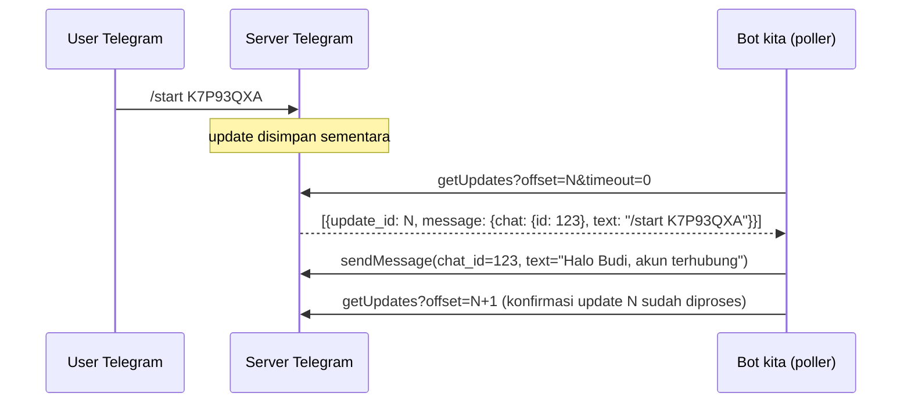
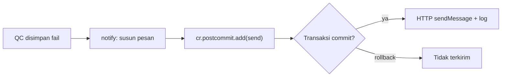

# F6. Notifikasi Telegram dari Odoo + Penautan Akun Karyawan

| | |
|---|---|
| **Requirement FSD** | FR-TG-01…06, FR-QC-08, NFR-TG-01…06 |
| **Minggu** | 6 (9–13 Nov 2026) |
| **Hasil** | Bot aktif, karyawan menautkan akun via `/start KODE`, notifikasi QC gagal / MO selesai / MO tertunda / expiry |

---

## 1. Konsep

### 1.1 Cara kerja Telegram Bot API



Fakta penting (⚠️ verifikasi di <https://core.telegram.org/bots/api>):
- Semua method: `https://api.telegram.org/bot<TOKEN>/<method>` (GET/POST, JSON).
- `getUpdates(offset, timeout, allowed_updates)`: **offset = update_id terakhir + 1** menandai update sebelumnya sudah diproses.
- Webhook dan `getUpdates` tidak bisa aktif bersamaan; panggil `deleteWebhook` bila pernah set webhook.
- `sendMessage(chat_id, text, parse_mode="HTML")`: escape `<`, `>`, `&` di teks dinamis.
- Error: `{"ok": false, "error_code": 403, "description": "Forbidden: bot was blocked by the user"}`; 429 menyertakan `parameters.retry_after`.
- Deep link: `https://t.me/<bot_username>?start=<payload>` → klien mengirim `/start <payload>`.

### 1.2 Kenapa poller di cron (F6), lalu pindah ke Go (F9)

| Opsi | Kelebihan | Kekurangan |
|---|---|---|
| **Cron Odoo `getUpdates` timeout 0 tiap 1 menit** (F6) | Tanpa layanan tambahan; tidak butuh URL publik | Latensi penautan hingga 1 menit; memakai slot cron |
| Webhook ke Odoo (`/telegram/webhook`) | Instan | Butuh URL HTTPS publik stabil (ngrok gratis berubah saat restart kecuali dev domain) |
| **Long polling di Go** (F9) | Instan, goroutine murah, tidak membebani Odoo | Layanan tambahan |

Hanya satu yang aktif: parameter `mrp_keripik.telegram_poller` = `odoo` | `gateway` | `off`.

### 1.3 Kirim setelah commit



Padanan Frappe: `frappe.enqueue(..., enqueue_after_commit=True)`.

---

## 2. Langkah

### Langkah 1 — Buat bot
1. Telegram → **@BotFather** → `/newbot` → nama "Keripik Factory Bot" → username `keripik_factory_dev_bot` (harus diakhiri `bot`).
2. Simpan token ke `.env` (`TELEGRAM_BOT_TOKEN`) dan ke Odoo: *Settings → Technical → System Parameters*:
   - `mrp_keripik.telegram_bot_token` = token
   - `mrp_keripik.telegram_bot_username` = `keripik_factory_dev_bot`
   - `mrp_keripik.telegram_poller` = `odoo`
3. Opsional: `/setcommands` di BotFather:
   ```
   start - Hubungkan akun karyawan
   produksi - Ringkasan produksi hari ini
   help - Bantuan
   ```
4. Uji token:
   ```bash
   curl -s "https://api.telegram.org/bot$TELEGRAM_BOT_TOKEN/getMe" | jq
   ```

> 🔐 Jangan commit token. Jika bocor, `/revoke` di BotFather.

### Langkah 2 — Field karyawan (kerangka)

`models/hr_employee.py`
```python
import secrets
from datetime import timedelta

from odoo import api, fields, models
from odoo.exceptions import UserError

CODE_ALPHABET = "ABCDEFGHJKLMNPQRSTUVWXYZ23456789"  # no 0/O/1/I
CODE_LENGTH = 8
CODE_TTL_MINUTES = 15


class HrEmployee(models.Model):
    _inherit = "hr.employee"

    telegram_chat_id = fields.Char(groups="hr.group_hr_user", copy=False)
    telegram_username = fields.Char(groups="hr.group_hr_user", copy=False)
    telegram_link_code = fields.Char(groups="base.group_system", copy=False, index=True)
    telegram_link_expires_at = fields.Datetime(groups="base.group_system", copy=False)
    telegram_linked_at = fields.Datetime(copy=False, readonly=True)
    telegram_status = fields.Selection(
        [("not_linked", "Not linked"), ("pending", "Pending"), ("linked", "Linked")],
        compute="_compute_telegram_status",
    )
    notify_qc_fail = fields.Boolean(default=True)
    notify_mo = fields.Boolean(default=True)
    notify_expiry = fields.Boolean(default=False)

    # TODO: unique telegram_chat_id (BR-TG-03)

    def _compute_telegram_status(self):
        # TODO: use sudo() to read restricted fields (compute runs as current user)
        ...

    def action_telegram_generate_code(self):
        """FR-TG-02. Employees may only do this for themselves unless HR/Manager."""
        self.ensure_one()
        # TODO: permission check: self.user_id == env.user or user has group hr / keripik manager
        # TODO: generate unique code with secrets.choice(CODE_ALPHABET) * CODE_LENGTH
        # TODO: sudo().write code + expires_at = now + 15 min
        # TODO: return an action/notification showing code + deep link
        #       f"https://t.me/{bot_username}?start={code}"
        ...

    def action_telegram_unlink(self):
        # TODO: clear chat_id, username, linked_at
        ...

    @api.model
    def api_link_telegram(self, code, chat_id, username=None):
        """Used by cron poller (F6) and REST /telegram/link (F9).

        Returns employee name, raises UserError subclasses mapped to 404/410 by the controller.
        """
        # TODO:
        # 1. normalise code (upper, strip)
        # 2. employee = sudo().search([('telegram_link_code', '=', code)], limit=1) -> not found: raise
        # 3. expired -> clear code, raise
        # 4. if another employee already has this chat_id -> unlink it there (or raise)
        # 5. write chat_id, username, linked_at, clear code/expiry
        # 6. message_post on employee "Telegram linked"
        ...
```

> **Field `groups=`**: field hanya bisa dibaca/ditulis user dalam grup itu. Saat karyawan biasa membuka profilnya, field disembunyikan. Karena itu method di atas memakai `sudo()` **setelah** cek hak manual.
> ⚠️ Odoo memisahkan `hr.employee` (data HR, terbatas) dan `hr.employee.public` (bisa dilihat semua). User non-HR yang membuka "My Profile" mungkin melihat model public. Cek apakah tombol perlu ditaruh di *Preferences* user (`res.users` → `employee_id`) di 19.

### Langkah 3 — View tab Telegram (kerangka)
Inherit `hr.view_employee_form` → tambah page "Telegram":
- `telegram_status` (widget badge), tombol `action_telegram_generate_code` (invisible jika linked), `action_telegram_unlink` (invisible jika tidak linked).
- Checkbox preferensi.
- Petunjuk teks: "Buka link di HP, tekan **Start**."

### Langkah 4 — Service Telegram (kerangka)

`models/telegram_service.py`
```python
import html
import logging

import requests

from odoo import SUPERUSER_ID, api, models

_logger = logging.getLogger(__name__)
API = "https://api.telegram.org/bot{token}/{method}"
TIMEOUT = 5


class KeripikTelegram(models.AbstractModel):
    _name = "keripik.telegram"
    _description = "Telegram service"

    # ---------- low level ----------
    @api.model
    def _token(self):
        return self.env["ir.config_parameter"].sudo().get_param("mrp_keripik.telegram_bot_token")

    @api.model
    def _call(self, method, payload):
        """Synchronous Bot API call. Returns (ok: bool, result_or_error: dict)."""
        # TODO: requests.post(API.format(...), json=payload, timeout=TIMEOUT)
        #       parse JSON; handle requests.RequestException -> (False, {"description": str(e)})
        ...

    @api.model
    def escape(self, text):
        return html.escape(text or "", quote=False)

    # ---------- recipients ----------
    @api.model
    def _recipients(self, event_type):
        """Employees with chat_id + preference + group for this event (FR-TG-03)."""
        # TODO: map event_type -> preference field & groups
        #   qc_fail -> notify_qc_fail, groups manager/quality
        #   mo_done / mo_late -> notify_mo, group manager
        #   expiry -> notify_expiry, groups manager/inventory user
        # HINT: employees = env['hr.employee'].sudo().search([('telegram_chat_id', '!=', False), (pref, '=', True)])
        #       then filter by employee.user_id.has_group(...)
        ...

    # ---------- public API ----------
    @api.model
    def notify(self, event_type, text, res=None):
        """Queue a message to all recipients AFTER commit (BR-TG-04)."""
        recipients = self._recipients(event_type)
        if not recipients or not self._token():
            # TODO: log 'skipped'
            return
        payload = [(emp.id, emp.telegram_chat_id) for emp in recipients]
        res_model, res_id = (res._name, res.id) if res else (False, False)
        dbname = self.env.cr.dbname

        def _send():
            # TODO:
            # with self.env.registry.cursor() as cr:   # new cursor: original is closed
            #     env = api.Environment(cr, SUPERUSER_ID, {})
            #     svc = env['keripik.telegram']
            #     for emp_id, chat_id in payload:
            #         ok, data = svc._call('sendMessage', {'chat_id': chat_id, 'text': text, 'parse_mode': 'HTML'})
            #         svc._log(emp_id, chat_id, event_type, text, ok, data, res_model, res_id)
            #         if not ok and data.get('error_code') == 403: unlink employee chat_id
            #         if not ok and data.get('error_code') == 429: sleep(retry_after) once? or mark failed
            ...

        self.env.cr.postcommit.add(_send)

    @api.model
    def _log(self, emp_id, chat_id, event_type, text, ok, data, res_model, res_id):
        # TODO: create keripik.telegram.log
        ...

    # ---------- poller (F6 only) ----------
    @api.model
    def _cron_poll_updates(self):
        """FR-TG-04: process /start commands when telegram_poller == 'odoo'."""
        ICP = self.env["ir.config_parameter"].sudo()
        if ICP.get_param("mrp_keripik.telegram_poller") != "odoo":
            return
        # TODO:
        # offset = int(ICP.get_param('mrp_keripik.telegram_offset', 0))
        # ok, data = self._call('getUpdates', {'offset': offset, 'timeout': 0,
        #                                      'allowed_updates': ['message']})
        # for update in data.get('result', []):
        #     offset = update['update_id'] + 1
        #     msg = update.get('message') or {}
        #     text = (msg.get('text') or '').strip()
        #     chat_id = str(msg.get('chat', {}).get('id'))
        #     if text.startswith('/start'):
        #         code = text[len('/start'):].strip()
        #         try: name = env['hr.employee'].api_link_telegram(code, chat_id, username)
        #              reply = f"Halo {escape(name)}, akun Telegram Anda terhubung ✅"
        #         except UserError as e: reply = str(e)
        #     elif text == '/help': ...
        #     else: reply = "Perintah tidak dikenal. Ketik /help"
        #     self._call('sendMessage', {...})   # direct, fine inside cron
        # ICP.set_param('mrp_keripik.telegram_offset', offset)
        ...
```

Cron XML (tambahkan ke `ir_cron_data.xml`):
```xml
<record id="ir_cron_keripik_telegram_poll" model="ir.cron">
    <field name="name">Keripik: Telegram poll updates</field>
    <field name="model_id" ref="model_keripik_telegram"/>
    <field name="state">code</field>
    <field name="code">model._cron_poll_updates()</field>
    <field name="interval_number">1</field>
    <field name="interval_type">minutes</field>
</record>
<record id="ir_cron_keripik_mo_late" model="ir.cron">
    <field name="name">Keripik: late manufacturing orders</field>
    <field name="model_id" ref="mrp.model_mrp_production"/>
    <field name="state">code</field>
    <field name="code">model._cron_keripik_late_alert()</field>
    <field name="interval_number">1</field>
    <field name="interval_type">hours</field>
</record>
```

> Model AbstractModel tidak punya tabel, tapi tetap punya `ir.model` sehingga `ref="model_keripik_telegram"` valid.

### Langkah 5 — Pemicu notifikasi (petunjuk)

| Event | Lokasi kode | Catatan |
|---|---|---|
| QC gagal manual | `keripik.quality.check.write` / `action_record_measure` / `action_fail`: jika result berubah ke `fail` dan `source == 'manual'` | Bandingkan nilai lama vs baru (baca sebelum `super().write`) |
| MO selesai | `mrp.production._keripik_after_done()` (F5) | Isi: qty, yield, biaya/unit |
| MO tertunda | `_cron_keripik_late_alert`: `date_deadline < now`, `state not in (done, cancel)`, field baru `keripik_late_notified_date != today` | Satu pesan per MO per hari |
| Expiry | `stock.lot._cron_keripik_expiry_alert` (F5) | Ganti TODO dengan `notify('expiry', ...)` |

Contoh format pesan (HTML parse mode):
```python
text = (
    f"❌ <b>QC GAGAL</b> — {esc(mo.name)}\n"
    f"Operasi: {esc(check.workorder_id.name)} ({esc(check.workorder_id.workcenter_id.name)})\n"
    f"{esc(check.point_id.name)}: {check.measure_value:.1f} {esc(check.unit)} "
    f"(batas {check.norm_min:g}–{check.norm_max:g})\n"
    f"Diperiksa: {esc(check.checked_by_id.name)}"
)
```

### Langkah 6 — Log model & ACL
`models/telegram_log.py` sesuai FSD 3(m). ACL: manager & owner read-only. Menu *Keripik → Configuration → Telegram Log*.

---

## 3. Testing

### Otomatis (mock HTTP)
```python
from unittest.mock import patch

from odoo.tests import TransactionCase, tagged


@tagged("post_install", "-at_install")
class TestTelegram(TransactionCase):

    def test_link_code_flow(self):
        emp = self.env["hr.employee"].create({"name": "Budi"})
        emp.sudo().action_telegram_generate_code()
        code = emp.sudo().telegram_link_code
        name = self.env["hr.employee"].api_link_telegram(code, "12345", "budi")
        self.assertEqual(name, "Budi")
        self.assertEqual(emp.sudo().telegram_chat_id, "12345")
        self.assertFalse(emp.sudo().telegram_link_code)

    # TODO test_expired_code (AC-TG-03): set expires_at in the past -> assertRaises
    # TODO test_notify_after_commit_only (AC-TG-05):
    #   postcommit callbacks do not run inside TransactionCase (no real commit) ->
    #   assert self.env.cr.postcommit has a callback, or call self.env.cr.postcommit.run() ⚠️
    # TODO test_403_unlinks (AC-TG-06) with patch on KeripikTelegram._call
```

### Manual

| AC | Langkah |
|---|---|
| AC-TG-01 | Karyawan Budi → tab Telegram → Hubungkan → kode & link tampil |
| AC-TG-02 | Buka link di HP → Start → tunggu ≤ 1 menit → status Linked, bot menyapa |
| AC-TG-03 | Ubah `telegram_link_expires_at` ke masa lalu (shell) → `/start` → pesan kedaluwarsa |
| AC-TG-04 | Isi QC 186 di layar operator → PPIC menerima pesan |
| AC-TG-05 | Buat QC fail tanpa note (error → rollback) → tidak ada pesan |
| AC-TG-06 | Blokir bot di Telegram → picu notifikasi → chat_id kosong, log 403 |
| AC-TG-07 | MO deadline kemarin → Run cron late 2× → satu pesan |

---

## 4. Error yang Sering Terjadi

| Gejala | Penyebab | Solusi |
|---|---|---|
| `409 Conflict: terminated by other getUpdates request` | Dua poller (misal cron + script test, atau nanti Go) | Satu poller saja; cek `telegram_poller` |
| `409 Conflict: can't use getUpdates method while webhook is active` | Pernah set webhook | `curl .../deleteWebhook` |
| `400 Bad Request: chat not found` | chat_id salah / user belum Start | Tautkan ulang |
| `400 can't parse entities` | HTML tidak di-escape / tag tidak didukung | `html.escape`, hanya tag yang didukung (`b`, `i`, `code`, `a`, `pre`) |
| Pesan terkirim padahal transaksi gagal | `requests.post` dipanggil langsung, bukan postcommit | Gunakan `cr.postcommit.add` |
| `psycopg2.InterfaceError: cursor already closed` di callback | Memakai `self.env` lama di postcommit | Buka cursor baru `registry.cursor()` |
| Cron menggantung | `timeout` getUpdates besar di cron | `timeout=0` di cron |
| Update diproses berulang | Offset tidak disimpan/+1 | Simpan `update_id + 1` setelah diproses |
| Container tidak bisa akses api.telegram.org | Jaringan/proxy | `docker compose exec odoo curl -I https://api.telegram.org` |

---

## 5. Pertanyaan Interview

1. **Kenapa bot tidak bisa mengirim pesan duluan?** Kebijakan anti-spam Telegram: user harus memulai chat. Karena itu ada alur penautan dengan kode, dan status "belum terhubung" ditampilkan di data karyawan.
2. **Kenapa kode sekali pakai + TTL, bukan langsung minta user mengetik email?** Kode membuktikan pemilik akun Odoo yang sama memegang akun Telegram; TTL & sekali pakai mencegah penyalahgunaan bila kode bocor.
3. **Kenapa kirim setelah commit?** Agar notifikasi selalu konsisten dengan data yang benar-benar tersimpan.
4. **Bagaimana menangani rate limit?** Hormati `retry_after` untuk 429; untuk volume UMKM cukup; skala lebih besar butuh antrean dengan throttle (Go di F9).
5. **Kenapa poller dipindah ke Go?** Long polling memblokir koneksi; di Go cukup satu goroutine. Di Odoo harus memakai cron `timeout=0` (latensi ≤ 1 menit). Satu token hanya boleh satu poller.
6. **Alternatif OCA?** `mail_gateway_telegram` (OCA/social) mengintegrasikan Telegram ke Discuss. Saya pilih custom yang ramping karena kebutuhannya notifikasi terarah per peran, bukan chat penuh.
