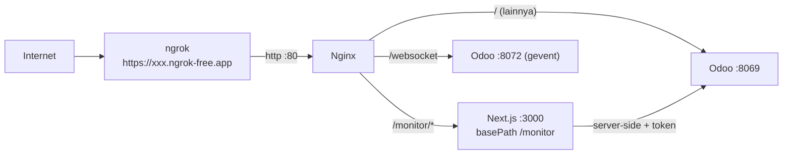

# F7. Next.js Monitor Produksi + Deploy Versi Pertama (Docker Compose, Nginx, ngrok)

| | |
|---|---|
| **Requirement FSD** | FR-MON-01…04, 07, 08 (05/06 di F10), NFR-SEC-04/05/06/09 |
| **Minggu** | 6–7 (13–22 Nov 2026) |
| **Hasil** | ⭐ Proyek layak ditampilkan: Odoo + Monitor dapat diakses publik lewat satu domain ngrok |

> Sesuai permintaan, **UI Next.js, Docker, Nginx, dan config diberikan lengkap** (boilerplate).

---

## 1. Konsep

### 1.1 Satu domain, banyak layanan (path-based routing)



### 1.2 `proxy_mode` & `web.base.url`
- ngrok menerima HTTPS, meneruskan HTTP ke Nginx dengan header `X-Forwarded-Proto: https`.
- Nginx meneruskan `X-Forwarded-Host/Proto/For` ke Odoo.
- `proxy_mode = True` → Odoo memercayai header itu (URL redirect, link email, IP log jadi benar).
- `web.base.url` = `https://<domain>` + `web.base.url.freeze = True` agar tidak berubah saat admin login dari `localhost`.

### 1.3 Mode worker Odoo produksi
`workers = 2` → prefork. Websocket/longpolling dilayani proses **gevent** di port **8072**, jadi Nginx harus mengarahkan `/websocket` ke 8072. Kalau tidak, live chat & notifikasi realtime tidak jalan.

### 1.4 Token tidak boleh sampai ke browser
Next.js App Router: data diambil di **Server Component** (`src/lib/odoo.ts` dengan `import "server-only"`). Browser hanya menerima HTML/RSC payload, tidak pernah token.

---

## 2. Langkah — Next.js

### Langkah 1 — Scaffold

```bash
cd ~/Documents/odoo-project
npx create-next-app@latest monitor \
  --ts --tailwind --eslint --app --src-dir --import-alias "@/*" --use-npm
cd monitor
npm install recharts server-only
```

> Versi Next.js, React, dan Tailwind mengikuti template `@latest` saat kamu menjalankannya. Kode di bawah memakai App Router dan API yang stabil sejak Next 15 (`cookies()` async).
> ⚠️ **Next.js 16** setahuku mengganti nama `middleware.ts` → `proxy.ts` (fungsi `proxy`). Cek dokumentasi versi yang ter-install (`npx next --version`).

### Langkah 2 — `next.config.ts`

```typescript
import type { NextConfig } from "next";

const nextConfig: NextConfig = {
  basePath: "/monitor",
  output: "standalone",
  poweredByHeader: false,
};

export default nextConfig;
```

### Langkah 3 — Env

`monitor/.env.local.example`
```dotenv
# Server-only variables (never prefix with NEXT_PUBLIC_)
ODOO_BASE_URL=http://localhost:8069
ODOO_MONITOR_TOKEN=kpk_xxx
GATEWAY_BASE_URL=http://localhost:8080
GATEWAY_MONITOR_TOKEN=
MONITOR_PASSWORD=change-me-owner
MONITOR_SESSION_SECRET=change-me-long-random-string-32chars-min
```

```bash
cp .env.local.example .env.local
```

### Langkah 4 — Types

`monitor/src/lib/types.ts`
```typescript
export type ApiOk<T> = { ok: true; data: T };
export type ApiErr = { ok: false; error: { code: string; message: string } };

export type ProductionToday = {
  date: string;
  mo_done: number;
  mo_in_progress: number;
  mo_late: number;
  qty_done_units: number;
  yield_pct_avg: number | null;
  qc_fail_today: number;
};

export type WorkorderBrief = { name: string; workcenter: string; state: string };

export type Production = {
  id: number;
  name: string;
  product: string;
  qty_plan: number;
  qty_produced: number;
  uom?: string;
  state: string;
  date_start: string | null;
  date_deadline: string | null;
  qc_state: "none" | "todo" | "fail" | "pass";
  workorders: WorkorderBrief[];
};

export type QualityCheck = {
  id: number;
  name: string;
  production: string;
  workorder: string | null;
  point: string;
  value: number | null;
  unit: string | null;
  source: "manual" | "gateway";
  checked_at: string | null;
  is_resolved: boolean;
};
```

### Langkah 5 — Klien Odoo (server-only)

`monitor/src/lib/odoo.ts`
```typescript
import "server-only";
import type { ApiErr, ApiOk, Production, ProductionToday, QualityCheck } from "./types";

const BASE = process.env.ODOO_BASE_URL ?? "http://odoo:8069";
const TOKEN = process.env.ODOO_MONITOR_TOKEN ?? "";

export class OdooError extends Error {
  constructor(public status: number, public code: string, message: string) {
    super(message);
  }
}

async function odooGet<T>(path: string, params?: Record<string, string>): Promise<T> {
  const url = new URL(`/api/keripik/v1${path}`, BASE);
  if (params) Object.entries(params).forEach(([k, v]) => url.searchParams.set(k, v));

  const res = await fetch(url, {
    headers: { Authorization: `Bearer ${TOKEN}`, Accept: "application/json" },
    // Revalidate cached data every 30 seconds
    next: { revalidate: 30 },
    signal: AbortSignal.timeout(8000),
  });

  let body: ApiOk<T> | ApiErr;
  try {
    body = await res.json();
  } catch {
    throw new OdooError(res.status, "INVALID_RESPONSE", `Odoo returned ${res.status}`);
  }
  if (!res.ok || !body.ok) {
    const err = (body as ApiErr).error ?? { code: "HTTP_" + res.status, message: res.statusText };
    throw new OdooError(res.status, err.code, err.message);
  }
  return body.data;
}

export const getProductionToday = () => odooGet<ProductionToday>("/production/today");

export const getRunningProductions = () =>
  odooGet<Production[]>("/productions", { state: "progress,confirmed", limit: "20" });

export function getRecentFailedChecks() {
  const from = new Date(Date.now() - 7 * 24 * 3600 * 1000).toISOString().slice(0, 10);
  return odooGet<QualityCheck[]>("/quality-checks", { result: "fail", date_from: from, limit: "10" });
}
```

### Langkah 6 — Sesi (HMAC cookie, Web Crypto agar jalan di edge/middleware)

`monitor/src/lib/session.ts`
```typescript
// Minimal signed session cookie: "<expiresAtMs>.<hmacHex>"
export const SESSION_COOKIE = "monitor_session";
export const SESSION_TTL_MS = 7 * 24 * 3600 * 1000;

const encoder = new TextEncoder();

async function hmac(value: string, secret: string): Promise<string> {
  const key = await crypto.subtle.importKey(
    "raw",
    encoder.encode(secret),
    { name: "HMAC", hash: "SHA-256" },
    false,
    ["sign"],
  );
  const sig = await crypto.subtle.sign("HMAC", key, encoder.encode(value));
  return Array.from(new Uint8Array(sig))
    .map((b) => b.toString(16).padStart(2, "0"))
    .join("");
}

function timingSafeEqual(a: string, b: string): boolean {
  if (a.length !== b.length) return false;
  let diff = 0;
  for (let i = 0; i < a.length; i++) diff |= a.charCodeAt(i) ^ b.charCodeAt(i);
  return diff === 0;
}

export async function createSessionValue(secret: string): Promise<string> {
  const expires = String(Date.now() + SESSION_TTL_MS);
  return `${expires}.${await hmac(expires, secret)}`;
}

export async function verifySessionValue(value: string | undefined, secret: string): Promise<boolean> {
  if (!value || !secret) return false;
  const [expires, sig] = value.split(".");
  if (!expires || !sig || Number(expires) < Date.now()) return false;
  return timingSafeEqual(sig, await hmac(expires, secret));
}

export { timingSafeEqual };
```

### Langkah 7 — Middleware (proteksi halaman)

`monitor/src/middleware.ts` (Next 16: `src/proxy.ts` dan `export async function proxy`)
```typescript
import { NextResponse, type NextRequest } from "next/server";
import { SESSION_COOKIE, verifySessionValue } from "@/lib/session";

const PUBLIC_PATHS = ["/login", "/api/login"];

export async function middleware(request: NextRequest) {
  // nextUrl.pathname does NOT include the basePath
  const { pathname } = request.nextUrl;
  if (PUBLIC_PATHS.some((p) => pathname.startsWith(p))) return NextResponse.next();

  const ok = await verifySessionValue(
    request.cookies.get(SESSION_COOKIE)?.value,
    process.env.MONITOR_SESSION_SECRET ?? "",
  );
  if (ok) return NextResponse.next();

  if (pathname.startsWith("/api/")) {
    return NextResponse.json({ error: "unauthorized" }, { status: 401 });
  }
  const url = request.nextUrl.clone();
  url.pathname = "/login"; // basePath is preserved by NextURL
  return NextResponse.redirect(url);
}

export const config = {
  matcher: ["/((?!_next/static|_next/image|favicon.ico).*)"],
};
```

### Langkah 8 — Login API & halaman

`monitor/src/app/api/login/route.ts`
```typescript
import { NextResponse } from "next/server";
import {
  SESSION_COOKIE,
  SESSION_TTL_MS,
  createSessionValue,
  timingSafeEqual,
} from "@/lib/session";

export async function POST(request: Request) {
  const form = await request.formData();
  const password = String(form.get("password") ?? "");
  const expected = process.env.MONITOR_PASSWORD ?? "";
  const base = new URL(request.url);

  // small delay against brute force
  await new Promise((r) => setTimeout(r, 800));

  if (!expected || !timingSafeEqual(password, expected)) {
    return NextResponse.redirect(new URL("/monitor/login?error=1", base), 303);
  }

  const res = NextResponse.redirect(new URL("/monitor", base), 303);
  res.cookies.set(SESSION_COOKIE, await createSessionValue(process.env.MONITOR_SESSION_SECRET ?? ""), {
    httpOnly: true,
    sameSite: "lax",
    secure: base.protocol === "https:" || request.headers.get("x-forwarded-proto") === "https",
    path: "/monitor",
    maxAge: SESSION_TTL_MS / 1000,
  });
  return res;
}
```

`monitor/src/app/api/logout/route.ts`
```typescript
import { NextResponse } from "next/server";
import { SESSION_COOKIE } from "@/lib/session";

export async function POST(request: Request) {
  const res = NextResponse.redirect(new URL("/monitor/login", request.url), 303);
  res.cookies.set(SESSION_COOKIE, "", { path: "/monitor", maxAge: 0 });
  return res;
}
```

> Di route handler, `request.url` berisi host internal (`http://localhost:3000/...`) bila di balik proxy. Karena redirect relatif terhadap host itu, pastikan Nginx meneruskan `Host` asli (lihat konfigurasi Nginx), atau pakai URL relatif.

`monitor/src/app/login/page.tsx`
```tsx
export const metadata = { title: "Masuk · Monitor Produksi" };

export default async function LoginPage({
  searchParams,
}: {
  searchParams: Promise<{ error?: string }>;
}) {
  const { error } = await searchParams;
  return (
    <main className="flex min-h-screen items-center justify-center bg-slate-100 px-4">
      <form
        action="/monitor/api/login"
        method="post"
        className="w-full max-w-sm space-y-4 rounded-2xl bg-white p-8 shadow"
      >
        <div className="text-center">
          <div className="text-4xl">🍘</div>
          <h1 className="mt-2 text-xl font-semibold text-slate-800">Monitor Produksi</h1>
          <p className="text-sm text-slate-500">Pabrik Keripik Tempe</p>
        </div>
        <label className="block">
          <span className="text-sm font-medium text-slate-700">Password</span>
          <input
            type="password"
            name="password"
            required
            minLength={8}
            autoFocus
            className="mt-1 w-full rounded-lg border border-slate-300 px-3 py-2 focus:border-slate-500 focus:outline-none"
          />
        </label>
        {error && <p className="text-sm text-red-600">Password salah.</p>}
        <button
          type="submit"
          className="w-full rounded-lg bg-slate-800 py-2 font-medium text-white hover:bg-slate-700"
        >
          Masuk
        </button>
      </form>
    </main>
  );
}
```

> `searchParams` berupa Promise sejak Next 15.

### Langkah 9 — Layout & util format

`monitor/src/app/layout.tsx`
```tsx
import type { Metadata } from "next";
import "./globals.css";

export const metadata: Metadata = {
  title: "Monitor Produksi Keripik",
  description: "Production monitor for a tempeh chips factory (Odoo + Go)",
};

export default function RootLayout({ children }: { children: React.ReactNode }) {
  return (
    <html lang="id">
      <body className="bg-slate-100 text-slate-800 antialiased">{children}</body>
    </html>
  );
}
```

`monitor/src/lib/format.ts`
```typescript
const nf1 = new Intl.NumberFormat("id-ID", { maximumFractionDigits: 1 });
const dtf = new Intl.DateTimeFormat("id-ID", {
  timeZone: "Asia/Jakarta",
  day: "2-digit",
  month: "short",
  hour: "2-digit",
  minute: "2-digit",
});
const df = new Intl.DateTimeFormat("id-ID", {
  timeZone: "Asia/Jakarta",
  weekday: "long",
  day: "numeric",
  month: "long",
  year: "numeric",
});

export const fmtNumber = (n: number | null | undefined) => (n == null ? "–" : nf1.format(n));
export const fmtDateTime = (iso: string | null | undefined) => (iso ? dtf.format(new Date(iso)) : "–");
export const fmtToday = () => df.format(new Date());
export const isPast = (iso: string | null | undefined) => !!iso && new Date(iso).getTime() < Date.now();
```

### Langkah 10 — Komponen

`monitor/src/components/AutoRefresh.tsx`
```tsx
"use client";

import { useRouter } from "next/navigation";
import { useEffect } from "react";

export default function AutoRefresh({ seconds = 30 }: { seconds?: number }) {
  const router = useRouter();
  useEffect(() => {
    const id = setInterval(() => router.refresh(), seconds * 1000);
    return () => clearInterval(id);
  }, [router, seconds]);
  return <span className="text-xs text-slate-500">⟳ {seconds} dtk</span>;
}
```

`monitor/src/components/Section.tsx`
```tsx
export default function Section({
  title,
  right,
  children,
}: {
  title: string;
  right?: React.ReactNode;
  children: React.ReactNode;
}) {
  return (
    <section className="rounded-2xl bg-white p-4 shadow-sm sm:p-5">
      <div className="mb-3 flex items-center justify-between gap-2">
        <h2 className="text-base font-semibold text-slate-700">{title}</h2>
        {right}
      </div>
      {children}
    </section>
  );
}

export function Unavailable({ message }: { message?: string }) {
  return (
    <div className="rounded-lg border border-dashed border-amber-300 bg-amber-50 p-4 text-sm text-amber-800">
      Data tidak tersedia{message ? `: ${message}` : ""}.
    </div>
  );
}
```

`monitor/src/components/KpiCards.tsx`
```tsx
import type { ProductionToday } from "@/lib/types";
import { fmtNumber } from "@/lib/format";

export default function KpiCards({ data }: { data: ProductionToday }) {
  const items = [
    { label: "MO berjalan", value: data.mo_in_progress, tone: "text-sky-700" },
    { label: "MO selesai hari ini", value: data.mo_done, tone: "text-emerald-700" },
    {
      label: "Yield rata-rata",
      value: data.yield_pct_avg == null ? "–" : `${fmtNumber(data.yield_pct_avg)} %`,
      tone: "text-slate-800",
    },
    {
      label: "QC gagal hari ini",
      value: data.qc_fail_today,
      tone: data.qc_fail_today > 0 ? "text-red-600" : "text-slate-800",
    },
  ];
  return (
    <div className="grid grid-cols-2 gap-3 lg:grid-cols-4">
      {items.map((k) => (
        <div key={k.label} className="rounded-2xl bg-white p-4 shadow-sm">
          <div className="text-xs font-medium uppercase tracking-wide text-slate-500">{k.label}</div>
          <div className={`mt-1 text-3xl font-bold ${k.tone}`}>{k.value}</div>
        </div>
      ))}
      {data.mo_late > 0 && (
        <div className="col-span-2 rounded-xl bg-red-50 px-4 py-2 text-sm text-red-700 lg:col-span-4">
          ⚠️ {data.mo_late} MO melewati deadline
        </div>
      )}
    </div>
  );
}
```

`monitor/src/components/RunningMoTable.tsx`
```tsx
import type { Production } from "@/lib/types";
import { fmtDateTime, fmtNumber, isPast } from "@/lib/format";

const QC_BADGE: Record<Production["qc_state"], string> = {
  none: "bg-slate-100 text-slate-500",
  todo: "bg-amber-100 text-amber-800",
  fail: "bg-red-100 text-red-700",
  pass: "bg-emerald-100 text-emerald-700",
};

export default function RunningMoTable({ rows }: { rows: Production[] }) {
  if (rows.length === 0) return <p className="text-sm text-slate-500">Tidak ada MO berjalan.</p>;

  return (
    <div className="overflow-x-auto">
      <table className="w-full min-w-[560px] text-sm">
        <thead className="text-left text-xs uppercase text-slate-500">
          <tr>
            <th className="py-2">MO</th>
            <th>Produk</th>
            <th className="text-right">Qty</th>
            <th className="w-40">Progres WO</th>
            <th>Deadline</th>
            <th>QC</th>
          </tr>
        </thead>
        <tbody className="divide-y divide-slate-100">
          {rows.map((mo) => {
            const done = mo.workorders.filter((w) => w.state === "done").length;
            const total = mo.workorders.length || 1;
            const pct = Math.round((done / total) * 100);
            return (
              <tr key={mo.id}>
                <td className="py-2 font-medium">{mo.name}</td>
                <td>{mo.product}</td>
                <td className="text-right">
                  {fmtNumber(mo.qty_produced)} / {fmtNumber(mo.qty_plan)} {mo.uom ?? ""}
                </td>
                <td>
                  <div className="flex items-center gap-2">
                    <div className="h-2 flex-1 rounded bg-slate-100">
                      <div className="h-2 rounded bg-sky-500" style={{ width: `${pct}%` }} />
                    </div>
                    <span className="w-9 text-right text-xs text-slate-500">{pct}%</span>
                  </div>
                </td>
                <td className={isPast(mo.date_deadline) ? "font-medium text-red-600" : ""}>
                  {fmtDateTime(mo.date_deadline)}
                </td>
                <td>
                  <span className={`rounded-full px-2 py-0.5 text-xs font-medium ${QC_BADGE[mo.qc_state]}`}>
                    {mo.qc_state}
                  </span>
                </td>
              </tr>
            );
          })}
        </tbody>
      </table>
    </div>
  );
}
```

`monitor/src/components/QcFailList.tsx`
```tsx
import type { QualityCheck } from "@/lib/types";
import { fmtDateTime, fmtNumber } from "@/lib/format";

export default function QcFailList({ rows }: { rows: QualityCheck[] }) {
  if (rows.length === 0) return <p className="text-sm text-slate-500">Tidak ada QC gagal 7 hari terakhir. 🎉</p>;
  return (
    <ul className="divide-y divide-slate-100 text-sm">
      {rows.map((qc) => (
        <li key={qc.id} className="flex items-start justify-between gap-3 py-2">
          <div>
            <div className="font-medium">
              {qc.point}: {fmtNumber(qc.value)} {qc.unit ?? ""}
              {qc.source === "gateway" && (
                <span className="ml-2 rounded bg-violet-100 px-1.5 py-0.5 text-xs text-violet-700">🤖 otomatis</span>
              )}
            </div>
            <div className="text-xs text-slate-500">
              {qc.production}
              {qc.workorder ? ` · ${qc.workorder}` : ""}
            </div>
          </div>
          <div className="text-right text-xs text-slate-500">
            {fmtDateTime(qc.checked_at)}
            {qc.is_resolved && <div className="text-emerald-600">retest lulus</div>}
          </div>
        </li>
      ))}
    </ul>
  );
}
```

`monitor/src/components/LiveTemperaturePlaceholder.tsx` (diganti grafik live di F10)
```tsx
export default function LiveTemperaturePlaceholder() {
  return (
    <div className="flex h-56 items-center justify-center rounded-lg bg-slate-50 text-sm text-slate-500">
      Gateway mesin belum aktif — grafik suhu live tersedia setelah fase F10.
    </div>
  );
}
```

### Langkah 11 — Halaman dashboard

`monitor/src/app/page.tsx`
```tsx
import AutoRefresh from "@/components/AutoRefresh";
import KpiCards from "@/components/KpiCards";
import LiveTemperaturePlaceholder from "@/components/LiveTemperaturePlaceholder";
import QcFailList from "@/components/QcFailList";
import RunningMoTable from "@/components/RunningMoTable";
import Section, { Unavailable } from "@/components/Section";
import { fmtToday } from "@/lib/format";
import { getProductionToday, getRecentFailedChecks, getRunningProductions } from "@/lib/odoo";

// Always render on request (data changes constantly)
export const dynamic = "force-dynamic";

function reason(r: PromiseSettledResult<unknown>) {
  return r.status === "rejected" ? (r.reason as Error)?.message : undefined;
}

export default async function DashboardPage() {
  const [today, running, fails] = await Promise.allSettled([
    getProductionToday(),
    getRunningProductions(),
    getRecentFailedChecks(),
  ]);

  return (
    <main className="mx-auto max-w-6xl space-y-4 px-4 py-5">
      <header className="flex flex-wrap items-center justify-between gap-2">
        <div>
          <h1 className="text-xl font-bold">🍘 Monitor Produksi Keripik</h1>
          <p className="text-sm text-slate-500">{fmtToday()}</p>
        </div>
        <div className="flex items-center gap-3">
          <AutoRefresh seconds={30} />
          <form action="/monitor/api/logout" method="post">
            <button className="rounded-lg border border-slate-300 px-3 py-1 text-sm hover:bg-white">Keluar</button>
          </form>
        </div>
      </header>

      {today.status === "fulfilled" ? <KpiCards data={today.value} /> : <Unavailable message={reason(today)} />}

      <Section title="Suhu Penggoreng (live)">
        <LiveTemperaturePlaceholder />
      </Section>

      <div className="grid gap-4 lg:grid-cols-5">
        <div className="lg:col-span-3">
          <Section title="MO berjalan">
            {running.status === "fulfilled" ? (
              <RunningMoTable rows={running.value} />
            ) : (
              <Unavailable message={reason(running)} />
            )}
          </Section>
        </div>
        <div className="lg:col-span-2">
          <Section title="QC gagal terbaru">
            {fails.status === "fulfilled" ? <QcFailList rows={fails.value} /> : <Unavailable message={reason(fails)} />}
          </Section>
        </div>
      </div>
    </main>
  );
}
```

> `Promise.allSettled` memenuhi AC-MON-06: satu sumber gagal tidak membuat seluruh halaman error.

Jalankan lokal:
```bash
npm run dev
# open http://localhost:3000/monitor
```

### Langkah 12 — Dockerfile Next.js

`monitor/Dockerfile`
```dockerfile
# ---------- deps ----------
FROM node:22-alpine AS deps
WORKDIR /app
COPY package.json package-lock.json ./
RUN npm ci

# ---------- build ----------
FROM node:22-alpine AS build
WORKDIR /app
COPY --from=deps /app/node_modules ./node_modules
COPY . .
ENV NEXT_TELEMETRY_DISABLED=1
RUN npm run build

# ---------- runtime ----------
FROM node:22-alpine AS runtime
WORKDIR /app
ENV NODE_ENV=production \
    NEXT_TELEMETRY_DISABLED=1 \
    PORT=3000 \
    HOSTNAME=0.0.0.0
RUN addgroup -S nodejs && adduser -S nextjs -G nodejs
COPY --from=build /app/public ./public
COPY --from=build --chown=nextjs:nodejs /app/.next/standalone ./
COPY --from=build --chown=nextjs:nodejs /app/.next/static ./.next/static
USER nextjs
EXPOSE 3000
CMD ["node", "server.js"]
```

`monitor/.dockerignore`
```
node_modules
.next
.env*
Dockerfile
```

---

## 3. Langkah — Deploy v1

### Langkah 13 — Odoo config produksi

`odoo/config/odoo.prod.conf.example` (salin ke `odoo.prod.conf`, **jangan commit** — tambahkan `odoo/config/odoo.prod.conf` ke `.gitignore`)
```ini
[options]
db_host = db
db_port = 5432
db_user = odoo
db_password = CHANGE_ME
admin_passwd = CHANGE_ME_LONG_RANDOM
dbfilter = ^keripik$
list_db = False

addons_path = /mnt/extra-addons
data_dir = /var/lib/odoo

proxy_mode = True
workers = 2
max_cron_threads = 1
gevent_port = 8072
; memory/time limits (defaults are fine for a demo)
limit_time_cpu = 120
limit_time_real = 240

smtp_server = mailpit
smtp_port = 1025
email_from = noreply@keripik.local
log_level = info
```

> ⚠️ Nama opsi `gevent_port` menggantikan `longpolling_port` sejak Odoo 16/17. Cek `odoo --help | grep -i port`.

### Langkah 14 — Nginx (versi F7, tanpa gateway)

`nginx/default.conf`
```nginx
# Upstreams
upstream odoo         { server odoo:8069; }
upstream odoo_ws      { server odoo:8072; }
upstream monitor_app  { server monitor:3000; }

map $http_upgrade $connection_upgrade {
    default upgrade;
    ''      close;
}

# Respect X-Forwarded-Proto from ngrok; fall back to the actual scheme
map $http_x_forwarded_proto $fwd_proto {
    default $http_x_forwarded_proto;
    ''      $scheme;
}

server {
    listen 80;
    server_name _;

    client_max_body_size 64m;
    proxy_read_timeout 720s;
    proxy_connect_timeout 720s;
    proxy_send_timeout 720s;

    proxy_set_header Host              $host;
    proxy_set_header X-Forwarded-Host  $host;
    proxy_set_header X-Forwarded-For   $proxy_add_x_forwarded_for;
    proxy_set_header X-Forwarded-Proto $fwd_proto;
    proxy_set_header X-Real-IP         $remote_addr;

    gzip on;
    gzip_types text/css text/plain application/json application/javascript text/xml application/xml;

    # ---------- Next.js Monitor (basePath /monitor, keep prefix) ----------
    location /monitor {
        proxy_pass http://monitor_app;
    }

    # ---------- Odoo websocket (bus / live chat) ----------
    location /websocket {
        proxy_pass http://odoo_ws;
        proxy_http_version 1.1;
        proxy_set_header Upgrade    $http_upgrade;
        proxy_set_header Connection $connection_upgrade;
    }

    # ---------- Odoo ----------
    location / {
        proxy_pass http://odoo;
        proxy_redirect off;
    }

    # Cache static assets served by Odoo
    location ~* /web/static/ {
        expires 24h;
        proxy_pass http://odoo;
    }

    # Block database manager from the internet
    location ~* ^/web/database/ {
        return 403;
    }
}
```

### Langkah 15 — Compose produksi (overlay)

`docker-compose.prod.yml`
```yaml
services:
  odoo:
    volumes:
      - ./odoo/config/odoo.prod.conf:/etc/odoo/odoo.conf:ro
      - ./odoo/addons:/mnt/extra-addons:ro
      - odoo-web-data:/var/lib/odoo
    ports: !reset []           # not exposed; only via nginx (Compose >= 2.24)
    command: ["odoo"]

  mailpit:
    ports:
      - "127.0.0.1:8025:8025"  # UI only on localhost

  monitor:
    build: ./monitor
    restart: unless-stopped
    environment:
      ODOO_BASE_URL: http://odoo:8069
      ODOO_MONITOR_TOKEN: ${ODOO_MONITOR_TOKEN}
      GATEWAY_BASE_URL: http://gateway:8080
      GATEWAY_MONITOR_TOKEN: ${GATEWAY_MONITOR_TOKEN}
      MONITOR_PASSWORD: ${MONITOR_PASSWORD}
      MONITOR_SESSION_SECRET: ${MONITOR_SESSION_SECRET}
    depends_on:
      - odoo

  nginx:
    image: nginx:1.27-alpine
    restart: unless-stopped
    depends_on:
      - odoo
      - monitor
    volumes:
      - ./nginx/default.conf:/etc/nginx/conf.d/default.conf:ro
    ports:
      - "80:80"

  ngrok:
    image: ngrok/ngrok:latest
    restart: unless-stopped
    depends_on:
      - nginx
    environment:
      NGROK_AUTHTOKEN: ${NGROK_AUTHTOKEN}
    command: ["http", "--url=${NGROK_DOMAIN}", "nginx:80"]
    profiles: ["public"]
```

Tambahkan ke `.env`: `NGROK_AUTHTOKEN=...`, `NGROK_DOMAIN=nama-kamu.ngrok-free.app`.

> ⚠️ `ports: !reset []` butuh Docker Compose ≥ 2.24. Alternatif: hapus `ports` dari service odoo di `docker-compose.yml` dan pindahkan ke `docker-compose.override.yml` (dev).
> ⚠️ Flag ngrok: `--url` (versi agent baru) menggantikan `--domain`. Cek `ngrok http --help`.

### Langkah 16 — ngrok
> ⚠️ Paket gratis ngrok dibatasi ±1 GB dan ±20.000 request per bulan (cek 6 Okt 2026). Backend Odoo sangat "cerewet" (banyak request per halaman), jadi jalankan profile `public` **hanya saat demo**. Saat develop, pakai `localhost`. Alternatif tanpa kuota: Cloudflare Tunnel (lihat D5 §5.6).

1. Daftar di <https://dashboard.ngrok.com> → salin **authtoken**.
2. *Domains* → klaim **1 dev domain gratis** (misal `keripik-demo.ngrok-free.app`).
3. Isi `.env`.

### Langkah 17 — Jalankan
```bash
# stop dev stack first
docker compose down

docker compose -f docker-compose.yml -f docker-compose.prod.yml --profile public up -d --build
docker compose -f docker-compose.yml -f docker-compose.prod.yml ps
docker compose -f docker-compose.yml -f docker-compose.prod.yml logs -f nginx ngrok
```

Tambahkan shortcut ke `Makefile`:
```makefile
PROD = docker compose -f docker-compose.yml -f docker-compose.prod.yml

prod-up:
	$(PROD) --profile public up -d --build

prod-down:
	$(PROD) --profile public down

prod-logs:
	$(PROD) logs -f --tail=200
```

### Langkah 18 — Set `web.base.url`
Login admin via domain ngrok → *Settings → Technical → System Parameters*:
- `web.base.url` = `https://keripik-demo.ngrok-free.app`
- `web.base.url.freeze` = `True`

---

## 4. Testing

| AC / Cek | Cara |
|---|---|
| AC-MON-01 | Buka `https://<domain>/monitor` tanpa login → redirect `/monitor/login` |
| AC-MON-02 | Login → KPI sama dengan curl `/production/today` |
| AC-MON-03 | DevTools → Network: tidak ada request ke `/api/keripik`; Sources → cari `kpk_` → tidak ada |
| AC-MON-06 | `docker compose stop odoo` → refresh monitor → kartu "Data tidak tersedia", halaman tetap tampil |
| AC-MON-07 | DevTools device iPhone 12 (390 px) → satu kolom, tidak ada scroll horizontal di halaman (tabel boleh scroll sendiri) |
| Live chat via ngrok | Buka website dari HP → chat → muncul di Discuss admin (websocket jalan) |
| proxy_mode | Kirim email invoice → link di Mailpit memakai `https://<domain>` |
| DB manager tertutup | `https://<domain>/web/database/manager` → 403 |

---

## 5. Error yang Sering Terjadi

| Gejala | Penyebab | Solusi |
|---|---|---|
| Asset Next.js 404 (`/_next/...`) | basePath tidak diset atau Nginx men-strip `/monitor` | `basePath: "/monitor"` dan `proxy_pass http://monitor_app;` (tanpa trailing slash) |
| Redirect loop login | Cookie `path` tidak cocok / `secure` di HTTP | `path: "/monitor"`; `secure` hanya bila https |
| Live chat / notifikasi tidak realtime | `/websocket` tidak ke 8072 atau header Upgrade hilang | Blok `location /websocket` |
| URL email masih `http://localhost` | `web.base.url` belum di-set/freeze, atau `proxy_mode` False | Langkah 18 |
| `502 Bad Gateway` | Service belum siap / nama upstream salah | `docker compose ps`, cek log |
| `host not found in upstream "gateway"` | Upstream gateway ditulis sebelum service ada | Tambahkan hanya di F10 |
| Halaman peringatan ngrok muncul | Kebijakan ngrok free untuk traffic browser ⚠️ | Normal untuk demo; klik *Visit Site*. Untuk API, header `ngrok-skip-browser-warning: 1` |
| Monitor `fetch failed` di container | `ODOO_BASE_URL` masih `localhost` | Pakai `http://odoo:8069` di container |
| Odoo `workers` crash OOM di Mac | RAM Docker kecil | Docker Desktop → Resources ≥ 6 GB; `workers = 2` |

---

## 6. Pertanyaan Interview

1. **Kenapa Next.js tidak memanggil Odoo dari browser?** Token akan bocor dan CORS perlu dibuka. Server Component memanggil Odoo di jaringan internal; browser hanya menerima HTML.
2. **Kenapa satu domain dengan path?** ngrok gratis hanya 1 domain; path-based routing di Nginx juga menghindari CORS (same origin).
3. **Apa fungsi `proxy_mode`?** Membuat Odoo memercayai `X-Forwarded-*`, sehingga skema/host/IP benar di balik reverse proxy. Hanya aktifkan bila memang di belakang proxy tepercaya (bisa di-spoof jika diekspos langsung).
4. **Kenapa `/websocket` ke port berbeda?** Dalam mode prefork, koneksi panjang dilayani proses gevent terpisah agar tidak memblokir worker HTTP.
5. **Bagaimana kamu mengamankan deploy demo?** DB manager diblokir, `list_db=False`, `dbfilter`, hanya port 80 Nginx terbuka, secret di `.env`, token monitor read-only scope.
6. **Kenapa `Promise.allSettled`?** Degradasi bertahap: satu endpoint gagal tidak menjatuhkan seluruh dashboard.
