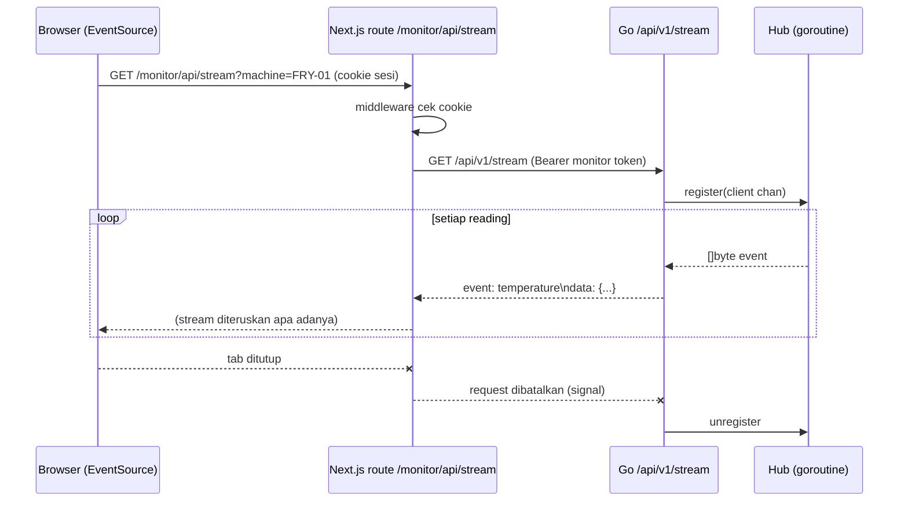
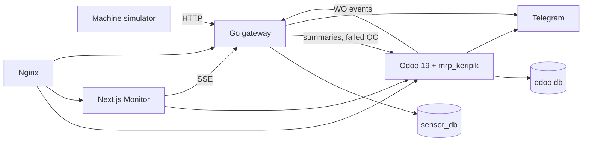

# F10. Streaming Live ke Next.js, Deploy Lengkap, Data Demo, README Portofolio

| | |
|---|---|
| **Requirement FSD** | FR-GW-10/11, FR-MON-05/06, NFR-PERF-02, NFR-SEC (checklist) |
| **Minggu** | 9 (30 Nov–6 Des 2026) |
| **Hasil** | Grafik suhu live + banner anomali, compose & Nginx final (Go + sensor_db), data demo, README portofolio |

---

## 1. Konsep: SSE dari Go → Next.js → Browser



**Kenapa SSE, bukan WebSocket?** Hanya butuh server → browser. SSE lewat HTTP biasa, reconnect otomatis (`EventSource`), dan mudah melewati Nginx/ngrok. Syaratnya: matikan **buffering** di setiap proxy (`X-Accel-Buffering: no`, `proxy_buffering off`).

---

## 2. Langkah — Go: Hub & endpoint SSE (kerangka + petunjuk)

`internal/stream/hub.go`
```go
package stream

// Hub fan-outs messages to SSE clients.
//
// type client struct { machine string; ch chan []byte }
// type Hub struct { mu sync.RWMutex; clients map[*client]struct{} }
//
// func NewHub() *Hub
// func (h *Hub) Subscribe(machine string) (*client, func())   // returns unsubscribe func
// func (h *Hub) Publish(r domain.Reading)
//     msg := formatSSE("temperature"|"weight", json)   -> "event: X\ndata: {...}\n\n"
//     RLock; for c := range clients: if c.machine == "" || c.machine == r.MachineCode:
//         select { case c.ch <- msg: default: /* slow client: drop message (count it) */ }
// func (h *Hub) PublishAnomaly(a domain.Anomaly)   // event: anomaly
//
// Never block Publish: it runs inside the ingest goroutine.
```

Handler (Fiber v3 ⚠️ API streaming; cek docs `SendStreamWriter` / `Context().SetBodyStreamWriter` di versi yang kamu pakai):
```go
// h.stream(c fiber.Ctx) error
//   c.Set("Content-Type", "text/event-stream")
//   c.Set("Cache-Control", "no-cache")
//   c.Set("Connection", "keep-alive")
//   c.Set("X-Accel-Buffering", "no")
//   sub, unsubscribe := hub.Subscribe(c.Query("machine"))
//   return c.SendStreamWriter(func(w *bufio.Writer) {
//       defer unsubscribe()
//       keepAlive := time.NewTicker(15 * time.Second)
//       defer keepAlive.Stop()
//       for {
//           select {
//           case msg := <-sub.ch:
//               if _, err := w.Write(msg); err != nil { return }
//               if err := w.Flush(); err != nil { return }   // flush error = client gone
//           case <-keepAlive.C:
//               if _, err := w.WriteString(": keep-alive\n\n"); err != nil { return }
//               if err := w.Flush(); err != nil { return }
//           }
//       }
//   })
```

> Pada fasthttp, cara mendeteksi klien terputus adalah **error saat `Flush`**. Itu sebabnya keep-alive tiap 15 detik penting: klien yang hilang terdeteksi paling lambat 15 detik.

Endpoint historis `GET /api/v1/machines/:code/temperature?from=&to=&bucket=10s` (petunjuk SQL):
```sql
SELECT date_bin($3::interval, ts, TIMESTAMPTZ '2000-01-01') AS bucket,
       round(avg(celsius)::numeric, 1) AS celsius
FROM temperature_readings
WHERE machine_code = $1 AND ts >= $2 AND ts < $4
GROUP BY bucket
ORDER BY bucket
LIMIT 1000;
```
(`date_bin` tersedia sejak PostgreSQL 14.)

---

## 3. Langkah — Next.js (lengkap)

### 3.1 Route proxy stream

`monitor/src/app/api/stream/route.ts`
```typescript
import type { NextRequest } from "next/server";

export const dynamic = "force-dynamic";
export const runtime = "nodejs";

const GATEWAY = process.env.GATEWAY_BASE_URL ?? "http://gateway:8080";
const TOKEN = process.env.GATEWAY_MONITOR_TOKEN ?? "";

export async function GET(req: NextRequest) {
  const machine = req.nextUrl.searchParams.get("machine") ?? "";
  const url = `${GATEWAY}/api/v1/stream?machine=${encodeURIComponent(machine)}`;

  let upstream: Response;
  try {
    upstream = await fetch(url, {
      headers: { Authorization: `Bearer ${TOKEN}`, Accept: "text/event-stream" },
      cache: "no-store",
      signal: req.signal, // abort upstream when the browser disconnects
    });
  } catch {
    return new Response("gateway unavailable", { status: 502 });
  }
  if (!upstream.ok || !upstream.body) {
    return new Response("gateway unavailable", { status: 502 });
  }

  return new Response(upstream.body, {
    headers: {
      "Content-Type": "text/event-stream",
      "Cache-Control": "no-cache, no-transform",
      Connection: "keep-alive",
      "X-Accel-Buffering": "no",
    },
  });
}
```

### 3.2 Route data historis & daftar mesin

`monitor/src/app/api/temperature/route.ts`
```typescript
import { NextResponse, type NextRequest } from "next/server";

export const dynamic = "force-dynamic";

const GATEWAY = process.env.GATEWAY_BASE_URL ?? "http://gateway:8080";
const TOKEN = process.env.GATEWAY_MONITOR_TOKEN ?? "";

export async function GET(req: NextRequest) {
  const machine = req.nextUrl.searchParams.get("machine") ?? "FRY-01";
  const to = new Date();
  const from = new Date(to.getTime() - 15 * 60 * 1000);
  const url = new URL(`/api/v1/machines/${encodeURIComponent(machine)}/temperature`, GATEWAY);
  url.searchParams.set("from", from.toISOString());
  url.searchParams.set("to", to.toISOString());
  url.searchParams.set("bucket", "2s");

  try {
    const res = await fetch(url, {
      headers: { Authorization: `Bearer ${TOKEN}` },
      cache: "no-store",
      signal: AbortSignal.timeout(5000),
    });
    if (!res.ok) return NextResponse.json({ points: [] }, { status: 502 });
    return NextResponse.json(await res.json());
  } catch {
    return NextResponse.json({ points: [] }, { status: 502 });
  }
}
```

> Bentuk respons Go yang diasumsikan: `{"points":[{"bucket":"2026-…Z","celsius":171.2}]}`. Sesuaikan bila handler-mu berbeda.

### 3.3 Komponen grafik live

`monitor/src/components/LiveTemperatureChart.tsx`
```tsx
"use client";

import { useEffect, useMemo, useRef, useState } from "react";
import {
  CartesianGrid,
  Line,
  LineChart,
  ReferenceLine,
  ResponsiveContainer,
  Tooltip,
  XAxis,
  YAxis,
} from "recharts";

type Point = { t: number; c: number };
type Anomaly = { ref: string; kind: string; machine_code: string; peak: number };
type Status = "connecting" | "open" | "error";

const MAX_POINTS = 450; // 15 minutes at one point per 2 s
const LIMIT = 180;
const BASE = "/monitor";

const timeFmt = new Intl.DateTimeFormat("id-ID", {
  timeZone: "Asia/Jakarta",
  hour: "2-digit",
  minute: "2-digit",
  second: "2-digit",
});

export default function LiveTemperatureChart({ machines }: { machines: string[] }) {
  const [machine, setMachine] = useState(machines[0] ?? "FRY-01");
  const [points, setPoints] = useState<Point[]>([]);
  const [status, setStatus] = useState<Status>("connecting");
  const [anomaly, setAnomaly] = useState<Anomaly | null>(null);
  const bufferRef = useRef<Point[]>([]);

  // initial history
  useEffect(() => {
    let cancelled = false;
    bufferRef.current = [];
    setPoints([]);
    fetch(`${BASE}/api/temperature?machine=${encodeURIComponent(machine)}`)
      .then((r) => (r.ok ? r.json() : { points: [] }))
      .then((data: { points?: { bucket: string; celsius: number }[] }) => {
        if (cancelled) return;
        const hist = (data.points ?? []).map((p) => ({ t: Date.parse(p.bucket), c: Number(p.celsius) }));
        bufferRef.current = hist.slice(-MAX_POINTS);
        setPoints(bufferRef.current);
      })
      .catch(() => undefined);
    return () => {
      cancelled = true;
    };
  }, [machine]);

  // live stream
  useEffect(() => {
    setStatus("connecting");
    const es = new EventSource(`${BASE}/api/stream?machine=${encodeURIComponent(machine)}`);

    es.onopen = () => setStatus("open");
    es.onerror = () => setStatus("error"); // EventSource retries automatically

    es.addEventListener("temperature", (ev) => {
      const d = JSON.parse((ev as MessageEvent).data) as { ts: string; celsius: number };
      const next = [...bufferRef.current, { t: Date.parse(d.ts), c: d.celsius }];
      bufferRef.current = next.length > MAX_POINTS ? next.slice(-MAX_POINTS) : next;
      setPoints(bufferRef.current);
    });

    es.addEventListener("anomaly", (ev) => {
      setAnomaly(JSON.parse((ev as MessageEvent).data) as Anomaly);
    });

    return () => es.close();
  }, [machine]);

  const last = points.at(-1)?.c;
  const domain = useMemo<[number, number]>(() => {
    if (points.length === 0) return [150, 200];
    const values = points.map((p) => p.c);
    return [Math.floor(Math.min(150, ...values) - 2), Math.ceil(Math.max(195, ...values) + 2)];
  }, [points]);

  const dot =
    status === "open" ? "bg-emerald-500" : status === "connecting" ? "bg-amber-400" : "bg-red-500";
  const label = status === "open" ? "terhubung" : status === "connecting" ? "menyambung…" : "terputus, mencoba lagi";

  return (
    <div className="space-y-3">
      {anomaly && (
        <div className="flex items-start justify-between gap-3 rounded-xl bg-red-600 px-4 py-3 text-white">
          <div>
            <div className="font-semibold">
              ⚠️ Anomali {anomaly.kind === "temp_over_limit" ? "suhu" : "berat"} — {anomaly.machine_code}
            </div>
            <div className="text-sm opacity-90">Puncak {anomaly.peak.toFixed(1)}</div>
          </div>
          <button onClick={() => setAnomaly(null)} className="rounded bg-white/20 px-2 py-1 text-sm">
            Tutup
          </button>
        </div>
      )}

      <div className="flex flex-wrap items-center justify-between gap-2">
        <select
          value={machine}
          onChange={(e) => setMachine(e.target.value)}
          className="rounded-lg border border-slate-300 px-3 py-1.5 text-sm"
        >
          {machines.map((m) => (
            <option key={m} value={m}>
              {m}
            </option>
          ))}
        </select>
        <div className="flex items-center gap-4 text-sm">
          <span className="font-semibold">{last == null ? "–" : `${last.toFixed(1)} °C`}</span>
          <span className="flex items-center gap-1.5 text-slate-500">
            <span className={`h-2.5 w-2.5 rounded-full ${dot}`} /> {label}
          </span>
        </div>
      </div>

      <div className="h-64 w-full">
        <ResponsiveContainer>
          <LineChart data={points} margin={{ top: 8, right: 16, bottom: 0, left: 0 }}>
            <CartesianGrid strokeDasharray="3 3" stroke="#e2e8f0" />
            <XAxis
              dataKey="t"
              type="number"
              domain={["dataMin", "dataMax"]}
              tickFormatter={(t) => timeFmt.format(new Date(t))}
              minTickGap={40}
              fontSize={12}
            />
            <YAxis domain={domain} fontSize={12} width={40} unit="°" />
            <Tooltip
              labelFormatter={(t) => timeFmt.format(new Date(Number(t)))}
              formatter={(v: number) => [`${v.toFixed(1)} °C`, "Suhu"]}
            />
            <ReferenceLine y={LIMIT} stroke="#dc2626" strokeDasharray="6 4" label={{ value: "180 °C", fill: "#dc2626", fontSize: 12 }} />
            <Line type="monotone" dataKey="c" stroke="#0284c7" strokeWidth={2} dot={false} isAnimationActive={false} />
          </LineChart>
        </ResponsiveContainer>
      </div>
    </div>
  );
}
```

Ganti placeholder di `src/app/page.tsx`:
```tsx
import LiveTemperatureChart from "@/components/LiveTemperatureChart";
// ...
<Section title="Suhu Penggoreng (live)">
  <LiveTemperatureChart machines={["FRY-01", "FRY-02"]} />
</Section>
```
(Opsional: ambil daftar mesin dari `GET /api/v1/machines` di server component.)

---

## 4. Langkah — Deploy Lengkap

### 4.1 Nginx final

`nginx/default.conf` (gantikan versi F7)
```nginx
upstream odoo         { server odoo:8069; }
upstream odoo_ws      { server odoo:8072; }
upstream monitor_app  { server monitor:3000; }
upstream gateway_app  { server gateway:8080; }

map $http_upgrade $connection_upgrade {
    default upgrade;
    ''      close;
}

map $http_x_forwarded_proto $fwd_proto {
    default $http_x_forwarded_proto;
    ''      $scheme;
}

server {
    listen 80;
    server_name _;

    client_max_body_size 64m;
    proxy_read_timeout 720s;
    proxy_connect_timeout 60s;
    proxy_send_timeout 720s;

    proxy_set_header Host              $host;
    proxy_set_header X-Forwarded-Host  $host;
    proxy_set_header X-Forwarded-For   $proxy_add_x_forwarded_for;
    proxy_set_header X-Forwarded-Proto $fwd_proto;
    proxy_set_header X-Real-IP         $remote_addr;

    gzip on;
    gzip_types text/css text/plain application/json application/javascript text/xml application/xml;

    # ---------- Next.js SSE proxy: no buffering, long timeout ----------
    location /monitor/api/stream {
        proxy_pass http://monitor_app;
        proxy_http_version 1.1;
        proxy_set_header Connection "";
        proxy_buffering off;
        proxy_cache off;
        proxy_read_timeout 1h;
        gzip off;
    }

    # ---------- Next.js Monitor ----------
    location /monitor {
        proxy_pass http://monitor_app;
    }

    # ---------- Go gateway (strip /gateway prefix) ----------
    location /gateway/ {
        proxy_pass http://gateway_app/;
        proxy_http_version 1.1;
        proxy_set_header Connection "";
        proxy_buffering off;
        proxy_read_timeout 1h;
        client_max_body_size 1m;
    }

    # ---------- Odoo websocket ----------
    location /websocket {
        proxy_pass http://odoo_ws;
        proxy_http_version 1.1;
        proxy_set_header Upgrade    $http_upgrade;
        proxy_set_header Connection $connection_upgrade;
    }

    # ---------- Odoo ----------
    location / {
        proxy_pass http://odoo;
        proxy_redirect off;
    }

    location ~* /web/static/ {
        expires 24h;
        proxy_pass http://odoo;
    }

    location ~* ^/web/database/ {
        return 403;
    }
}
```

### 4.2 Compose produksi final
Tambahkan ke `docker-compose.prod.yml`:
```yaml
  gateway:
    ports: !reset []        # only via nginx / internal network
    environment:
      TELEGRAM_POLLER: gateway

  nginx:
    depends_on:
      - odoo
      - monitor
      - gateway
```
(Service `gateway`, `sensor-db`, `simulator` sudah ada di `docker-compose.yml` sejak F9.)

Jalankan seluruh stack + simulator demo:
```bash
make prod-down
docker compose -f docker-compose.yml -f docker-compose.prod.yml --profile public --profile demo up -d --build
```

### 4.3 Uji beban (NFR-PERF-02)
```bash
# inside the compose network or from host with port 8080 exposed in dev
docker compose run --rm --entrypoint /usr/local/bin/simulator simulator \
  -url http://gateway:8080 -scenario burst -duration 2m
```
Catat dari log gateway: total accepted, 503 count, durasi flush. Opsional pakai `hey`/`k6` untuk p95:
```bash
brew install hey
hey -z 30s -c 50 -m POST -H "X-Machine-Token: $MACHINE_TOKEN" -T application/json \
  -d '{"machine_code":"FRY-01","readings":[{"ts":"2026-12-01T03:00:00Z","celsius":171}]}' \
  http://localhost:8080/api/v1/readings/temperature
```
> ⚠️ Timestamp statis di contoh `hey` akan ditolak validasi "ts terlalu jauh di masa lalu" jika kamu menambahkan aturan itu. Sesuaikan atau gunakan simulator.

### 4.4 Checklist keamanan (NFR-SEC)
- [ ] `.env`, `odoo.prod.conf` tidak ada di git (`git ls-files | grep -E '\.env$|prod.conf'` kosong)
- [ ] `/web/database/manager` → 403
- [ ] Hanya port 80 (dan 127.0.0.1:8025) terbuka: `docker compose ps`
- [ ] Token API Odoo & Go acak ≥ 24 byte; token Telegram tidak di repo
- [ ] Endpoint Go tanpa token → 401; token monitor ke `/events/workorder` → 401
- [ ] Respons error tidak berisi stack trace
- [ ] `proxy_mode` hanya aktif karena Odoo di balik Nginx
- [ ] Cookie monitor `HttpOnly`, `Secure` saat via ngrok

---

## 5. Data Demo (lengkap, sesuaikan dengan nama method kamu)

`scripts/demo_data.py` — dijalankan dengan Odoo shell. Membuat ±2 minggu riwayat agar pivot/grafik terlihat hidup.

```python
# Usage:
#   docker compose exec -T odoo odoo shell -c /etc/odoo/odoo.conf -d keripik --no-http < scripts/demo_data.py
#
# Creates past sale orders and completes their MO chains with QC values,
# then back-dates them over the last 14 days.
# ⚠️ Adjust method names (e.g. button_mark_done context keys, action_generate_serial)
#    to Odoo 19 and to your own mrp_keripik implementation.
import random
from datetime import datetime, timedelta

random.seed(42)
DAYS = 14
ORDERS_PER_DAY = (1, 3)

Product = env["product.product"]
finished = Product.search([("name", "=", "Keripik Tempe 200 g")], limit=1)
assert finished, "Create the master data from F1 first"

raw_names = ["Tempe Mentah", "Tepung Bumbu", "Minyak Goreng", "Bumbu Keripik", "Plastik Kemasan 200 g"]
stock_loc = env.ref("stock.stock_location_stock")


def ensure_stock(product, qty):
    """Add stock (with a lot when tracked) so MOs can consume."""
    vals = {"product_id": product.id, "location_id": stock_loc.id, "inventory_quantity": qty}
    if product.tracking == "lot":
        lot = env["stock.lot"].create({
            "name": f"DEMO-{product.default_code or product.id}-{random.randint(1000, 9999)}",
            "product_id": product.id,
            "company_id": env.company.id,
        })
        vals["lot_id"] = lot.id
    quant = env["stock.quant"].with_context(inventory_mode=True).create(vals)
    quant.action_apply_inventory()


for name in raw_names:
    ensure_stock(Product.search([("name", "=", name)], limit=1), 2000)

partners = env["res.partner"].search([("customer_rank", ">", 0)], limit=5)
if not partners:
    partners = env["res.partner"].create([{"name": f"Pelanggan Demo {i}", "email": f"demo{i}@example.com"} for i in range(1, 6)])


def fill_quality(mo, fail_rate=0.08):
    for check in mo.qc_check_ids.filtered(lambda c: c.result == "todo"):
        if check.test_type == "measure":
            lo, hi = check.norm_min, check.norm_max
            value = random.uniform(lo, hi)
            if random.random() < fail_rate:
                value = hi + random.uniform(1, 6)
            check.action_record_measure(round(value, 1))
            if check.result == "fail":
                check.note = "Demo: out of range"
                retest = check.action_retest()
                new = env["keripik.quality.check"].browse(retest["res_id"]) if isinstance(retest, dict) else check.retest_ids[-1:]
                new.action_record_measure(round(random.uniform(lo, hi), 1))
        else:
            check.action_pass()


def finish_mo(mo, when):
    mo.action_assign()
    for wo in mo.workorder_ids:
        wo.button_start()
        wo.button_finish()
    fill_quality(mo)
    if mo.product_id.tracking == "lot" and not mo.lot_producing_id:
        mo.action_generate_serial()
    mo.qty_producing = mo.product_qty
    # simulate slightly higher oil consumption (shrinkage)
    for move in mo.move_raw_ids.filtered(lambda m: "Minyak" in m.product_id.name):
        move.quantity = move.product_uom_qty * random.uniform(1.0, 1.15)
    res = mo.with_context(skip_backorder=True, skip_consumption=True).button_mark_done()
    if isinstance(res, dict) and res.get("res_model"):
        print("  wizard returned:", res.get("res_model"), "-> adjust context keys for Odoo 19")
    mo.sudo().write({"date_start": when - timedelta(hours=3), "date_finished": when})


def chain(top_mo):
    """Return child MOs first (deepest level), then the top MO."""
    # ⚠️ Odoo 17/18: mo._get_children(); verify in 19
    children = top_mo._get_children() if hasattr(top_mo, "_get_children") else env["mrp.production"]
    ordered = env["mrp.production"]
    for child in children:
        ordered |= chain(child)
    return ordered | top_mo


today = datetime.now().replace(hour=15, minute=0, second=0, microsecond=0)
for day in range(DAYS, 0, -1):
    when = today - timedelta(days=day)
    for _ in range(random.randint(*ORDERS_PER_DAY)):
        so = env["sale.order"].create({
            "partner_id": random.choice(partners).id,
            "order_line": [(0, 0, {"product_id": finished.id, "product_uom_qty": random.choice([30, 60, 90])})],
        })
        so.action_confirm()
        top = env["mrp.production"].search([("origin", "=", so.name)])
        for mo in top:
            for item in chain(mo):
                if item.state not in ("done", "cancel"):
                    finish_mo(item, when)
        so.sudo().write({"date_order": when - timedelta(hours=5)})
        print("done", so.name, when.date())

env.cr.commit()
print("Demo data committed.")
```

> Jika ada error, jalankan baris per baris di `make shell` untuk menemukan method versi 19 yang tepat. Memperbaiki skrip ini juga melatih pemahaman alur MO.

---

## 6. README Portofolio (template lengkap)

`odoo-project/README.md`
````markdown
# 🍘 Keripik Factory — Odoo 19 Manufacturing + Go Machine Data Gateway

Production system for a small tempeh-chips factory, built on **Odoo 19 Community** with a custom
manufacturing module and a **Go** service that ingests high-frequency machine data.

> Live demo: https://<your-domain>.ngrok-free.app  ·  Monitor: /monitor  ·  Video: <link>

## Why
Small factories (UMKM) use Odoo Community but need Enterprise-like features — quality control,
shop-floor screens, machine integration, alerts — without license costs. This project builds them.

## Architecture


## Odoo vs Go — who owns what
| Odoo (system of record) | Go gateway (telemetry) |
|---|---|
| Orders, MOs, work orders, lots, QC, costs, reports | Raw temperature/weight readings (~0.5M rows/month) |
| Business rules (QC blocks MO completion) | Real-time anomaly detection (>180 °C for >60 s) |
| Customer emails, business Telegram alerts | Safety alerts, SSE live stream, Telegram bot |

**Why not store sensor data in Odoo?** Every ORM write carries access checks, computed fields and a
transaction; Odoo workers are few; the business DB would bloat (backups, upgrades). Telemetry needs
time-series queries and retention. Odoo receives only *summaries and events*.

## Features
- **Quality checks** per BoM operation (manual or automatic from machines); MO cannot be completed with failed/missing checks; retest flow
- **Yield & shrinkage** analysis (SQL view → pivot/graph) + PDF report
- **Lot traceability / recall simulation** backward & forward, PDF
- **OWL operator screen** for tablets (start/pause/finish, QC, scrap, sensor summary)
- **Batch cost** (materials + work-center hours)
- **Expiry alerts** (scheduled action), **customer emails**, **Telegram** with employee account linking
- **REST API** with hashed scoped tokens, idempotency, outbox
- **Go gateway**: Fiber, pgx `COPY` batching, backpressure, detector, transactional outbox, SSE, long-polling bot
- **Next.js monitor** with live temperature chart

## Odoo modules touched
`mrp`, `mrp_account`, `sale_mrp`, `purchase_stock`, `product_expiry`, `stock`, `hr`, `mail`, `website_sale`, `im_livechat`, `maintenance`, `account`.
Custom: `mrp_keripik` (models: `keripik.quality.point`, `keripik.quality.check`, `keripik.sensor.summary`, `keripik.api.token`, `keripik.gateway.event`, `keripik.yield.report`, … ; extends `mrp.production`, `mrp.workorder`, `mrp.workcenter`, `stock.lot`, `stock.picking`, `hr.employee`).

## Tech stack
Odoo 19 CE · Python · OWL · QWeb · PostgreSQL 16 · Go 1.27 · Fiber v3 · pgx v5 · Next.js (App Router, TS, Tailwind) · Recharts · Nginx · Docker Compose · Mailpit · Telegram Bot API · ngrok

## Run locally
```bash
git clone https://github.com/<you>/odoo-project && cd odoo-project
cp .env.example .env            # fill tokens
docker compose up -d            # Odoo :8069, Mailpit :8025, gateway :8080
make install MOD=mrp_keripik
docker compose --profile demo up -d simulator
cd monitor && cp .env.local.example .env.local && npm i && npm run dev   # :3000/monitor
```
Full guide: [docs/INSTALL.md](docs/INSTALL.md)

## Tests
```bash
make test MOD=mrp_keripik
cd gateway && go test ./... -race
```

## Screenshots
| Operator screen | Quality check | Yield pivot | Monitor |
|---|---|---|---|
|  |  |  |  |

## Design docs
[FSD](docs/design/D7-FSD.md) · [Data model](docs/design/D4-data-model.md) · [Architecture](docs/design/D5-arsitektur.md) · [API](docs/design/D6-api-layar-struktur.md)

## What I would do next
WhatsApp notifications, MQTT with TLS, TimescaleDB partitioning, bus-based live updates on the operator screen, Odoo 20 migration.
````

### Screenshot yang perlu diambil (`docs/screenshots/`)
- `operator.png` (tablet mode), `qc.png` (form QC gagal + retest), `mo-blocked.png` (error blokir MO), `yield.png` (pivot), `recall.png` (wizard), `monitor.png` (grafik live + banner anomali), `telegram.png` (pesan bot), `mailpit.png` (email pelanggan).
- Rekam video demo 3–5 menit (lihat skrip di F11).

---

## 7. Error yang Sering Terjadi

| Gejala | Penyebab | Solusi |
|---|---|---|
| Grafik tidak bergerak, data datang tiap ~beberapa detik sekaligus | Buffering di Nginx/Next | `proxy_buffering off`, `X-Accel-Buffering: no`, `gzip off` untuk stream |
| SSE putus tiap 60 dtk | `proxy_read_timeout` default | Set 1h + keep-alive 15 dtk |
| `EventSource` 401 | Cookie path ≠ `/monitor` | Path cookie `/monitor` |
| Go: goroutine per klien tidak pernah berhenti | Tidak mendeteksi disconnect | Error `Flush` → return + unsubscribe |
| `host not found in upstream gateway` | Service gateway belum ada di compose prod | Pastikan service ada & nama benar |
| ngrok halaman peringatan memutus SSE | Interstitial ngrok free ⚠️ | Buka halaman utama dulu (cookie ngrok tersimpan), lalu monitor |
| Demo data error di `button_mark_done` | Wizard/konteks versi 19 | Cek `res`, sesuaikan context |

---

## 8. Pertanyaan Interview

1. **Bagaimana data live sampai ke browser tanpa membuka token?** Browser → Next.js route (cookie) → Go SSE (Bearer di server). Stream diteruskan apa adanya; abort signal menutup upstream.
2. **Bagaimana menangani klien SSE yang lambat?** Publish non-blocking: buffer per klien; penuh → pesan di-drop untuk klien itu, bukan memblokir pipeline ingest.
3. **Kenapa downsample data historis?** 15 menit × 2 mesin cukup ringan, tapi untuk rentang jam/hari, `date_bin` menjaga ≤ 1.000 titik → grafik cepat.
4. **Bagaimana kamu mengukur performa?** Skenario burst + `hey`; catat p95 latensi ingest, jumlah 503, durasi flush batch.
5. **Apa yang membuat proyek ini siap produksi, dan apa yang belum?** Siap: idempotensi, outbox, auth token, graceful shutdown, tests. Belum: HA (satu host), TLS internal, backup otomatis sensor_db, observability (metrics/tracing), MQTT TLS.
